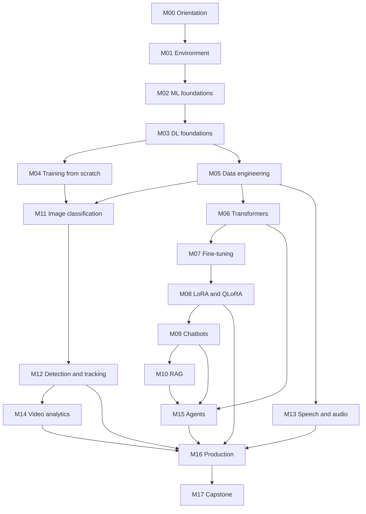

# Course roadmap

This roadmap explains the sequence, time commitment, milestones, and readiness
requirements for the full program. Module-level detail - objectives, theory,
notebooks, labs, rubrics, and deliverables - is in the
[syllabus](../syllabus/index.md).

## Design principles

1. **Progressive depth.** Each level adds one kind of capability: foundations,
   then language, then vision/video, then agents, then production.
2. **Build before you fine-tune.** You train small models from scratch before
   adapting large ones, so that fine-tuning is not magic.
3. **One artifact per module.** Every module produces something reviewable:
   a model, a dataset card, an evaluation table, a demo, or a report.
4. **Hardware honesty.** CPU-only work is separated from GPU-dependent work.
5. **Responsible engineering.** Licensing, privacy, bias, security, and
   evaluation are graded, not optional.
6. **Reproducibility.** Fixed seeds, pinned environments, documented data
   sources, and recorded hardware.

## Learning outcomes

By the end of the full program, a successful student can:

| # | Outcome | Evidence |
| --- | --- | --- |
| 1 | Build reproducible CPU and GPU environments on Windows 11 and Colab | M01 environment report |
| 2 | Train and diagnose classical and deep models | M02-M04 labs |
| 3 | Design, label, clean, and document datasets | M05 dataset card |
| 4 | Explain transformer internals and train a tiny language model | M06 lab |
| 5 | Fine-tune a small language model with SFT, LoRA, and QLoRA | M07-M08 labs |
| 6 | Build a domain chatbot with citations, guardrails, and evaluation | M09-M10 labs |
| 7 | Train image classifiers and object detectors with transfer learning | M11-M12 labs |
| 8 | Build speech recognition, audio classification, and speech generation demos | M13 lab |
| 9 | Build a privacy-preserving video analytics prototype | M14 lab |
| 10 | Build and evaluate a tool-using agent with memory and permissions | M15 lab |
| 11 | Evaluate, red-team, package, deploy, and monitor an AI system | M16 lab |
| 12 | Deliver an evaluated capstone with a report, model/dataset card, and demo | M17 |

## Full module sequence

| Code | Module | Level | Hours | Hardware |
| --- | --- | --- | --- | --- |
| M00 | Course orientation and study plan | 0 | 3 | CPU |
| M01 | Python and AI development environment | 0 | 12 | CPU; GPU check optional |
| M02 | Machine learning foundations | 1 | 16 | CPU |
| M03 | Deep learning foundations | 1 | 16 | CPU or GPU |
| M04 | Training models from scratch | 1 | 18 | GPU recommended |
| M05 | Dataset preparation, labeling, cleaning, augmentation | 1 | 14 | CPU |
| M06 | Transformers and language models | 2 | 18 | CPU for tiny models; GPU recommended |
| M07 | Small language models and supervised fine-tuning | 2 | 24 | GPU required for core lab |
| M08 | LoRA, QLoRA, quantization, efficient training | 2 | 18 | GPU required |
| M09 | Chatbots and conversational applications | 2 | 16 | CPU or GPU |
| M10 | Embeddings, vector search, and RAG | 2 | 18 | CPU |
| M11 | Image classification and computer vision | 3 | 18 | GPU recommended |
| M12 | Object detection, tracking, and transfer learning | 3 | 20 | GPU required for training |
| M13 | Speech recognition, audio classification, speech generation | 3 | 22 | GPU recommended |
| M14 | Video understanding and video analytics | 3 | 22 | GPU recommended |
| M15 | AI agents, tool calling, memory, workflows | 4 | 24 | CPU or API |
| M16 | Evaluation, security, responsible AI, deployment | 5 | 20 | CPU |
| M17 | Integrated capstone | 5 | 40 | Depends on project |
| | **Total** | | **339** | |

The arrows are recommended prerequisites, not rigid gates. For example, a
language-track student can take M09-M10 before M11-M12. The
[learning paths](learning-paths.md) encode these choices.

## Prerequisites and readiness

### Knowledge

| Skill | Needed for | Self-check |
| --- | --- | --- |
| Python functions, loops, lists, dictionaries, files | M01 onward | Can you read a CSV, transform rows, and write a small class? |
| Git basics (clone, commit, branch, pull request) | All labs | Can you restore a file from a previous commit? |
| High-school algebra | M02 | Can you rearrange and interpret a linear equation? |
| Basic vectors and derivatives | M03 | Comfort with slopes and sums; a primer is included |
| Basic probability and statistics | M02 | Mean, variance, distributions, sampling |
| Command line | M01 | Navigate directories and run commands in PowerShell or Bash |

### Hardware and accounts

| Resource | Minimum | Recommended |
| --- | --- | --- |
| RAM | 8 GB | 16 GB or more |
| Disk | 30 GB free | 60 GB free |
| GPU | None for CPU track | NVIDIA GPU with 8 GB+ VRAM |
| Free GPU | Google Colab or Kaggle account | Both, as backup |
| Accounts | GitHub, Google, Kaggle, Hugging Face | Weights & Biases free tier (optional) |
| Software | Windows 11, Python 3.11 or 3.12, Git | WSL2 or Linux for advanced work |

### Readiness actions

- Complete a Python refresher if you cannot write functions and read files
  without help.
- Create free accounts before M01.
- Decide where you will store datasets and model weights (at least 30 GB).
- Set a weekly study block that you can protect.
- Read [How to study](how-to-study.md) before starting.

## Study schedules

The estimates below are planning aids, not deadlines. Most learners should
expect the standard pace.

### Standard: 26 weeks

About **13 hours per week**. Recommended for students with a full course load or
part-time work.

| Weeks | Modules | Hours | Average per week |
| --- | --- | --- | --- |
| 1 | M00-M01 | 15 | 15 |
| 2-6 | M02-M05 | 64 | 12.8 |
| 7-13 | M06-M10 | 94 | 13.4 |
| 14-19 | M11-M14 | 82 | 13.7 |
| 20-21 | M15 | 24 | 12 |
| 22-26 | M16-M17 | 60 | 12 |

Within each block, complete modules in order. Each module includes its own lab.

### Intensive: 13 weeks

About **26 hours per week**. Suitable for full-time study or a bootcamp cohort.

| Weeks | Modules | Hours | Average per week |
| --- | --- | --- | --- |
| 1-3 | M00-M05 | 79 | 26.3 |
| 4-7 | M06-M10 | 94 | 23.5 |
| 8-10 | M11-M14 | 82 | 27.3 |
| 11 | M15 | 24 | 24 |
| 12-13 | M16-M17 | 60 | 30 |

This pace is demanding. Do not combine it with a heavy workload unless you have
prior ML experience.

### Relaxed: 42 weeks

About **8 hours per week**. Good for working professionals and students taking
other courses.

| Weeks | Modules | Hours | Average per week |
| --- | --- | --- | --- |
| 1-2 | M00-M01 | 15 | 7.5 |
| 3-10 | M02-M05 | 64 | 8 |
| 11-21 | M06-M10 | 94 | 8.5 |
| 22-31 | M11-M14 | 82 | 8.2 |
| 32-34 | M15 | 24 | 8 |
| 35-42 | M16-M17 | 60 | 7.5 |

### University semester: 16 weeks

About **19 hours per week** for guided modules, with the capstone completed in
the project or examination period.

| Weeks | Modules | Hours | Notes |
| --- | --- | --- | --- |
| 1-4 | M00-M05 | 79 | Includes environment and data labs |
| 5-9 | M06-M10 | 94 | Language track |
| 10-13 | M11-M14 | 82 | Vision, speech, video |
| 14 | M15 | 24 | Agents |
| 15-16 | M16 | 20 | Production and security |
| Project period | M17 | 40 | Capstone |

Instructors using this roadmap should assign the independent labs as graded
coursework and reserve class time for reviews and demonstrations.

## Milestones and portfolio checkpoints

| Milestone | After | Evidence | Why it matters |
| --- | --- | --- | --- |
| Reproducible setup | M01 | Environment report and working notebook | Every later lab depends on it |
| First trained model | M04 | Training curves, evaluation, error analysis | Proves you can train, not just call |
| Documented dataset | M05 | Dataset card and labeling guide | Data quality drives model quality |
| Tiny transformer | M06 | Trained tiny LM and sample outputs | Demystifies LLMs |
| Fine-tuned SLM | M07 | Adapter, evaluation table, model card | Core employable skill |
| Efficient adaptation | M08 | Memory/quality trade-off report | Real-world cost control |
| Domain chatbot | M09-M10 | Demo, retrieval eval, guardrail tests | End-to-end language product |
| Vision system | M11-M12 | Classifier, detector, tracking demo | Applied CV evidence |
| Speech system | M13 | ASR/audio/TTS demo with WER | Multimodal evidence |
| Video analytics | M14 | Privacy review and analytics report | Applied video evidence |
| Agent system | M15 | Agent, tool suite, eval suite | Modern AI engineering |
| Deployed system | M16 | API, container, tests, monitoring plan | Production readiness |
| Capstone | M17 | Repository, report, cards, demo, talk | Portfolio centerpiece |

## What "done" means at each level

- **Level 0:** You can create, reproduce, and document an environment on
  Windows 11 and Colab, and you know your hardware limits.
- **Level 1:** You can train and evaluate a model, explain its errors, and
  document the data behind it.
- **Level 2:** You can fine-tune a small language model, build a RAG chatbot,
  and measure quality with more than a vibe check.
- **Level 3:** You can adapt vision, speech, and video models and reason about
  privacy and licensing.
- **Level 4:** You can build an agent with bounded permissions, memory, and an
  evaluation suite.
- **Level 5:** You can defend an AI system's quality, security, cost, and
  limitations, and ship it with documentation.

## Adjusting the plan

- **Slow down** if a lab takes more than 1.5 times its estimate. Repeat the
  guided notebook before attempting the independent lab.
- **Do not skip M05** to save time. Data failures are the most common cause of
  disappointing models.
- **Do not start fine-tuning (M07) without M06.** You need the mental model of
  tokenization, attention, and decoding to debug training.
- **If hardware is limited,** pair up, use Colab/Kaggle, or reduce dataset size
  and model size as described in each lab.
- **If you already have experience,** use the readiness quiz in each level page
  to place out of modules. Keep the labs as evidence.

## Next steps

- Pick a [learning path](learning-paths.md).
- Read [How to study](how-to-study.md).
- Open [Level 0](../syllabus/level-0-start.md).
