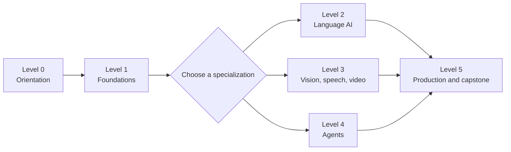

# Applied AI Engineering

**Learn to train, adapt, evaluate, and deploy real AI systems - from your first
classifier to a fine-tuned small language model, a retrieval-augmented chatbot, a
video analytics pipeline, and a tool-using agent.**

[Start with F01](lessons/f01-python-ai/index.md){ .md-button .md-button--primary }
[Foundation sequence](lessons/index.md#foundation-sequence){ .md-button }

Created and taught by [Engr. Dr. Muhammad Nadeem Majeed](about/instructor.md),
Professor in the Department of Data Science (PUCIT), University of the Punjab,
Lahore, Pakistan.

!!! warning "Course status"
    **All eighteen modules now have published learning material.** The foundation
    sequence F01-F13 delivers M01-M03 with executable notebooks, labs, and
    assessments. Five sections cover the rest: [Model Training](lessons/model-training/index.md)
    (M04-M05), [LLM Fine-Tuning](lessons/llm-fine-tuning/index.md) (M06-M08),
    [AI Agents](lessons/ai-agents/index.md) (M15), [Production](lessons/production/index.md)
    (M16), and [Capstone](lessons/capstone/index.md) (M17). The applied slices
    [Conversational AI](lessons/chatbots-rag/index.md) (M09-M10),
    [Computer Vision](lessons/computer-vision/index.md) (M11-M12),
    [Speech and Audio](lessons/speech-audio/index.md) (M13), and
    [Video AI](lessons/video-ai/index.md) (M14) remain available as well.

    All **26 notebooks** (thirteen foundation and thirteen section notebooks) were
    executed on Windows 11 CPU. Google Colab and GPU execution are still pending and
    are documented as limitations. Check the [lessons index](lessons/index.md) for
    per-section execution status.

## What this course teaches, and why

Most AI tutorials stop at a toy demo or an API call. This course teaches the full
lifecycle: frame a problem, prepare and document data, train or adapt a model,
measure whether it works, reduce cost, secure the system, and deploy it with a
rollback plan.

You will work with free and open-source tools on **Windows 11**, Linux, or
**Google Colab**. Every exercise is labeled **CPU-only**, **GPU recommended**, or
**GPU required**, so you know what your machine can do before you start. Paid
APIs are optional and are never required for the core path.

The course is **practical first**. Each module ends with an independent lab and a
published rubric, not just a notebook to read. The artifact goes into a portfolio
that demonstrates what you can actually build.

## Who it is for

- Undergraduate and postgraduate students in computer science, data science,
  software engineering, and related fields.
- Developers and analysts moving from classical software or statistics into AI.
- Researchers who need practical training, evaluation, and deployment skills.
- Instructors who want a modular, reusable applied-AI curriculum.

**Prior knowledge:** basic Python (variables, loops, functions, lists,
dictionaries, files), comfort with a terminal, and high-school algebra. You do
**not** need prior deep-learning experience. The mathematics you need is
introduced where it is used.

If your Python is rusty, start with
[F01 - Python essentials for AI](lessons/f01-python-ai/index.md). The
[roadmap](course/roadmap.md#prerequisites-and-readiness) lists the expected level
and concrete readiness actions.

## What you will be able to build

-   **Classical and deep models**

    ---

    Train, evaluate, and diagnose models instead of only calling pretrained APIs.
    Start with tabular classifiers, then build neural networks and a CNN from
    scratch.

    [M02-M04](syllabus/level-1-foundations.md#m02)

-   **A fine-tuned small language model**

    ---

    Prepare instruction data, run supervised fine-tuning and LoRA/QLoRA, and
    report the memory, quality, and cost trade-offs.

    [M07-M08](syllabus/level-2-language.md#m07)

-   **A cited RAG chatbot**

    ---

    Build embeddings, vector search, retrieval-augmented generation, guardrails,
    and an evaluation set with citations.

    [M09-M10](syllabus/level-2-language.md#m09)

-   **A vision or video system**

    ---

    Adapt image classifiers, train detectors, track objects, and build a
    privacy-preserving video analytics prototype.

    [M11-M14](syllabus/level-3-vision-video.md#m11)

-   **A speech or audio system**

    ---

    Adapt speech recognition, classify audio, generate speech, and evaluate with
    word and character error rates.

    [M13](syllabus/level-3-vision-video.md#m13)

-   **A tool-using AI agent**

    ---

    Add tool calling, memory, permissions, failure handling, observability, and
    an evaluation suite.

    [M15](syllabus/level-4-agents.md#m15)

## At a glance

| | |
| --- | --- |
| **Levels** | 6, from orientation to capstone |
| **Modules** | 18 (M00-M17) |
| **Guided hours** | Approximately 339, plus capstone revision time |
| **Core stack** | Python, scikit-learn, PyTorch, Hugging Face, OpenCV, Whisper, YOLO, vector search, agent tooling |
| **Cost** | Free and open-source core; optional paid APIs are never required |
| **Hardware** | CPU track available; free Colab/Kaggle GPUs supported for training |
| **Assessment** | Labs, rubrics, portfolio, and capstone; no proctored exam |

## Start here

1. **Check your starting point.** Read
   [Prerequisites and readiness](course/roadmap.md#prerequisites-and-readiness).
2. **Choose a path.** Compare the six
   [learning paths](course/learning-paths.md) or start with
   [AI foundations](course/learning-paths.md#path-1-ai-foundations).
3. **Learn how the course works.** Read
   [How to study](course/how-to-study.md) and
   [Course conventions](course/course-conventions.md).
4. **Start the foundation sequence.** Open
   [F01 - Python essentials for AI](lessons/f01-python-ai/index.md), then build
   your environment in
   [F02 - Python and AI development environment](lessons/m01-environment/index.md).
   Run each guided notebook and complete its lab before moving on.

M00 orientation is delivered through the roadmap, learning paths, study guide,
and the [M00 plan](syllabus/level-0-start.md#m00). F01 is the first full lesson.

## Foundation sequence

The recommended starting path is F01-F13. Each unit has a lesson, a runnable
notebook, an independent lab, and an assessment, and the units map onto the
approved M01-M03 codes.

| Unit | Focus | Implements | Hours | Hardware | Lesson |
| --- | --- | --- | --- | --- | --- |
| F01 | Python essentials for AI | pre-M01 | 8 | CPU-only | [Open](lessons/f01-python-ai/index.md) |
| F02 | Environments, packages, Jupyter, Colab | M01 | 12 | CPU-only | [Open](lessons/m01-environment/index.md) |
| F03 | NumPy and pandas | M02 | 8 | CPU-only | [Open](lessons/f03-numpy-pandas/index.md) |
| F04 | Cleaning and normalization | M02/M05 | 10 | CPU-only | [Open](lessons/f04-data-cleaning/index.md) |
| F05 | Train, validation, test splits | M02 | 8 | CPU-only | [Open](lessons/f05-splits/index.md) |
| F06 | Exploratory data analysis | M02 | 8 | CPU-only | [Open](lessons/f06-eda/index.md) |
| F07 | Supervised and unsupervised learning | M02 | 8 | CPU-only | [Open](lessons/f07-supervised-unsupervised/index.md) |
| F08 | Regression and classification | M02 | 10 | CPU-only | [Open](lessons/f08-regression-classification/index.md) |
| F09 | Trees, forests, and boosting | M02 | 10 | CPU-only | [Open](lessons/f09-tree-ensembles/index.md) |
| F10 | Metrics, overfitting, leakage, CV | M02 | 10 | CPU-only | [Open](lessons/f10-metrics-validation/index.md) |
| F11 | Neural network fundamentals | M03 | 10 | CPU or GPU | [Open](lessons/f11-neural-networks/index.md) |
| F12 | Backpropagation and training | M03 | 12 | CPU or GPU | [Open](lessons/f12-backpropagation/index.md) |
| F13 | Seeds, devices, reproducibility | M03 | 8 | CPU-only core | [Open](lessons/f13-reproducibility/index.md) |

The foundation units add explicit practice and assessment time beyond the coarse
M01-M03 budget. The [syllabus](syllabus/index.md) remains authoritative for
module prerequisites and credit.

## Beginner to advanced

| Level | Modules | What changes | Hours |
| --- | --- | --- | --- |
| 0 - Orientation | [M00-M01](syllabus/level-0-start.md) | You can build and prove a reproducible environment | 15 |
| 1 - Foundations | [M02-M05](syllabus/level-1-foundations.md) | You train and evaluate models from first principles | 64 |
| 2 - Language AI | [M06-M10](syllabus/level-2-language.md) | You adapt language models and build cited RAG systems | 94 |
| 3 - Vision, speech, video | [M11-M14](syllabus/level-3-vision-video.md) | You work with images, audio, and video under privacy constraints | 82 |
| 4 - AI agents | [M15](syllabus/level-4-agents.md) | You build tool-using systems with permissions and evaluation | 24 |
| 5 - Production and capstone | [M16-M17](syllabus/level-5-production.md) | You harden, deploy, document, and defend a complete system | 60 |

The full sequence, dependencies, and 13-, 16-, 26-, and 42-week schedules are in
the [course roadmap](course/roadmap.md#study-schedules).

## Module sequence

Each card links to the published lesson or the module plan. A **plan** defines
the objectives, practical work, and rubric; it is not a finished lesson.

### Level 0 - Orientation

-   **M00 · Course orientation and study plan**

    ---

    3 h · CPU-only · Plan

    Choose a path, build a realistic schedule, and set up your portfolio.

    [Read the plan](syllabus/level-0-start.md#m00)

-   **F01 · Python essentials for AI**

    ---

    8 h · CPU-only · **Published**

    Types, collections, validated functions, parsing, and a JSON/CSV run log.

    [Open the lesson](lessons/f01-python-ai/index.md)

-   **M01 / F02 · Python and AI development environment**

    ---

    12 h · CPU-only · **Published**

    Build a reproducible local and Colab environment and prove it with a report.

    [Open the lesson](lessons/m01-environment/index.md)

### Level 1 - Foundations

-   **M02 · Machine learning foundations**

    ---

    16 h · CPU-only · **Published as F03-F10**

    Baselines, train/test discipline, metrics, leakage, and classical models.

    [Open F03](lessons/f03-numpy-pandas/index.md)

-   **M03 · Deep learning foundations**

    ---

    16 h · CPU or GPU · **Published as F11-F13**

    Tensors, autograd, neural networks, and a reproducible training loop.

    [Open F11](lessons/f11-neural-networks/index.md)

-   **M04 · Training models from scratch**

    ---

    18 h · GPU recommended · **Published**

    Train a CNN, augment data, tune hyperparameters, and log experiments.

    [Open M04-M05](lessons/model-training/index.md)

-   **M05 · Dataset preparation, labeling, cleaning, and augmentation**

    ---

    14 h · CPU-only · **Published**

    Labeling guidelines, quality checks, augmentation, and dataset cards.

    [Open M04-M05](lessons/model-training/index.md)

### Level 2 - Language AI

-   **M06 · Transformers and language models**

    ---

    18 h · CPU or GPU · **Published**

    Tokenization, attention, transformer blocks, and a tiny language model.

    [Open M06-M08](lessons/llm-fine-tuning/index.md)

-   **M07 · Small language models and supervised fine-tuning**

    ---

    24 h · GPU required · **Published**

    Format instruction data, fine-tune a small model, and evaluate it.

    [Open M06-M08](lessons/llm-fine-tuning/index.md)

-   **M08 · LoRA, QLoRA, quantization, and efficient training**

    ---

    18 h · GPU required · **Published**

    Compare adapters and quantization on memory, quality, and cost.

    [Open M06-M08](lessons/llm-fine-tuning/index.md)

-   **M09 · Chatbots and conversational applications**

    ---

    16 h · CPU or GPU · **Published**

    Prompting, conversation state, guardrails, and chatbot evaluation.

    [Open Conversational AI](lessons/chatbots-rag/index.md)

-   **M10 · Embeddings, vector search, and RAG**

    ---

    18 h · CPU-only · **Published**

    Embed documents, retrieve evidence, generate with citations, and evaluate.

    [Open Conversational AI](lessons/chatbots-rag/index.md)

### Level 3 - Vision, speech, and video AI

-   **M11 · Image classification and computer vision**

    ---

    18 h · CPU-only · **Published**

    Transfer learning, augmentation, domain shift, and honest evaluation.

    [Open Computer Vision](lessons/computer-vision/index.md)

-   **M12 · Object detection, tracking, and transfer learning**

    ---

    20 h · CPU-only · **Published**

    Detection metrics, tracking, annotation quality, and deployment limits.

    [Open Computer Vision](lessons/computer-vision/index.md)

-   **M13 · Speech recognition, audio classification, and speech generation**

    ---

    22 h · CPU-only · **Published**

    ASR, audio classification, speech generation, and WER/CER evaluation.

    [Open Speech and Audio](lessons/speech-audio/index.md)

-   **M14 · Video understanding and video analytics**

    ---

    22 h · CPU-only · **Published**

    Frame sampling, tracking, temporal reasoning, and privacy-preserving analytics.

    [Open Video AI](lessons/video-ai/index.md)

### Level 4 - AI agents

-   **M15 · AI agents, tool calling, memory, and workflows**

    ---

    24 h · CPU-only core · **Published**

    Tools, memory, permissions, failure handling, observability, and agent evaluation.

    [Open AI Agents](lessons/ai-agents/index.md)

### Level 5 - Production and capstone

-   **M16 · Evaluation, security, responsible AI, and deployment**

    ---

    20 h · CPU-only · **Published**

    Evaluation design, red teaming, privacy, packaging, deployment, and monitoring.

    [Open Production](lessons/production/index.md)

-   **M17 · Integrated capstone**

    ---

    40 h · Depends on option · **Published**

    Propose, build, evaluate, document, and demonstrate a complete AI system.

    [Open Capstone](lessons/capstone/index.md)

## Featured hands-on projects

The capstone is a complete, evaluated system with a reproducible repository, a
technical report, a model or dataset card, a demo, and a presentation.

-   **Cited RAG assistant**

    ---

    Build a domain assistant that retrieves evidence, cites sources, refuses
    unsupported questions, and has a measurable evaluation set.

    [Option A](course/projects.md#project-a)

-   **Visual inspection system**

    ---

    Classify or detect defects in a manufacturing, agricultural, or remote-sensing
    task using public or consented images.

    [Option B](course/projects.md#project-b)

-   **Privacy-preserving video analytics**

    ---

    Count vehicles or recognize clothing attributes in consented footage without
    identifying people.

    [Option C](course/projects.md#project-c)

See all five [capstone options](course/projects.md), the
[submission structure](course/projects.md#submission-structure), and the
[evaluation questions](course/projects.md#evaluation-questions-reviewers-will-ask).

## Hardware and setup

| Setup | What you can do | What to expect |
| --- | --- | --- |
| **Laptop CPU, 8-16 GB RAM** | Levels 0-1, data engineering, RAG, small-model inference, agents, evaluation, deployment | The core path is designed to work without a GPU |
| **Free Colab or Kaggle GPU** | Fine-tuning, detection, speech, and video labs | Session or quota limits; save artifacts before disconnect |
| **Local NVIDIA GPU, 8 GB+ VRAM** | The full training path with fewer interruptions | Driver and wheel compatibility matter; M01 teaches the check |

The course never assumes a paid API. If you cannot install a local GPU stack, use
Colab for GPU labs and keep a local CPU environment for development.

Start with [F01](lessons/f01-python-ai/index.md), then see
[Troubleshooting](technical/troubleshooting.md) for Windows, CUDA, Colab, and
storage problems.

## Datasets and pretrained models

The [Datasets and Resources](resources/index.md) page lists every course dataset,
generator, hardware tier, and licence rule. The summary here is only a starting
point.

- **M01 needs no download.** It uses the small digits dataset bundled with
  scikit-learn.
- **F01-F13 use four synthetic tables.** They are generated locally under
  CC0-1.0, contain no real people, and are documented in
  [Foundation data and dependencies](technical/foundation-assets.md).
- **Later modules use dataset cards and download scripts.** Raw datasets are not
  committed to the repository. Each card records the source, license, size,
  checksum, and intended use.
- **Pretrained models** come from libraries such as torchvision, Hugging Face
  Transformers, Whisper, and Ultralytics YOLO. Model weights are downloaded or
  cached locally, never committed.
- **Check the license before you train or publish.** A model's license and a
  dataset's license are separate constraints.
- **Never commit tokens.** Use environment variables or a local secrets file that
  is excluded from Git.

The full policy is in the
[repository architecture](planning/repository-architecture.md#data-and-model-policy).
The [FAQ](course/faq.md#where-do-the-datasets-come-from) explains where data comes from.

## Responsible AI, privacy, and safe experimentation

This course treats ethics and security as engineering requirements:

- Use data you have the right to use. Record consent and license terms.
- Remove personal identifiers from reports, screenshots, and demos.
- Do not build face recognition, identity inference, covert surveillance, or
  non-consensual voice cloning.
- Do not scrape private data, bypass access controls, or disable TLS checks.
- Disclose substantive AI assistance in your reflections.
- Report limitations and failure modes instead of hiding them.

The [capstone rules](course/projects.md#acceptable-and-unacceptable-projects)
list acceptable and prohibited work. The
[academic integrity policy](course/assessments.md#academic-integrity) explains
what you must do yourself.

## How you are assessed

There is no proctored exam. Each module uses the same weights:

| Component | Weight | Evidence |
| --- | --- | --- |
| Knowledge check | 20% | Short answers or auto-checkable questions |
| Guided notebook | 30% | A clean run with interpretation |
| Independent lab | 40% | Artifact scored against a published rubric |
| Reflection | 10% | What you learned and what you would change |

The lab rubric evaluates technical correctness, evaluation quality,
reproducibility, data ethics, and communication. The capstone has its own rubric.

Completing the public materials does **not** confer a certificate, university
credit, or professional certification. Enrolled students follow their
institution's rules. See [Assessments](course/assessments.md) and the
[FAQ](course/faq.md#is-there-a-certificate-or-university-credit).

## Studying independently

- Follow a [weekly routine](course/how-to-study.md#a-sustainable-weekly-routine)
  with spaced practice and buffer time.
- Pick a [schedule](course/roadmap.md#study-schedules) that matches your real
  availability, not an aspirational one.
- Keep a learning log and a
  [portfolio](course/how-to-study.md#notes-and-portfolio) with one folder per
  module.
- Use the [debugging protocol](course/how-to-study.md#debugging-protocol) before
  asking for help.
- Track completion with the [assessment evidence checklist](course/assessments.md#assessment-evidence-checklist).

## Instructor

**Engr. Dr. Muhammad Nadeem Majeed**  
Professor, Department of Data Science (PUCIT)  
University of the Punjab, Lahore, Pakistan

Read [about the instructor](about/instructor.md) and the course's
[teaching approach](about/instructor.md#teaching-approach). Course questions and
corrections are handled through the repository's GitHub Issues; include the module
code and the exact page or notebook.

## License and attribution

AITopics uses a multi-licence structure approved by the instructor on
2026-11-07:

- **Original source code:** MIT License.
- **Original educational content** (lessons, documentation, labs, notebooks,
  templates, and diagrams): Creative Commons Attribution 4.0 International
  (CC BY 4.0), with attribution to the instructor.
- **Original synthetic datasets:** CC0 1.0 Universal, where provenance has been
  verified.
- **Third-party material:** its own original licence and terms; it is not
  relicensed by this repository.

Commercial reuse of original educational content is allowed under CC BY 4.0
with attribution. Read
[LICENSES/README.md](https://github.com/nadeem-majeedch/AITopics/blob/release/v0.1.0-rc.1/LICENSES/README.md)
for the scope and attribution wording, and see the
[licensing and attribution register](technical/licensing-and-attribution.md) for
the evidence, third-party exclusions, and unresolved SSDLite weight terms.

## Course status and maintenance

| Item | Status |
| --- | --- |
| F01-F13 lessons, notebooks, labs, assessments | Published; all 13 notebooks executed on Windows 11 CPU |
| Foundation Google Colab verification | Pending |
| Foundation GPU execution | Not executed; optional paths documented |
| F02 (M01) lesson, notebook, lab, assessment | Published; notebook verified on Windows 11 |
| Conversational AI (M09-M10), Computer Vision (M11-M12), Speech and Audio (M13), Video AI (M14) | Published: lessons, labs, assessments, runnable code, measured results |
| M04-M08 and M15-M17 lessons, notebooks, labs, assessments | Published; seven new notebooks executed on Windows 11 CPU |
| Model-training and LLM notebooks on GPU | Not executed; CPU paths complete, GPU/pretrained paths documented as optional |
| Documentation build | Verified locally with `mkdocs build --strict` |
| Documentation site deployment | Workflows configured; Pages API and public URL return 404; no deployment run (2026-11-09) |
| License files | Implemented and verified locally on 2026-11-07 (MIT, CC BY 4.0, CC0 1.0) |

Maintainers and contributors should read the
[repository architecture](planning/repository-architecture.md),
[quality standards](planning/quality-standards.md), and
[implementation phases](planning/implementation-phases.md).
