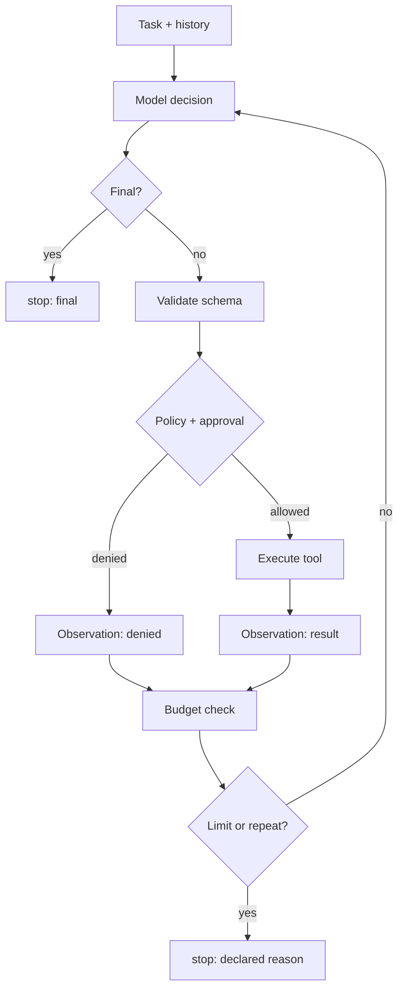

# AG01 - The agent loop {#ag01}

**Section path:** [Overview](index.md) · **Module 15** · [Assessment](assessment.md)

| | |
| --- | --- |
| **Study time** | 3 hours |
| **Hardware** | CPU-only; no API key |
| **Prerequisites** | [LF07](../llm-fine-tuning/lf07-evaluating-assistants.md) |
| **You will produce** | A traced, bounded agent run with two tool calls |


## Learning objectives

By the end of this lesson you can:

* describe an agent as a bounded observe-decide-act loop
* implement the decision protocol and stop conditions
* read a trace and distinguish the model transcript from harness events

## An agent is a control loop

A chatbot maps one input to one output. An agent repeats: observe, decide, act,
observe. The model is only the decision function. The harness owns validation,
execution, budgets, and stopping.

```text
messages = [system, user]
for step in range(max_steps):
    reply = model(messages)
    if reply is final: stop("final")
    result = registry.call(tool, arguments)
    messages.append(observation(result))
stop("step_limit")
```

The notebook uses a scripted model with fixed JSON responses. That is not a
downgrade: it isolates the harness. When a run misbehaves, you know it was the
control logic, not sampling temperature.

## Beginner: the decision protocol

Every step returns one of two shapes:

```json
{"tool": "lookup_order", "arguments": {"order_id": "A-1007"}}
{"final": "Order A-1007 ships on 2026-11-12."}
```

The model never executes Python. It emits JSON, the registry validates it against
the tool's schema, and the loop appends a structured observation. This boundary is
what makes the system testable.

## Intermediate: the transcript is not the trace

A transcript is what the model saw. A trace is what the harness did: model calls,
tool calls, results, retries, approvals, policy blocks, token counts, latency, stop
reason.

```python
for event in result.trace.events:
    if event.kind in {"tool_call", "tool_result"}:
        print(event.kind, event.name, event.data)
```

Expected output:

```text
tool_call lookup_order {'step': 1, 'arguments': {'order_id': 'A-1007'}}
tool_result lookup_order {'ok': True, 'code': None, 'attempts': 1, ...}
tool_call calculate {'step': 2, 'arguments': {'expression': '2 * 3'}}
tool_result calculate {'ok': True, ...}
```

An evaluation reads the trace, not the agent's claim that it looked something up.
That is the difference between a demo and a test.

## Advanced: workflows versus agents

A workflow is an explicit state machine: steps are known, transitions are coded,
and the model fills slots. An agent lets the model choose the next action. Agents
are appropriate when the path is unknown and the action space is small and
well-guarded. Workflows are cheaper, more predictable, and easier to audit.

The package includes `StateMachine` for the workflow case. The rule of thumb: if
you can draw the flowchart, build the workflow. Use an agent only for the branch
you cannot enumerate.

## Diagram: one episode



## Practice

1. Run the notebook's two-tool task. Print the trace summary. How many model calls
   produced two tool calls?
2. Change the plan to answer without calling the second tool. What does the trace
   show, and is the answer still correct?
3. Add a third tool that returns a constant. Use it in the plan and confirm the
   observation appears in the transcript.
4. Draw the flowchart for a workflow that handles only order-status questions.
   Which decisions disappear?

## Common mistakes

* **Letting the model call Python directly.**
* **Scoring the final prose instead of the trace.**
* **No stop condition other than "the model says it is done".**
* **Hiding tool errors from the model.** It needs the error to recover.
* **Treating an agent as always better than a workflow.**

## Knowledge checks

1. What are the two decision shapes in this protocol?
   *A tool call with arguments, or a final answer.*
2. Why is the trace more trustworthy than the transcript?
   *The transcript is model-visible text; the trace is harness-recorded events with
   results and status.*
3. When should you prefer a workflow?
   *When the steps and branches are known in advance and can be coded explicitly.*
4. What does the loop do after a tool error?
   *Appends a structured observation with `ok: false` and a non-retryable or
   retryable code, then continues within the budget.*

## Lab connection

[Lab 1](labs/lab-1-support-agent.md) requires a traced run with at least two tools
and a declared stop reason. The trace, not the answer alone, is marked.

## Further reading

* Yao et al., *ReAct* (2022).
* Anthropic, *Building effective agents* (2024).
* Russell and Norvig, *Artificial Intelligence: A Modern Approach*, agents chapter.

---

**Previous:** [LF10 - Merging and serving](../llm-fine-tuning/lf10-merging-and-serving.md)
**Next:** [AG02 - Tools and schemas](ag02-tool-schemas.md)
