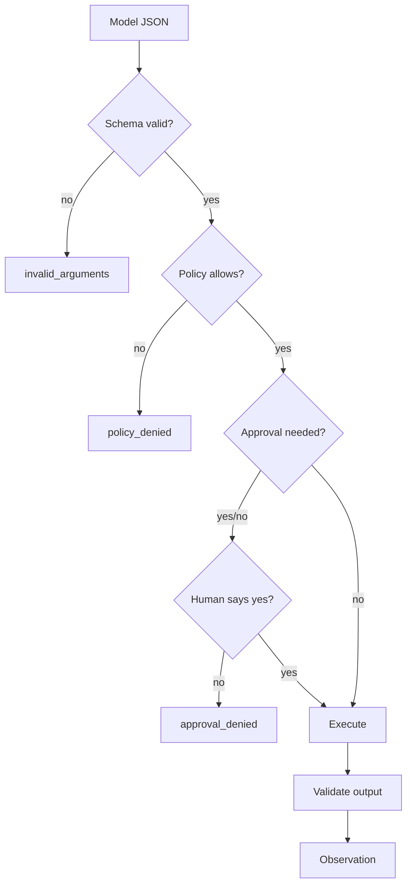

# AG02 - Tools, schemas, and side effects {#ag02}

**Section path:** [Overview](index.md) · **Module 15** · [Assessment](assessment.md)

| | |
| --- | --- |
| **Study time** | 3 hours |
| **Hardware** | CPU-only |
| **Prerequisites** | [AG01](ag01-agent-loop.md) |
| **You will produce** | Three tools with strict schemas and a validation report |


## Learning objectives

By the end of this lesson you can:

* write a strict tool schema that rejects missing and extra fields
* classify tools by side effect and grant the minimum set
* validate arguments before execution and return a structured error

## A tool is a capability grant

The model proposes; the registry decides. A tool definition includes:

* name and description (what the model reads);
* input schema (strict JSON Schema subset);
* output schema (optional but useful);
* side effect (`none`, `read`, `write`, `network`);
* timeout, retry policy, and whether approval is required.

The description is prompt text, but the schema is enforcement. Never rely on the
description to prevent bad arguments.

## Strict schemas are a security feature

The notebook calls `lookup_order` with `{"ordr_id": "A-1007"}`:

```json
{
  "code": "invalid_arguments",
  "message": "arguments do not match the tool schema",
  "details": [
    "$.order_id: required property is missing",
    "$.ordr_id: unexpected property (additionalProperties is false)"
  ],
  "hint": "Fix the listed fields and call the tool again with valid JSON.",
  "retryable": false
}
```

Two things matter. The error names the path (`$.order_id`), so the model can
correct itself, and `additionalProperties: false` turns a typo into a visible
failure instead of an empty lookup that returns nothing.

## Beginner: build a tool

```python
lookup = make_tool(
    "lookup_order",
    "Look up an order by id. Returns status, ship date, and carrier.",
    lambda args: ORDERS.get(args["order_id"], {"error": "unknown order"}),
    object_schema({"order_id": STRING}, ["order_id"]),
)
registry.register(lookup)
```

The schema uses `object_schema`, which sets required fields and
`additionalProperties: false`. Types are checked; a number where a string is
expected fails before the function runs.

## Intermediate: side effects and idempotency

| Side effect | Retry safe? | Needs approval? |
| --- | --- | --- |
| read | yes | usually no |
| write, idempotent (set status) | yes with a key | yes |
| write, non-idempotent (send email) | no without a key | yes |
| network purchase | no | yes |

A retry policy that re-sends an email or charges a card twice is a bug, not
resilience. Mark non-idempotent tools `retryable=False` or require an idempotency
key supplied by the caller.

## Advanced: least privilege

The registry's policy has four independent controls:

* **allowlist** - which tools exist for this run;
* **roots** - which paths are reachable;
* **capabilities** - write, network, shell;
* **approval** - which tools need a human.

The notebook's `write_note` is allowed by the policy but denied without approval,
and a path outside the root is denied even with approval. Both checks run in
`registry.call`, so a direct call cannot bypass them.

## Diagram: call path



## Practice

1. Add a `refund_order` tool with `side_effect="write"`, approval required, and an
   idempotency key. Write a test that calls it twice with the same key and once
   with a different key.
2. Remove `additionalProperties: false` and call with a typo. What does the tool
   receive, and what does the model learn?
3. Add an output schema and return a wrong type. Confirm the registry reports
   `invalid_output`.
4. Deny the tool in the policy but keep it registered. What error does the model
   see?

## Common mistakes

* **Using the description as validation.**
* **Allowing every tool "for convenience".**
* **Retrying non-idempotent writes.**
* **Returning raw exceptions to the model.** They leak internals and are not
  actionable.
* **Forgetting output validation.** A tool can return a shape the model cannot
  parse.

## Knowledge checks

1. Why does strict schema validation happen before execution?
   *It prevents malformed or malicious arguments from reaching a side effect and
   gives the model a correctable error.*
2. What is the difference between an allowlist and an approval?
   *An allowlist says the tool exists for this run; approval says this specific
   call may proceed.*
3. Why is a non-idempotent write dangerous to retry?
   *A duplicate request can repeat the effect (send twice, charge twice).*
4. What should an error observation contain?
   *A stable code, a human-readable message, a hint, and whether retrying can
   help.*

## Lab connection

[Lab 1](labs/lab-1-support-agent.md) requires at least three tools with different
side effects and a validation test for each.

## Further reading

* JSON Schema, *Understanding JSON Schema*.
* OWASP, *LLM Top 10* - excessive agency.
* Anthropic, *Tool use* documentation.

---

**Previous:** [AG01 - The agent loop](ag01-agent-loop.md)
**Next:** [AG03 - Memory and state](ag03-memory-and-state.md)
