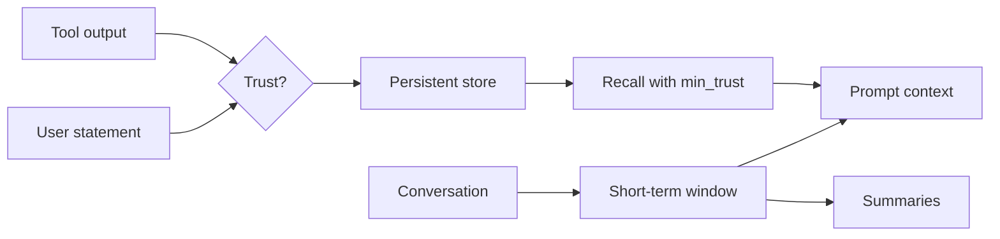

# AG03 - Memory and state {#ag03}

**Section path:** [Overview](index.md) · **Module 15** · [Assessment](assessment.md)

| | |
| --- | --- |
| **Study time** | 2.5 hours |
| **Hardware** | CPU-only |
| **Prerequisites** | [AG01](ag01-agent-loop.md) |
| **You will produce** | A bounded window and a provenance-aware store |


## Learning objectives

By the end of this lesson you can:

* bound the working context and summarize without silent loss
* store provenance and trust with every remembered item
* enforce a trust threshold and purge an item on request

## Two problems, two structures

**Short-term memory** is the conversation window. It is bounded by turns and
characters, and older turns are summarised rather than silently dropped.

**Persistent memory** survives the process. Entries carry a source, a trust level,
and an optional expiry. Recall takes a minimum trust, so a note learned from a web
page cannot masquerade as a user preference.

Mixing the two produces a system where you cannot answer: why does the agent
believe this, and how do I delete it?

## Beginner: the window

```python
short = ShortTermMemory(max_turns=3, max_chars=200)
for i in range(6):
    short.add("user" if i % 2 == 0 else "assistant", f"turn {i}: detail " * 8)
print(len(short.turns), len(short.summaries))
```

Expected output:

```text
kept turns: 2 | summaries: 4
```

The summary is not free: it compresses and loses detail. The point is to make the
loss explicit and bounded, not to pretend the model has infinite context.

## Intermediate: trust levels

`TRUST_LEVELS = ("user", "tool", "document", "model")`, ordered most trusted
first. `recall(key, min_trust="user")` returns only user-provided values.

| Entry | Source | Trust | Recall at user bar |
| --- | --- | --- | --- |
| preferred carrier | user | user | returned |
| return window | policy page | document | blocked |
| page note | web | tool | blocked |

The notebook measures exactly this after the trust-ordering fix. Before the fix,
the comparison was inverted and a document value passed the user bar. The
regression test now asserts the correct direction; trust is a security property,
not a sort order.

## Advanced: provenance and purge

Every entry records `source`, `trust`, `created`, and `expires`. The recovery step
after contamination is one call:

```python
purged = memory.forget_untrusted()   # removes every non-user entry
```

A production store also needs:

* **write authorisation** - only the harness writes, not the model directly;
* **TTL** - stale facts expire instead of being retrieved forever;
* **audit** - who wrote what, when, and from which tool;
* **tenant isolation** - keys scoped per user, not global.

## Diagram: memory scopes



## Practice

1. Set `max_turns=5` and add ten turns. How many summaries are produced, and what
   detail is lost from turn 1?
2. Add an entry with `trust="model"` and try to recall it at the user and document
   bars. Record both results.
3. Give an entry a TTL of one second and a fake clock. Prove it expires without a
   delete.
4. Write a test that fails if a document entry is returned at the user bar. Run it
   against the fixed code and against the old comparison.

## Common mistakes

* **Storing tool output as user truth.**
* **Unbounded conversation growth.**
* **No deletion path for contaminated memory.**
* **Global keys shared across users.**
* **Summarising without recording that a summary occurred.**

## Knowledge checks

1. Why are short-term and persistent memory separate?
   *Different lifetimes, sizes, and trust rules; mixing them makes retention and
   deletion ambiguous.*
2. What does `min_trust` protect against?
   *Returning lower-trust content (web, tool, model) as if it were a user
   preference.*
3. What is the recovery step after a poisoned memory entry?
   *Purge every non-user entry, then re-add only verified facts with provenance.*
4. Why does summarisation need to be visible?
   *The model and the reviewer should know that earlier detail was compressed, not
   silently lost.*

## Lab connection

[Lab 1](labs/lab-1-support-agent.md) requires a persistent store with provenance
and a purge test. The marker will inject a tool-sourced instruction and check that
it is not recalled as a user fact.

## Further reading

* Packer et al., *MemGPT: Towards LLMs as Operating Systems* (2023).
* Lewis et al., *Retrieval-Augmented Generation* (2020) - external memory.
* OWASP, *LLM Top 10* - insecure output handling.

---

**Previous:** [AG02 - Tools and schemas](ag02-tool-schemas.md)
**Next:** [AG04 - Budgets and approvals](ag04-budgets-and-approvals.md)
