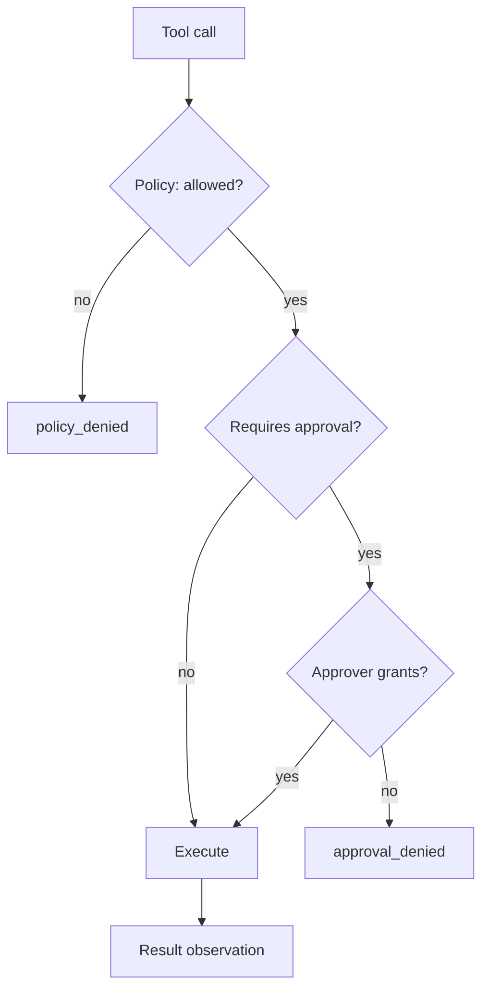

# AG04 - Budgets, stop reasons, and approvals {#ag04}

**Section path:** [Overview](index.md) · **Module 15** · [Assessment](assessment.md)

| | |
| --- | --- |
| **Study time** | 3 hours |
| **Hardware** | CPU-only |
| **Prerequisites** | [AG02](ag02-tool-schemas.md), [AG03](ag03-memory-and-state.md) |
| **You will produce** | A loop that stops for a declared reason and a denial trace |


## Learning objectives

By the end of this lesson you can:

* set independent step, call, token, cost, and time budgets
* name the stop reason for every terminated run
* implement an approval gate that shows the exact action and arguments

## Every run ends for a reason you can name

`RunLimits` bounds steps, tool calls, tokens, cost, and wall-clock time. The loop
also detects a repeated identical action. The stop reasons form a small, auditable
vocabulary:

| Stop reason | Meaning |
| --- | --- |
| `final` | the model produced an answer |
| `step_limit` | the step budget ran out |
| `tool_call_limit` | the tool-call budget ran out |
| `timeout` | the wall-clock deadline passed |
| `token_budget` / `cost_budget` | the usage budget ran out |
| `repeated_action` | the same call was proposed without progress |
| `invalid_decisions` | too many malformed model outputs |

The notebook's repeating model is stopped after two identical calls with
`repeated_action`. Without loop detection it would burn the full step budget doing
nothing.

## Beginner: budgets are not one number

A step limit does not bound cost: one step can call an expensive tool or generate
thousands of tokens. Set independent limits and report which one fired. In an
incident review, "the run hit `tool_call_limit` at 8 calls" is actionable; "the
agent timed out" is not.

## Intermediate: approval is a gate, not a prompt

```python
policy = Policy.for_sandbox(
    root,
    tools=["lookup_order", "calculate", "write_note"],
    allow_write=True,
    require_approval=("write_note",),
)
registry.policy = policy
registry.approver = DenyAllApprover()   # the default when nobody is present
```

A write call now fails with `approval_denied` unless an approver says yes. Two
independent checks must pass:

1. the policy allows the tool and the path;
2. the approver grants this call.

A human clicking "yes" does not override path containment. The notebook's escape
attempt returns `policy_denied` even with approval.

## Advanced: designing the approval UX

The approver needs enough information to decide: tool name, exact arguments, the
path or resource affected, and a diff of what will change. "Approve write_note?"
is not a decision; "write 24 bytes to notes/order.txt, replacing 0 bytes" is.

Production approval also needs:

* an expiry, so a stale request cannot be approved hours later;
* an audit record of who approved and when;
* a deny-by-default path for unattended runs;
* a way to grant a scoped capability for a session, not a permanent blanket.

## Diagram: two gates



## Practice

1. Set `max_tool_calls=1` on the two-tool task. Report the stop reason and the
   answer.
2. Replace the repeating model with a model that alternates two calls forever. Does
   repeat detection fire? Why or why not?
3. Add an approval request for a path inside the root and one outside. Record both
   codes.
4. Write an approver that grants only paths under `notes/`. Test it with three
   paths.

## Common mistakes

* **Defaulting the approver to yes.**
* **Approving a tool without showing its arguments.**
* **Relying on the step limit to bound cost.**
* **Treating `repeated_action` as a model failure rather than a loop-design
  signal.**
* **No audit record of approvals and denials.**

## Knowledge checks

1. Why is `repeated_action` a separate stop reason from `step_limit`?
   *It stops early when no progress is possible, saving budget and making the
   failure mode visible.*
2. What must an approval request show?
   *The tool, exact arguments, affected resource, and the change or cost.*
3. Why does approval not override path containment?
   *Containment is the granted scope; approval is permission for a specific action
   within that scope.*
4. Which budget actually bounds monetary cost?
   *A cost or token budget, checked per step; step limits alone do not.*

## Lab connection

[Lab 1](labs/lab-1-support-agent.md) requires a run that hits a budget, a run that
is denied, and a run that is approved. All three traces go in the report.

## Further reading

* NIST, *AI Risk Management Framework* - human oversight.
* OWASP, *LLM Top 10* - excessive agency.
* Anthropic, *Building effective agents* - guardrails and stop conditions.

---

**Previous:** [AG03 - Memory and state](ag03-memory-and-state.md)
**Next:** [AG05 - Injection and agent evaluation](ag05-injection-and-evaluation.md)
