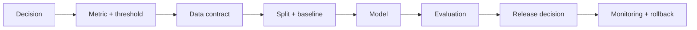

# CP01 - Scoping the capstone and fixing the data {#cp01}

**Section path:** [Overview](index.md) · **Module 17** · [Assessment](assessment.md)

| | |
| --- | --- |
| **Study time** | 4 hours |
| **Hardware** | depends on the chosen project |
| **Prerequisites** | at least one completed vertical (M04-M16) |
| **You will produce** | A one-page scope, a data contract, and a risk register |

## Learning objectives

By the end of this lesson you can:

* turn a broad idea into a decision with a metric, threshold, and failure cost
* write a data contract that prevents leakage and unavailable features
* build a risk register where every row has a mitigation and an owner

## The capstone is a decision, not a demo

A capstone succeeds when a reviewer can answer four questions:

1. What decision does this system support?
2. What evidence shows it does that better than the alternative?
3. What happens when it is wrong?
4. Can someone else reproduce the evidence?

A notebook with a high score and no answer to those questions is a demo. The
scope document exists to make the answers explicit before the build.

## Beginner: choose a narrow, measurable task

| Too broad | Narrow enough |
| --- | --- |
| "an AI for customer support" | "route billing tickets to the billing queue with 90% precision" |
| "detect fraud" | "flag the top 1% of transactions by risk with a stated review budget" |
| "video analytics" | "count vehicles crossing a line in a 60-second clip" |
| "a chatbot for the handbook" | "answer 20 handbook questions with citations or abstain" |

The narrow version has a metric, a threshold, and a failure cost. The broad version
has none.

## Intermediate: the data contract

Write down, before training:

* the source and version (digest);
* the unit of prediction (row, customer, video, session);
* the label definition and who assigned it;
* the split strategy and why it matches deployment;
* the features available at prediction time;
* the features that are **not** available (to prevent leakage);
* the class balance and the cost of each error.

If the label is not available at prediction time, or the split does not match the
deployment unit, stop and fix the contract.

## Advanced: the risk register

| Risk | Likelihood | Impact | Mitigation | Owner |
| --- | --- | --- | --- | --- |
| test data leaks into training | medium | high | grouped split + overlap probe | you |
| labels are noisy | high | medium | double-label a sample, report kappa | you |
| model is overconfident | medium | high | calibration table | you |
| latency exceeds budget | medium | medium | p95 measurement | you |
| guard misses paraphrase | high | medium | capability limits + review | you |
| data contains personal information | low | high | minimise, document, delete | you |

The register is not decoration. Each row becomes a test or a documented limitation.

## Diagram: scope to evidence

## Practice

1. Rewrite a broad idea as a narrow task with a metric and a threshold.
2. Write the data contract for the task. Which feature is unavailable at prediction
   time?
3. Fill the risk register with at least six rows. Which risk has no test yet?
4. Define the baseline: majority class, simple rule, or existing process. What must
   the model beat?

## Common mistakes

* **Choosing a task because the dataset exists, not because a decision exists.**
* **No baseline.**
* **A test set that is not the deployment unit.**
* **Leaving label definition implicit.**
* **Skipping the risk register until the report.**

## Knowledge checks

1. Why does a narrow task make a better capstone?
   *It has a measurable decision, a threshold, and a failure cost, so evidence can
   support or reject it.*
2. What must a data contract state about features?
   *Which are available at prediction time and which are excluded to prevent
   leakage.*
3. Why is a baseline required?
   *It defines the value added; without it, a score has no reference.*
4. What makes a risk register useful?
   *Each risk maps to a test, mitigation, or documented limitation with an owner.*

## Lab connection

The capstone lab requires the scope and data contract in the first checkpoint. A
project that changes its task after the first checkpoint must document why.

## Further reading

* Sculley et al., *Hidden Technical Debt in ML Systems* (2015).
* NIST, *AI Risk Management Framework* (2023).
* Google, *People + AI Guidebook* - problem framing.

---

**Previous:** [PR05 - Artifacts and serving](../production/pr05-artifacts-and-serving.md)
**Next:** [CP02 - Build and evidence](cp02-build-and-evidence.md)
