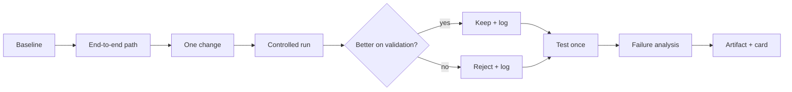

# CP02 - Build, measure, and keep the evidence {#cp02}

**Section path:** [Overview](index.md) · **Module 17** · [Assessment](assessment.md)

| | |
| --- | --- |
| **Study time** | 12 hours |
| **Hardware** | depends on the project |
| **Prerequisites** | [CP01](cp01-scoping-and-data.md) |
| **You will produce** | A reproducible baseline, an improved model, and an experiment log |


## Learning objectives

By the end of this lesson you can:

* build an end-to-end path from data to one prediction before optimizing
* run a controlled comparison and report every cell, not only the winner
* keep an experiment log that attributes a result to a code and data version

## Build the smallest end-to-end path first

The first milestone is not a good model. It is a complete path: data -> split ->
train -> evaluate -> artifact -> one prediction. A complete weak system teaches you
where the real bottleneck is; a strong component with no path teaches you nothing.

Order of work:

1. data audit and split (M05);
2. baseline (majority, rule, or linear model);
3. end-to-end training and evaluation;
4. one improvement with a controlled comparison;
5. artifact, card, and serving path;
6. failure analysis and limitations.

## Beginner: the experiment log

Every run records:

| Field | Example |
| --- | --- |
| run id | `2026-11-05-a` |
| code version | git commit or script digest |
| data digest | SHA-256 of the input |
| config | seed, lr, epochs, batch, model width |
| metrics | validation and test, with n |
| decision | keep / reject / rerun |
| notes | what changed and why |

Without the log, a later "improvement" cannot be attributed to a change. The log is
the evidence, not the notebook's last cell.

## Intermediate: controlled comparison

Change one factor at a time. If you change augmentation and learning rate together,
the result cannot tell you which mattered. If you must change two, run the 2x2
grid.

```text
baseline:        lr 1e-3, no aug
aug only:        lr 1e-3, aug
lr only:         lr 3e-3, no aug
both:            lr 3e-3, aug
```

Report the grid, not just the winner. The interaction is often the interesting
part.

## Advanced: evidence for a negative result

A rejected improvement is a result if it is measured:

* same split, same seed policy, same evaluation;
* a paired comparison where possible;
* an interval on the difference;
* an explanation of the mechanism.

"LoRA was worse at this budget" is a finding. "LoRA did not work" is a shrug.

## Diagram: iteration loop



## Practice

1. Build the end-to-end path with a majority-class baseline. Report its accuracy
   and macro-F1.
2. Run a 2x2 grid for two factors. Report all four cells and the interaction.
3. Write the experiment log for your last three runs. Which field is missing?
4. Take one rejected change and write it up as a negative result with an interval.

## Common mistakes

* **Optimising a component before the path exists.**
* **Changing several factors and attributing the gain to one.**
* **No code or data digest.**
* **Reporting only the winning run.**
* **Treating a negative result as a failure to hide.**

## Knowledge checks

1. Why build the end-to-end path before improving the model?
   *It exposes integration, data, and evaluation problems early, when they are
   cheap to fix.*
2. What makes a comparison controlled?
   *One factor changes while data, split, seed policy, and evaluation stay fixed.*
3. Why log rejected runs?
   *They prevent re-running dead ends and provide evidence for the final choice.*
4. What turns a negative result into evidence?
   *A controlled comparison, an interval, and a mechanism.*

## Lab connection

The capstone lab's second checkpoint requires the experiment log and the 2x2 (or
equivalent) comparison. A single winning run is not enough.

## Further reading

* Bouthillier et al., *Accounting for Variance in Machine Learning Benchmarks*
  (2021).
* Google, *Deep Learning Tuning Playbook* - controlled experiments.
* Pineau et al., *Improving Reproducibility in Machine Learning Research* (2021).

---

**Previous:** [CP01 - Scoping and data](cp01-scoping-and-data.md)
**Next:** [CP03 - Evaluation, security, and packaging](cp03-evaluation-and-packaging.md)
