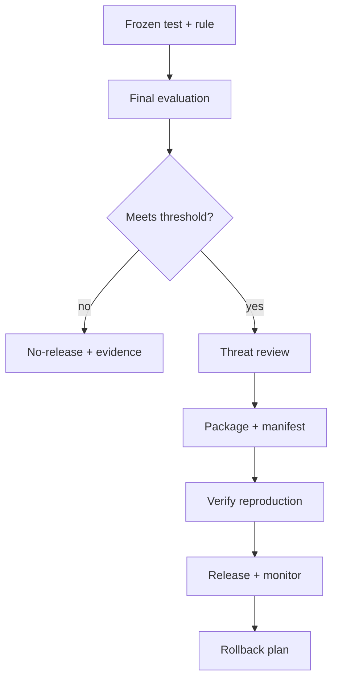

# CP03 - Evaluation, security, and packaging {#cp03}

**Section path:** [Overview](index.md) · **Module 17** · [Assessment](assessment.md)

| | |
| --- | --- |
| **Study time** | 8 hours |
| **Hardware** | depends on the project |
| **Prerequisites** | [CP02](cp02-build-and-evidence.md), [PR05](../production/pr05-artifacts-and-serving.md) |
| **You will produce** | A final evaluation, a threat review, and a reproducible package |


## Learning objectives

By the end of this lesson you can:

* freeze a test set and scoring rule before the final evaluation
* write a threat review with residual risk and an owner
* package the project so another person can reproduce the headline metric

## The final evaluation is written before it is run

Freeze the test set and the scoring rule before the final run. Then evaluate once.
If the result is disappointing, report it; changing the test or the threshold after
seeing it converts the evaluation into a tuning set.

The final report contains:

* the decision the system supports;
* the baseline and the model, with the same metrics and n;
* intervals and a paired comparison;
* the threshold and its cost trade-off;
* per-slice results for at least one subgroup or condition;
* the failures you inspected.

## Beginner: the reproducibility package

A package someone else can run:

```text
project/
  README.md          # what, why, how, results, limitations
  requirements.txt   # pinned versions
  data/README.md     # source, digest, licence (no raw private data)
  src/               # training and serving code
  configs/           # one config per reported run
  artifacts/         # model + card + manifest (or a download link)
  reports/           # evaluation, failure analysis
```

The reproduction command must be one line. If it needs five manual steps, it is
not reproducible.

## Intermediate: threat review

| Threat | Control | Residual risk |
| --- | --- | --- |
| poisoned input | guard + capability limits | paraphrases pass; review sample |
| artifact tampering | digest + signed manifest | manifest rewrite if unsigned |
| data leakage | grouped split + probe | near-duplicates remain |
| overconfident output | calibration + abstention | distribution shift |
| privacy | minimise + delete + access control | memorisation in weights |
| denial of service | rate limit + timeout | not implemented in teaching server |

The residual-risk column is the honest part. A threat with no residual risk is
usually a threat that was not examined.

## Advanced: the release decision

A release recommendation has four parts:

1. **Evidence.** The metric, interval, and baseline.
2. **Conditions.** The population, threshold, and monitoring in place.
3. **Failure plan.** Rollback artifact, trigger, and owner.
4. **Limitations.** What the system must not be used for.

"No" is a valid recommendation when the evidence does not support the decision.
A capstone that recommends no-release with a clear reason can score higher than one
that ships an unmeasured system.

## Diagram: final gate



## Practice

1. Write the final evaluation plan before running it. What would make you recommend
   no-release?
2. Package the project and ask someone else to run the reproduction command. Record
   every missing step.
3. Fill the threat table for your project. Which residual risk has no owner?
4. Write the rollback procedure. What is the previous digest, and who triggers it?

## Common mistakes

* **Changing the test set after a disappointing result.**
* **A README without a one-line reproduction command.**
* **Shipping artifacts without a manifest.**
* **Threat review as a checklist with no residual risk.**
* **No rollback plan.**

## Knowledge checks

1. Why freeze the test set and scoring rule before the final run?
   *To prevent the evaluation from becoming a tuning signal; the reported number
   must be an out-of-sample estimate.*
2. What makes a package reproducible?
   *Pinned dependencies, a data contract, configs per run, artifacts with digests,
   and a one-line command.*
3. What is residual risk?
   *The risk that remains after controls; it must be documented and owned.*
4. When is "no-release" the right recommendation?
   *When the evidence does not support the decision, or the failure plan and
   monitoring are absent.*

## Lab connection

The capstone lab's final checkpoint is the package, the evaluation report, the
threat review, and the release recommendation. All four are marked.

## Further reading

* Pineau et al., *Improving Reproducibility in ML Research* (2021).
* NIST, *AI Risk Management Framework* (2023).
* Mitchell et al., *Model Cards for Model Reporting* (2019).

---

**Previous:** [CP02 - Build and evidence](cp02-build-and-evidence.md)
**Next:** [Assessment](assessment.md)
