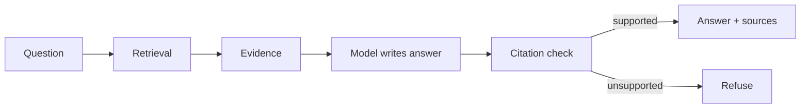

# CA02 - Rule-based, retrieval-based, and generative chatbots {#ca02}

**Section path:** [Overview](index.md) · **Module 2** · [Projects](index.md#the-projects) · [Assessment](assessment.md)

| | |
| --- | --- |
| **Study time** | 3 hours: 1.5 h reading, 1.5 h Project A |
| **Hardware** | CPU-only, standard library |
| **Prerequisites** | CA01 |
| **You will produce** | A working rule-based FAQ bot and a written comparison with the alternatives |

## Why this module exists

The honest answer to "should this be a chatbot?" is often "no, it should be a
lookup table". Knowing when a rule beats a model is a design skill, and it protects
you from the most common failure in this field: adding a language model to a problem
that needed a form.

The three families differ in where the knowledge lives. Rules: in the code. Retrieval:
in the documents. Generative: in the weights. Each location has a different update
cost, audit story, and failure mode.

## Where the knowledge lives

| | Rules | Retrieval | Generative |
| --- | --- | --- | --- |
| Knowledge stored in | Code | Documents and index | Model weights |
| Update a fact | Edit code, redeploy | Edit the document, reindex | Retrain or re-prompt |
| Can cite a source | No (the rule *is* the source) | Yes | Only if retrieval supplies it |
| Handles new phrasing | Only if anticipated | Partly | Well |
| Reproducible output | Exactly | Mostly | No (sampling, version drift) |
| Cost per answer | Microseconds | Milliseconds | 100 ms to seconds |
| Testable | Exhaustively | With a question set | With a question set and tolerance |

None of these columns says "better". A refund policy that changes twice a year is a
good candidate for retrieval. A safety rule that must never be violated is a good
candidate for a rule, checked before the model is called.

## Rule-based systems, done properly

The naive version is a chain of `if "refund" in text`. The version worth building has
four properties:

1. **Normalisation** before matching: lowercase, collapse whitespace, strip
   punctuation that breaks patterns.
2. **Priority**, because a message can match several intents. "I want a refund for
   the workshop I enrolled in" matches both *refund* and *enroll*; the bot must pick
   deliberately.
3. **An explicit fallback**, which is a first-class answer, not an error.
4. **A log of ambiguity**, so you can see which intents are competing.

From `project_a_faq_bot.py`:

```python
@dataclass(frozen=True)
class Intent:
    name: str
    patterns: tuple[str, ...]
    answer: str
    priority: int = 0

    def matches(self, text: str) -> bool:
        return any(re.search(pattern, text) for pattern in self.patterns)
```

Scoring is a sort by priority, and the ambiguity flag is recorded:

```python
chosen = sorted(candidates, key=lambda intent: -intent.priority)[0]
self.log.append({"message": normalized, "intent": chosen.name, "ambiguous": len(candidates) > 1})
```

That `ambiguous` field is what lets you improve the system with evidence instead of
guesses. Run Project A's selftest and look at the ambiguity line: the refund/enroll
message is flagged, and the higher-priority refund intent wins.

### When rules are the right answer

- The space of questions is small and closes: opening hours, a fixed policy, a form.
- The answer must be identical every time, for audit or safety.
- Latency matters more than flexibility.
- You need something working today, and you want a baseline to compare against later.

### When rules are the wrong answer

- Users phrase the same question many ways.
- The content changes often.
- The domain is open, and unknowns dominate.

A rule bot's failure is silent: it returns the fallback, which looks like a working
system that happens to be unhelpful. That is easier to diagnose than a confident
wrong answer, which is why it is a good first baseline.

## Retrieval-based systems

Retrieval separates *finding* from *answering*. The finding step is measurable on its
own: for a question with a known correct passage, retrieval either returned it or it
did not. That single property is why this section spends five modules on retrieval
before generating a single token.

```python
results = retriever.search("How long is a refund window?", k=4)
for result in results:
    print(result.rank, round(result.score, 3), result.chunk.chunk_id)
```

If rank 1 is the right passage, retrieval worked. If the answer is still wrong, the
problem is in generation, and you have narrowed the search space for the bug. Module
14 formalises this as `hit_at_k` versus `answer_accuracy`.

## Generative systems

A generative system answers from learned parameters. It generalises phrasing better
than either alternative and is the least auditable. Three properties matter here:

- **Fluency is not accuracy.** The model produces grammatical text whether or not it
  has evidence. There is no internal flag that says "I made this up".
- **Consistency is not accuracy.** The same wrong answer twice is still wrong.
- **Refusal must be engineered.** A model asked to "be helpful" will usually answer.
  The refusal behaviour has to be specified and tested.

That is why the section never asks a model to answer from memory in the pipeline you
build: it asks the model to answer from *supplied evidence*, and a separate layer
checks the citations.

## The hybrid you will build



Rules still exist in this design, just not as the answer: they are the minimum-score
threshold, the refusal policy, the injection quarantine, and the citation validator.
Those are deterministic checks around a probabilistic core, which is the practical
definition of a responsible chatbot.

## Choosing: a short decision procedure

1. Can you list every question the bot must answer? If yes, **rules**.
2. Is there an authoritative document set that answers them? If yes, **retrieval**.
3. Do questions require synthesis across sources or open phrasing? Then **retrieval +
   generation**.
4. Is the answer impossible to check? Then stop: no chatbot should be built, because
   nobody can evaluate it.

## Common failures and how to diagnose them

| Symptom | Likely cause | First check |
| --- | --- | --- |
| Rule bot answers the wrong intent | Two patterns match; no priority | Print the candidate list for the failing message |
| Rule bot stops matching after an edit | Normalisation removed or pattern now anchored | Test the normalised string, not the raw input |
| Retrieval returns a plausible but wrong passage | Lexical overlap without topical match | Inspect the top 3 chunk texts, not just the scores |
| Generative bot invents details | No evidence supplied, or evidence ignored | Check the prompt: does it contain the passage at all? |
| Adding a model made the system worse to test | No fixed question set | Write the question set first, then add the model |

## Checkpoint

- [ ] You can state where the knowledge lives in each of the three families.
- [ ] You can explain what the `ambiguous` flag in Project A is for.
- [ ] You can name a case where rules are the correct engineering choice.
- [ ] You can explain why retrieval is evaluated separately from generation.

## Next step

Build [Project A](projects/a-faq-bot.md), then read
[CA03 - Calling a language model from Python](ca03-calling-a-model.md).
