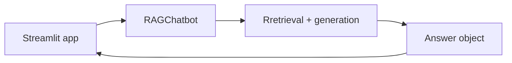

# CA06 - Building a chatbot interface using Streamlit {#ca06}

**Section path:** [Overview](index.md) · **Module 6** · [Projects](index.md#the-projects) · [Assessment](assessment.md)

| | |
| --- | --- |
| **Study time** | 3 hours: 1 h reading, 2 h Project C |
| **Hardware** | CPU-only; needs `requirements/llm.txt` |
| **Prerequisites** | CA03, CA05 |
| **You will produce** | A working chat interface that displays answers, citations, and refusals |

## Why this module exists

An interface is not decoration. It decides what the user can see, and therefore what
they can check. A chat window that shows only the answer invites trust it has not
earned. The same pipeline with a sources panel and a visible refusal state invites
scrutiny.

This module also teaches a discipline: the UI owns no logic. If the interface contains
retrieval or prompt code, you cannot test the system without starting a web server,
and you cannot change a knob without editing the front end.

## Architecture



Everything the interface does is: collect input, call `bot.ask()`, render the returned
`Answer`. That is the entire contract, and it is why the same `Answer` renders in the
terminal (`render_answer`) and in the browser.

## The session model

Streamlit re-runs the whole script on every interaction, so state must live in
`st.session_state`:

```python
def init_state() -> None:
    if "messages" not in st.session_state:
        st.session_state.messages = []
    if "bot" not in st.session_state:
        st.session_state.bot = None
```

Two consequences that surprise students:

- **A local variable does not survive a click.** A bot created outside session state is
  rebuilt (or lost) on every rerun.
- **Caching is not the same as state.** `@st.cache_resource` shares the index across
  users; session state isolates one conversation. Use both, for different reasons.

```python
@st.cache_resource(show_spinner="Indexing documents...")
def load_bot(corpus: str, k: int, min_score: float) -> RAGChatbot:
    return RAGChatbot.from_directory(Path(corpus), config=GenerationConfig(k=k, min_score=min_score))
```

The index is expensive and shareable; the conversation is cheap and private.

## Rendering an answer honestly

The interface must distinguish three outcomes, and students usually implement only the
first:

| Outcome | What the user sees | What must not happen |
| --- | --- | --- |
| Grounded answer | Answer text plus a sources panel | Sources hidden behind a click nobody makes |
| Refusal | The refusal, plus "no sources cited" | A refusal styled like an error, or hidden |
| Answer with a conflict | Both values, with a warning | One value silently chosen |

```python
def render_sources(answer) -> None:
    if answer.citations:
        with st.expander(f"Sources ({len(answer.citations)})", expanded=False):
            for citation in answer.citations:
                st.markdown(f"**[{citation.number}] {citation.title} - {citation.section}**")
                st.caption(f"`{citation.source}`  ·  score {citation.score:.3f}")
    elif answer.abstained:
        st.caption("No sources cited: the documents do not support an answer.")
```

Showing the score is a deliberate choice: it teaches the user that retrieval confidence
varies, and it makes a low-confidence answer visibly different from a strong one.

## Controls worth exposing

| Control | Effect | Why expose it |
| --- | --- | --- |
| `k` | Chunks retrieved | Students can watch retrieval quality change |
| `min_score` | Refusal threshold | The single most instructive knob in the section |
| Corpus path | Document set | The same UI works for the student's own documents |
| Rebuild index | Clears cache and history | Forces an honest fresh start |

`min_score` deserves a slider: set it to `0.0` and the bot answers everything, often
wrongly; set it to `0.9` and it refuses almost everything. The useful range is found by
measurement, not by taste — which is Module 14.

## Debug panel

```python
with st.expander("Debug details"):
    st.json(answer.as_dict())
    st.code(render_answer(answer), language="text")
```

An expander that shows `retrieved`, `top_score`, `quarantined_chunks`, and
`dropped_citations` turns "the bot said something odd" into a specific cause. In a
course setting it also makes the pipeline legible to a reader who will never open the
source.

## Running it

```bash
python -m pip install -r requirements/llm.txt
python scripts/make_chatbot_data.py
python -m streamlit run projects/chatbots-rag/app_streamlit.py
```

!!! warning "Verified status"
    The application was syntax-checked (`python -m py_compile`) in the authoring
    environment, but **not opened in a browser**, because Streamlit is not installed
    there. Treat browser behaviour as unverified until you run it yourself, and report
    the version you used.

## Common failures and how to diagnose them

| Symptom | Likely cause | First check |
| --- | --- | --- |
| Chat history disappears on every message | Messages not stored in `session_state` | Confirm the messages list is initialised once |
| Index rebuilt on every message | `load_bot` not cached, or cache key changes | Print a marker inside `load_bot` |
| "Corpus not found" | Data generator not run, or relative path | Use the absolute path shown in the error |
| Sidebar change has no effect | Bot created before the slider was read | Rebuild on change, or clear the cache |
| Everything refuses | `min_score` too high, or the index is empty | Check the debug panel's `retrieved` and `top_score` |
| App crashes on start | Streamlit not installed, or an import error | Run the module directly: `python app_streamlit.py` surfaces the import error |

## Checkpoint

- [ ] You can explain the difference between `st.session_state` and `st.cache_resource`.
- [ ] You can point to the line where the UI stops and the pipeline begins.
- [ ] You can describe what a user learns from seeing a refusal and a score.
- [ ] You can state which parts of the interface you have personally verified.

## Next step

Read [CA07 - Running a compatible language model locally](ca07-local-models.md) and
complete [Project C](projects/c-streamlit-app.md).
