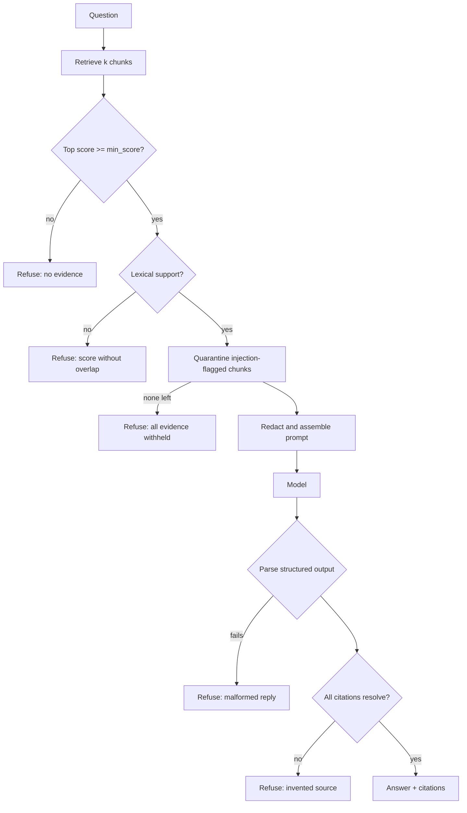

# CA12 - Retrieval-augmented generation (RAG) {#ca12}

**Section path:** [Overview](index.md) · **Module 12** · [Projects](index.md#the-projects) · [Assessment](assessment.md)

| | |
| --- | --- |
| **Study time** | 5 hours: 2 h reading, 3 h Project F |
| **Hardware** | CPU-only |
| **Prerequisites** | CA05, CA11 |
| **You will produce** | A working RAG pipeline that refuses, quarantines, and cites |

## Why this module exists

RAG is usually described as "put documents in the prompt". That description omits every
decision that determines whether the result is trustworthy. This module is the ordering
of those decisions, and the reason each one sits where it does.

## The order matters



Every refusal branch is a place a naive implementation would instead show something
plausible. Five chances to fail safely, not one.

### Why the lexical-support gate exists

A similarity score is not evidence. With the offline embedder, *"What is the capital of
Mongolia?"* scored 0.894 against a chunk about context windows — high enough to pass any
naive threshold. The gate asks a different question:

```python
asked = content_words(question)
supported = bool(asked) and any(asked & content_words(chunk.text) for chunk in chunks)
```

If no retrieved passage shares a content term with the question, there is nothing to
quote, and the pipeline refuses. This is a crude heuristic with a known cost: a pure
paraphrase ("what happens if I change my mind about a workshop") could be refused even
when the right passage was retrieved. Module 14 measures over-refusal rather than
assuming it away.

### Why quarantine comes before assembly

```python
for chunk in chunks:
    if scan_for_injection(chunk.text).flagged:
        quarantined.append(chunk.chunk_id)
    else:
        usable.append(chunk)
```

The poisoned text never enters the prompt, so the model's susceptibility to injected
instructions stops mattering. Asking a model to ignore instructions is a mitigation;
removing the instructions is a control. The test asserts the stronger property:

```python
self.assertEqual(client.prompts, [], "quarantined text must never reach a model")
```

## What the model is asked to do

```python
user_turn = (
    "EVIDENCE:\n"
    f"{evidence}\n\n"
    f"QUESTION: {question}\n\n"
    "Reply with the JSON object described in the system prompt."
)
```

Evidence before question, numbered, redacted, with title and section headers. The order
is not cosmetic: a question first invites the model to answer from memory and treat the
evidence as a citation to find later.

## Grounding versus fluency

| Behaviour | Looks like | Is it grounded? |
| --- | --- | --- |
| Repeats evidence with a citation | Terse, sometimes awkward | Yes |
| Paraphrases evidence with a citation | Smooth | Yes, if the citation supports the claim |
| Adds a plausible detail | Very smooth | No |
| Answers with no citation | Confident | Unverified, and refused by this pipeline |

The extractive client in this section produces the first kind: it stitches sentences
from evidence. That is why its answers read a little mechanically and why its accuracy
is measurable rather than rhetorical.

## The refusal text is part of the design

```python
ABSTAIN_TEXT = "I do not have enough evidence in the provided documents to answer that."
```

Three properties: it states the limitation, it does not apologise vaguely, and it names
the reason (evidence, not knowledge). Downstream code recognises it, and the evaluator
scores it as a correct outcome on unanswerable questions.

## What RAG does not fix

| Problem | RAG's effect |
| --- | --- |
| Wrong or outdated documents | Retrieves the wrong source faithfully |
| Poor chunking | Retrieval cannot find what was never a unit |
| Conflicting sources | Retrieves both; disclosure must be built separately |
| Model ignoring instructions | Retrieval cannot enforce compliance |
| Prompt injection in documents | Must be filtered before assembly |
| Access control | Must be enforced in retrieval, not in the prompt |

This table is the answer to "is RAG enough?". It is not.

## Assembling the pipeline

```python
bot = RAGChatbot.from_directory(
    "data/chatbots-rag/corpus",
    config=GenerationConfig(k=4, min_score=0.12),
)
answer = bot.ask("How much does a paid workshop cost?", use_history=False)
print(answer.text, [c.chunk_id for c in answer.citations])
```

`RAGChatbot` holds no policy of its own: retrieval, prompts, abstention, and logging are
in their own modules. When a behaviour is wrong, you edit one file, and the evaluation
tells you what changed.

## Common failures and how to diagnose them

| Symptom | Likely cause | First check |
| --- | --- | --- |
| Answers are correct but never cite | Model ignoring the schema | Inspect the raw reply; the parser may be discarding it |
| Everything refuses | `min_score` too high, or evidence empty | Print `retrieved` and `top_score` |
| Answers include invented details | Evidence assembled incorrectly, or model too weak | Print the exact prompt sent |
| Injection text appears in the answer | Quarantine bypassed on that path | Confirm `scan_for_injection` runs before assembly |
| Answers contradict each other across turns | Different chunks retrieved per turn | Inspect both retrievals; consider pinning evidence per topic |
| Answers are right but slow | `k` and chunk size too large | Measure latency per stage before optimising |

## Checkpoint

- [ ] You can list the five refusal points in the pipeline.
- [ ] You can explain why quarantine is stronger than an instruction.
- [ ] You can explain why the evidence precedes the question.
- [ ] You can name one problem RAG does not solve.

## Next step

Read [CA13 - Citations, source grounding, and abstention](ca13-citations-and-abstention.md),
then complete [Project F](projects/f-cited-assistant.md).
