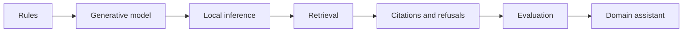
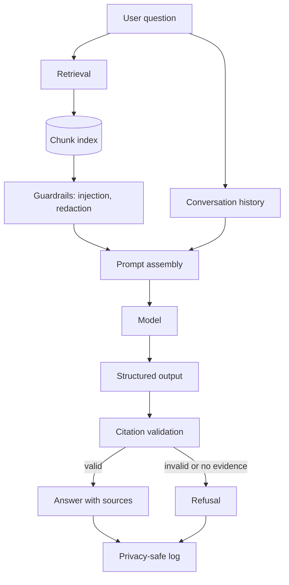

# Conversational AI: build a chatbot from rules to retrieval



This section teaches you to build conversational systems the way they are actually
built: one layer at a time, with a measurement after each layer. You start with a
rule-based FAQ bot that has no model at all, and you finish with a domain assistant
that retrieves evidence, cites it, refuses when the evidence is missing, and is
evaluated against a fixed question set that you wrote before you tuned anything.

Sixteen modules and eight projects. Everything runs on a laptop CPU with no
account, no API key, and no model download. A hosted API and a local model are
optional comparisons, never requirements.

| | |
| --- | --- |
| **Level** | 2 - Language AI (follows the foundation sequence F01-F13) |
| **Study time** | 58 hours: 20 h reading, 22 h projects, 14 h evaluation and write-up |
| **Hardware** | CPU-only for the whole core path. Optional GPU or hosted API for comparisons |
| **Prerequisites** | [F03-F10](../index.md#foundation-sequence) (Python, data handling, metrics) and [F11-F13](../index.md#foundation-sequence) for the neural material |
| **You will produce** | Eight working systems, one evaluation report with measured metrics, and one domain assistant with a model card |

!!! note "This section teaches one thing well"
    It does not cover chat fine-tuning from scratch (M07-M08), agent tool use
    (M15), or production infrastructure. It covers the layer that decides whether
    a chatbot is useful or merely fluent: grounding an answer in evidence and
    proving it with measurements.

## Why this section exists

A chatbot that writes a confident paragraph is easy. A chatbot whose answer you can
check is hard, and the difference is not the model. It is the pipeline around the
model: what was retrieved, what was ignored, what was cited, and what the system
does when it does not know.

The failure this section is designed to prevent is specific. A student builds a
retrieval-augmented chatbot, asks it five questions, gets five fluent answers,
demonstrates it, and ships it. Two of those answers were wrong. Nothing in the
demo could have revealed that, because there was no fixed question set, no gold
evidence, and no measurement.

By the end of Module 14 you will have all three, and you will have found real
errors in your own system. That is the point.

## The modules

| Code | Module | Hours | Project | Hardware |
| --- | --- | --- | --- | --- |
| CA01 | [What a chatbot is and how conversational systems work](ca01-what-is-a-chatbot.md) | 3 | - | CPU-only |
| CA02 | [Rule-based, retrieval-based, and generative chatbots](ca02-chatbot-types.md) | 3 | [A](projects/a-faq-bot.md) | CPU-only |
| CA03 | [Calling a language model from Python](ca03-calling-a-model.md) | 4 | [B](projects/b-llm-chatbot.md) | CPU-only |
| CA04 | [Conversation history and context windows](ca04-history-and-context.md) | 3 | [B](projects/b-llm-chatbot.md) | CPU-only |
| CA05 | [System instructions, prompt templates, structured outputs](ca05-prompts-and-structured-output.md) | 4 | [B](projects/b-llm-chatbot.md) | CPU-only |
| CA06 | [Building a chatbot interface with Streamlit](ca06-streamlit-interface.md) | 3 | [C](projects/c-streamlit-app.md) | CPU-only |
| CA07 | [Running a compatible language model locally](ca07-local-models.md) | 4 | [D](projects/d-local-model.md) | CPU or optional GPU |
| CA08 | [A hosted model API as an optional alternative](ca08-hosted-api.md) | 2 | [D](projects/d-local-model.md) | CPU + optional key |
| CA09 | [Embeddings and semantic similarity](ca09-embeddings.md) | 4 | [E](projects/e-course-docs-bot.md) | CPU-only |
| CA10 | [Chunking, document parsing, and metadata](ca10-chunking.md) | 4 | [E](projects/e-course-docs-bot.md) | CPU-only |
| CA11 | [Vector search and retrieval](ca11-vector-search.md) | 4 | [E](projects/e-course-docs-bot.md) | CPU-only |
| CA12 | [Retrieval-augmented generation](ca12-rag.md) | 5 | [F](projects/f-cited-assistant.md) | CPU-only |
| CA13 | [Citations, source grounding, and abstention](ca13-citations-and-abstention.md) | 4 | [F](projects/f-cited-assistant.md) | CPU-only |
| CA14 | [RAG evaluation and error analysis](ca14-evaluation.md) | 5 | [G](projects/g-evaluation.md) | CPU-only |
| CA15 | [Integrating fine-tuned models into a chatbot](ca15-fine-tuned-models.md) | 4 | [G](projects/g-evaluation.md) | Optional GPU |
| CA16 | [Logging, privacy, access control, and deployment](ca16-privacy-and-deployment.md) | 4 | [H](projects/h-domain-assistant.md) | CPU-only |

## The projects

Each project is a working program in `projects/chatbots-rag/`, not a notebook to
read. Every one has a `--selftest` you can run first.

| Project | Build | Code | Difficulty |
| --- | --- | --- | --- |
| [A](projects/a-faq-bot.md) | Rule-based FAQ chatbot | `project_a_faq_bot.py` | Beginner |
| [B](projects/b-llm-chatbot.md) | Simple LLM chatbot in Python | `project_b_llm_chatbot.py` | Beginner |
| [C](projects/c-streamlit-app.md) | Streamlit conversational app | `app_streamlit.py` | Intermediate |
| [D](projects/d-local-model.md) | Local-model chatbot | `project_d_local_model.py` | Intermediate |
| [E](projects/e-course-docs-bot.md) | Questions about course documents | `project_e_course_docs_bot.py` | Intermediate |
| [F](projects/f-cited-assistant.md) | RAG assistant with citations | `project_f_cited_assistant.py` | Intermediate |
| [G](projects/g-evaluation.md) | Evaluation harness | `project_g_evaluation.py` | Advanced |
| [H](projects/h-domain-assistant.md) | Final domain assistant | `project_h_domain_assistant.py` | Advanced |

## The pipeline you build



Each box is a module in `projects/chatbots-rag/chatbot_core/`. If you can point at
the box where a failure happened, you can fix it. If everything is one function,
you cannot.

## Run the code

```bash
python scripts/make_chatbot_data.py                  # synthetic corpus + questions
python -m pip install -r requirements/base.txt        # NumPy; nothing else needed

cd projects/chatbots-rag
python project_a_faq_bot.py --selftest
python project_f_cited_assistant.py --selftest
python -m unittest discover -s ../../tests -v
```

The Streamlit interface needs one extra file:

```bash
python -m pip install -r requirements/llm.txt
python -m streamlit run projects/chatbots-rag/app_streamlit.py
```

## What has been verified, and what has not

This section ships with a measured baseline rather than an impression. On the
authoring machine (Windows 11, Python 3.12.10, CPU only):

| Check | Result |
| --- | --- |
| Offline unit tests (`tests/test_chatbot_rag.py`) | 24 tests, all passing |
| Project selftests | 7 of 7 run and report pass (see each project page) |
| Corpus | 13 documents, 41 chunks, generated deterministically |
| Dev question set (14 questions) | Measured metrics in [Module 14](ca14-evaluation.md) |
| Test question set (12 questions) | Measured metrics in [Module 14](ca14-evaluation.md) |

Not verified, and stated here rather than buried:

- **The Streamlit app was syntax-checked, not opened in a browser**, because
  Streamlit is not installed in the authoring environment.
- **No local transformers model was downloaded.** The local path is documented and
  its fallback is tested; the inference path is not benchmarked here.
- **No hosted API was called.** No credentials exist in the repository, by design.
- **The fine-tuned leg of Project G was not run.** It requires a GPU and a trained
  checkpoint; the harness records the leg as `skipped` rather than pretending.

## Data and licensing

All corpus text is synthetic and written for this course, released CC0-1.0. It
contains no real people, no real email addresses (the one that appears is fictional
and used to test redaction), and no institutional data.

When you point the pipeline at your own documents, the rules in
[Module 16](ca16-privacy-and-deployment.md) apply: you need the right to use them,
and you need consent before sending them to a third party.

## Next step

Start at [CA01 - What a chatbot is](ca01-what-is-a-chatbot.md), then do
[Project A](projects/a-faq-bot.md) before reading CA02. Building the dumbest
possible bot first is what makes the rest legible.

When you finish, score your evidence with the [section assessment](assessment.md).
