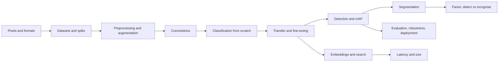

# Computer vision: from pixels to a documented model



This section teaches computer vision the way it is actually built: data first, one
measurement per layer, and an honest record of what failed. You start with what a pixel
value means and finish with a model card that states what your system cannot do.

Fourteen modules, eight labs, one face-safety module with measured demographic gaps, and a
documented capstone. Everything runs on a laptop CPU with no account, no download, and no
dataset licence to negotiate.

| | |
| --- | --- |
| **Level** | 3 - Vision and video (after F03-F13) |
| **Study time** | 62 hours: 26 h reading, 30 h labs, 6 h write-up |
| **Hardware** | CPU-only for the whole core path. GPU optional for real pretrained weights |
| **Prerequisites** | [F03-F10](../index.md#foundation-sequence), [F11-F13](../index.md#foundation-sequence) |
| **You will produce** | Eight working programs, a measured robustness table, a stratified face analysis, and a model card |

!!! note "What this section does not cover"
    Video and tracking (M14), speech (M13), transformers for vision, and production
    infrastructure. It covers the layer that decides whether a vision system is useful:
    data provenance, correct splits, the right metric, and evidence that it works.

## Why this section exists

A vision demo is easy. An image classifier that reports 0.93 is easy - especially if the
split leaks. An object detector that reports mAP 0.32 is easy to produce and hard to
interpret. The difference between a demo and a system is not a bigger model; it is a
grouped split, a metric that matches the task, and an error analysis someone else can
check.

The failure this section is designed to prevent is specific. A student trains a
classifier, sees 0.93, writes "high accuracy", and ships it. The 0.93 came from test
images that were near-copies of training images. Nothing in the workflow could have
revealed that, because there was no audit, no grouped split, and no stratified evaluation.

By Module 14 you will have all three - and you will have measured your own leak.

## The modules

| Code | Module | Hours | Lab |
| --- | --- | --- | --- |
| CV01 | [Digital images, pixels, channels, and formats](cv01-digital-images.md) | 3 | - |
| CV02 | [Image datasets and annotation formats](cv02-datasets-and-annotation-formats.md) | 4 | [1](labs/lab1-licensed-dataset-classifier.md) |
| CV03 | [Preprocessing, resizing, normalization, augmentation](cv03-preprocessing-and-augmentation.md) | 4 | [2](labs/lab2-cnn-learning-curves.md) |
| CV04 | [Convolutional neural networks](cv04-convolutional-networks.md) | 5 | [2](labs/lab2-cnn-learning-curves.md) |
| CV05 | [Image classification from scratch](cv05-classification-from-scratch.md) | 5 | [2](labs/lab2-cnn-learning-curves.md) |
| CV06 | [Transfer learning with pretrained models](cv06-transfer-learning.md) | 5 | [3](labs/lab3-scratch-vs-transfer.md) |
| CV07 | [Fine-tuning a pretrained classifier](cv07-fine-tuning.md) | 4 | [4](labs/lab4-finetune-everyday-objects.md) |
| CV08 | [Training and validating object detectors](cv08-training-detectors.md) | 6 | [5](labs/lab5-annotate-and-train-detector.md) |
| CV09 | [Boxes, IoU, precision, recall, and mAP](cv09-boxes-iou-map.md) | 5 | [6](labs/lab6-detector-thresholds.md) |
| CV10 | [Image segmentation and metrics](cv10-segmentation.md) | 5 | - |
| CV11 | [Face detection versus face recognition](cv11-face-detection-vs-recognition.md) | 6 | [Faces](faces.md) |
| CV12 | [Image embeddings and similarity search](cv12-embeddings-and-similarity.md) | 4 | [7](labs/lab7-similarity-app.md) |
| CV13 | [Model optimization and inference](cv13-optimization-and-inference.md) | 4 | [8](labs/lab8-deployment-comparison.md) |
| CV14 | [Evaluation, robustness, and deployment](cv14-evaluation-robustness-deployment.md) | 5 | - |

## The labs

| Lab | Program | What it proves | Weight |
| --- | --- | --- | --- |
| [1](labs/lab1-licensed-dataset-classifier.md) | `lab1_dataset_and_splits.py` | Grouped split removes a 0.111 accuracy inflation | 8% |
| [2](labs/lab2-cnn-learning-curves.md) | `lab2_cnn_learning_curves.py` | Curves, history, and honest interpretation | 10% |
| [3](labs/lab3-scratch-vs-transfer.md) | `lab3_scratch_vs_transfer.py` | 260 parameters match 72,564; fine-tuning wins | 12% |
| [4](labs/lab4-finetune-everyday-objects.md) | `lab4_finetune_objects.py` | Fine-tune, perturb, document | 12% |
| [5](labs/lab5-annotate-and-train-detector.md) | `lab5_detector_training.py` | Annotations audited, detector at mAP 0.324 | 15% |
| [6](labs/lab6-detector-thresholds.md) | `lab6_detector_thresholds.py` | The threshold is a product decision | 10% |
| [7](labs/lab7-similarity-app.md) | `lab7_similarity.py` | Two embeddings, one measurement | 10% |
| [8](labs/lab8-deployment-comparison.md) | `lab8_deployment.py` | Latency, size, threads, and a rejected optimisation | 13% |

Plus: [face exercises](faces.md), the [model card template](model-card.md), and the
[assessment](assessment.md).

## Measured results from this section

Every number below comes from a run recorded in the lab manuals, on Windows 11, Python
3.12.10, torch 2.14.1+cpu, 16 cores (8 threads used), no GPU.

| Experiment | Result |
| --- | --- |
| Grouped vs leaky split (300 images, 100 sources) | 0.822 vs 0.933, inflation **+0.111**; 0 vs 91 shared sources |
| CNN learning curves (25 epochs) | best epoch 18, val 1.000, test 1.000, gap +0.035, 3.0 s |
| Scratch vs probe vs fine-tune | 0.500 / 0.500 / **0.722**, with 72,564 / 260 / 55,812 trainable parameters |
| Fine-tuned object classifier | test 0.500 on 18 images; card complete |
| Detector (heatmap, 80 epochs) | mAP@0.5 **0.324**, precision 0.200, recall 0.613, 190 predictions for 62 boxes |
| Detector threshold sweep | best F1 0.424 at 0.70; mAP@[.5:.95] 0.088 |
| Segmentation (120 epochs) | mIoU **0.762**, object IoU 0.538, vs 0.318 for the all-background control |
| Similarity search | colour precision@5 0.400, learned features **0.589** |
| Inference | 0.441 ms median, 0.29 MB, 1.4x from 1 to 8 threads, int8 **0.88x** (slower) |
| Face detection (synthetic, 64 images) | recall 0.750 overall; **0.000** for two of five tone groups |
| Face verification | EER 0.215 at threshold 0.855; 4/4 unenrolled probes matched at 0.5 |

## Quick start

```bash
pip install -r requirements/vision.txt
python scripts/make_vision_data.py            # ~2.3 s, deterministic, CC0-1.0

cd projects/computer-vision
python lab1_dataset_and_splits.py             # ~3 s
python lab2_cnn_learning_curves.py            # ~3 s
python lab3_scratch_vs_transfer.py            # ~10 s
python lab4_finetune_objects.py               # ~4 s
python lab5_detector_training.py              # ~8 s
python lab6_detector_thresholds.py            # reuses lab 5's checkpoint
python lab7_similarity.py
python lab8_deployment.py --runs 20
python project_faces.py
python segmentation_demo.py                   # module CV10, ~18 s
```

Automated checks:

```bash
python -m unittest tests.test_computer_vision -v      # 50 tests, ~1 s
```

## The data, honestly

All images are **generated by code** and released **CC0-1.0**. No download, no personal
data, no licence negotiation. That choice buys reproducibility and lets you *see* leakage;
it costs realism - synthetic shapes are not photographs, and a 0.93 here is not a claim
about real images.

| Dataset | Size | Task |
| --- | --- | --- |
| Classification | 300 images / 100 sources, 3 classes | classification, leakage audit |
| Objects | 120 images / 40 sources, 4 classes | scratch vs transfer |
| Detection | 200 images, 302 boxes, 3 classes | detector training, mAP |
| Segmentation | 80 images, 3 classes | mIoU, imbalance |
| Faces | 64 images, 8 identities, 5 tone groups | detection, verification, identification |

The Lab 1 rubric asks you to repeat the split and licence exercise on a **real licensed
dataset of your choice**, which is where realism belongs.

## How to study this section

1. Read a module, then run the matching lab before reading the next.
2. Change one thing per run. The labs are seconds long; use that.
3. Keep a run log. Every number you report should be reproducible by one command.
4. Do the face module attentively: it is the one where an engineering shortcut has legal
   consequences.

## Verified environment and known gaps

| Item | Value |
| --- | --- |
| OS / Python | Windows 11, Python 3.12.10 |
| torch / torchvision | 2.14.1+cpu / 0.29.1+cpu |
| Pillow / NumPy | 13.0.0 / 2.5.4 |
| Missing, worked around | matplotlib (curves via Pillow and ASCII), OpenCV, scikit-image, pytest |
| Not verified here | GPU timings, real ImageNet weights (`torchvision_backbone` reports unavailability), real-face evaluation |

The absence of matplotlib is why learning curves are drawn with Pillow and printed in the
terminal. That is a limitation, stated rather than hidden.

## Start here

If your Python is solid and you have done F11-F13, start with
[CV01](cv01-digital-images.md). If you have never built a dataset split, read
[CV02](cv02-datasets-and-annotation-formats.md) twice - the leakage audit is the single
most valuable habit in this section.
