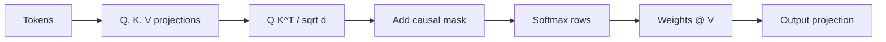

# LF02 - Attention and the causal mask {#lf02}

**Section path:** [Overview](index.md) · **Module 6** · [Assessment](assessment.md)

| | |
| --- | --- |
| **Study time** | 3 hours |
| **Hardware** | CPU-only |
| **Prerequisites** | [LF01](lf01-tokens-and-embeddings.md) |
| **You will produce** | A single-head attention function with a verified causal mask |


## Learning objectives

By the end of this lesson you can:

* compute scaled dot-product attention by hand for a small sequence
* apply a causal mask and explain what it prevents
* explain why multiple heads can represent different relations

## Attention is a weighted lookup

For each position, attention builds a query from the current token, compares it
with keys from every position, and takes a weighted sum of their values:

```text
scores = Q K^T / sqrt(d_k)
weights = softmax(scores, dim=-1)
output = weights V
```

The `sqrt(d_k)` keeps the dot products from growing with dimension, which would
saturate the softmax and kill gradients.

## The causal mask is the whole game for language models

A next-token model must not see the token it is predicting. Before the softmax,
set every score where `j > i` to negative infinity:

```python
def causal_mask(seq_len):
    return torch.triu(torch.full((seq_len, seq_len), float("-inf")), diagonal=1)

scores = q @ k.transpose(-2, -1) / math.sqrt(q.size(-1))
scores = scores + causal_mask(seq_len)   # broadcast over batch and heads
weights = torch.softmax(scores, dim=-1)
out = weights @ v
```

If the mask is wrong, training loss can look excellent and generation collapses:
the model has learned to copy the answer from the future. This is one of the few
bugs that produces a **better** training curve than the correct implementation.

The notebook includes a test that fails if any position attends to a later one.
That test is more valuable than the loss curve.

## Beginner: an intuition that survives

Attention answers: "which earlier tokens help me predict this one?" In
`"The cat sat on the ___"`, the query at the blank attends strongly to `cat` and
`sat`. The weights are not explanations; they are a routing mechanism that the
next layer reads.

## Intermediate: multi-head attention

One head can only express one weighting pattern. Multi-head attention runs `h`
independent projections and concatenates the results:

```text
head_i = Attention(Q W_i^Q, K W_i^K, V W_i^V)
output = Concat(head_1, ..., head_h) W^O
```

The notebook's tiny model uses 4 heads with width 96, so each head has 24
dimensions. Total parameter count is unchanged relative to one 96-dimensional
head, but the model can represent several relationships at once.

## Advanced: complexity and the context budget

Attention cost grows with the square of sequence length. Doubling context
quadruples the score matrix. For a 128-token teaching model this is irrelevant; for
a 128k-token production model it is the dominant cost.

Techniques that change the trade-off: sliding-window attention, sparse attention,
flash attention (same math, better memory access), and KV caching at inference.
A KV cache stores past keys and values so each new token is one step, not a full
recompute; it costs memory proportional to context and layers.

## Diagram: masked attention



```text
allowed (4 tokens):          blocked:
x . . .                      -inf -inf -inf
x x . .               +       x    -inf -inf
x x x .                       x     x   -inf
x x x x                       x     x    x
```

## Practice

1. Remove the mask and train for 50 steps. Report the loss and sample a
   continuation. Explain the result.
2. Mask only the diagonal instead of the strict upper triangle. What does the model
   see, and why is that still leakage?
3. Increase heads from 4 to 8 at the same width. Report parameter count and loss
   after 100 steps.
4. Compute the attention matrix size for sequence lengths 128, 1024, and 8192.
   How much memory does one fp32 matrix need?

## Common mistakes

* **Masking after the softmax.** Set scores to `-inf` before softmax, then masked
  weights become zero.
* **Using the wrong triangle.** `triu(diagonal=1)` blocks the future; `tril` keeps
  it.
* **Forgetting to scale by `sqrt(d_k)`.** Training becomes unstable at larger
  widths.
* **Sharing the mask across heads incorrectly.** The mask is the same; the
  projections are not.
* **Treating attention weights as explanations.** They are one layer's routing.

## Knowledge checks

1. Why does an unmasked model show a low training loss?
   *It can copy the target token from the input sequence, so next-token prediction
   becomes trivial.*
2. What does the scaling factor prevent?
   *Large dot products that push softmax into saturation, where gradients vanish.*
3. What is the parameter cost of multi-head attention relative to one head of the
   same total width?
   *Approximately the same, because the projections split the width.*
4. What does a KV cache trade?
   *Memory for compute: past keys and values are stored so generation is linear
   per token instead of quadratic.*

## Lab connection

[Lab 1](labs/lab-1-tiny-lm.md) requires the mask test to pass before training. A
model that cannot pass the mask test is not eligible for marks, regardless of its
loss.

## Further reading

* Vaswani et al., *Attention Is All You Need* (2017).
* Dao et al., *FlashAttention* (2022).
* Elhage et al., *A Mathematical Framework for Transformer Circuits* (2021).

---

**Previous:** [LF01 - Tokens and embeddings](lf01-tokens-and-embeddings.md)
**Next:** [LF03 - The transformer block](lf03-transformer-block.md)
