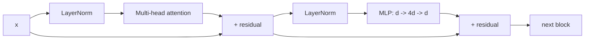

# LF03 - The transformer block, assembled {#lf03}

**Section path:** [Overview](index.md) · **Module 6** · [Assessment](assessment.md)

| | |
| --- | --- |
| **Study time** | 3 hours |
| **Hardware** | CPU-only |
| **Prerequisites** | [LF02](lf02-attention.md) |
| **You will produce** | A parameter-count derivation that matches the implementation |


## Learning objectives

By the end of this lesson you can:

* assemble a transformer block from attention, normalization, and an MLP
* explain the residual stream and the order of pre-norm operations
* count parameters and predict which part dominates

## A block in four parts

```text
x = x + Attention(LayerNorm(x))      # token mixing
x = x + MLP(LayerNorm(x))            # channel mixing
```

That is a pre-norm transformer block. The residual connections let gradients reach
early layers; the layer norms stabilise the scale; the MLP gives each position
non-linear capacity.

The notebook's `TinyGPT` stacks 2 blocks with width 96, 4 heads, and a 128-token
context. The model reports **239,040** parameters, and the lesson's derivation must
match that number.

## Beginner: why residuals

Without a residual path, a deep stack has to learn the identity mapping through
every layer, and gradients shrink. With `x + f(x)`, a layer can start near zero and
learn a small correction. The signal has a direct path from input to output.

## Intermediate: parameter arithmetic

For vocabulary `V=90`, width `d=96`, context `T=128`, blocks `L=2`:

| Component | Formula | Count |
| --- | --- | --- |
| token embedding | `V * d` | 8,640 |
| position embedding | `T * d` | 12,288 |
| per block: LayerNorm 1 | `2 * d` | 192 |
| per block: QKV projection | `3 * d * d` (+ bias if used) | 27,648 |
| per block: attention output | `d * d` | 9,216 |
| per block: LayerNorm 2 | `2 * d` | 192 |
| per block: MLP up | `d * 4d` | 36,864 |
| per block: MLP down | `4d * d` | 36,864 |
| per block total (no bias) | | 110,976 |
| two blocks | | 221,952 |
| final LayerNorm | `2 * d` | 192 |
| output head | `d * V` | 8,640 |
| **total** | | **239,040** |

The exact total depends on whether biases are used. The notebook's measured total
matches the formula it prints; if yours is off by a few hundred, check biases and
the final norm before changing the architecture.

## Advanced: pre-norm vs post-norm

The original transformer applied the norm after the residual add. Pre-norm
(`x + f(norm(x))`) is easier to train at depth and is standard in modern language
models. Post-norm can be slightly better after careful warmup but is less stable.

Other choices that matter:

* **GELU vs ReLU.** GELU is smooth and standard in transformers; ReLU is cheaper.
* **Dropout.** Often disabled in large pretrained models, useful in small ones.
* **Weight tying.** Sharing the output head with the token embedding saves
  `V*d` parameters and often helps small models.
* **Bias terms.** Modern models often omit them in linear layers; they add few
  parameters but change the arithmetic.

## Diagram: pre-norm block



## Practice

1. Derive the parameter count with biases included. How many parameters are added
   per block?
2. Switch to post-norm and train for 200 steps. Compare loss stability in the first
   20 steps.
3. Tie the output head to the embedding. Report the new parameter count and the
   loss after the same number of steps.
4. Change the MLP expansion from 4x to 2x. Report parameters and validation loss.

## Common mistakes

* **Forgetting the final LayerNorm before the head.**
* **Applying the mask only in the first block.**
* **Letting the residual stream width change between blocks.**
* **Counting parameters without checking the implementation's print.**
* **Assuming a bigger MLP always helps.** At fixed data, it can overfit.

## Knowledge checks

1. Why do residual connections help optimisation?
   *They provide a direct path for gradients and let layers learn small corrections
   instead of full transformations.*
2. What does pre-norm change relative to post-norm?
   *The norm is applied inside the residual branch, which stabilises deep stacks
   without a long warmup.*
3. Where does most of a block's parameter count sit?
   *The MLP, specifically the two `d x 4d` matrices.*
4. Why is the output head `d x V`?
   *It produces one logit per vocabulary item for next-token prediction.*

## Lab connection

[Lab 1](labs/lab-1-tiny-lm.md) requires a parameter table that matches the model's
reported count. An unexplained mismatch is a fail on the "implementation
understanding" criterion.

## Further reading

* Vaswani et al., *Attention Is All You Need* (2017).
* Xiong et al., *On Layer Normalization in the Transformer Architecture* (2020).
* Radford et al., *GPT-2* technical report - architecture choices.

---

**Previous:** [LF02 - Attention](lf02-attention.md)
**Next:** [LF04 - Training a tiny language model](lf04-tiny-lm-training.md)
