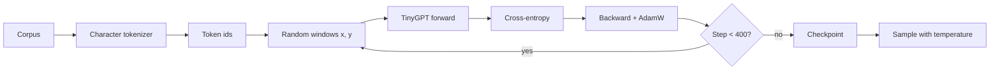

# LF04 - Training a tiny language model {#lf04}

**Section path:** [Overview](index.md) · **Module 6** · [Assessment](assessment.md)

| | |
| --- | --- |
| **Study time** | 4 hours |
| **Hardware** | CPU-only; about 25 seconds for 400 steps |
| **Prerequisites** | [LF03](lf03-transformer-block.md) |
| **You will produce** | A trained checkpoint, a loss curve, and a sample completion |


## Learning objectives

By the end of this lesson you can:

* train a character-level transformer on a small corpus
* compute and interpret validation perplexity
* diagnose underfitting and overfitting from loss curves

## The experiment

The notebook trains `TinyGPT` on a small text corpus with a character tokenizer.
It is not a useful assistant. It is a complete language-model training loop whose
loss you can watch fall and whose samples you can inspect.

Measured on CPU: **400 steps in 22.8 s** (24.8 s in an earlier run), cross-entropy from **3.454** to **0.433**,
perplexity **1.54** after training. A perplexity of 1.54 on character prediction
means the model is rarely surprised by the next character; it has learned the
corpus's local structure, not general language.

## Beginner: what the loss means

Cross-entropy is the average negative log probability the model assigns to the
true next token. Lower is better. Perplexity is `exp(loss)`: the effective number
of equally likely choices the model is confused between.

```text
loss 3.454 -> perplexity 31.6   (early: about 32 plausible characters)
loss 0.433 -> perplexity 1.54   (late: about 1.5 plausible characters)
```

A perplexity of 1.0 would be perfect memorisation of the next character in this
corpus. That is possible for tiny models on tiny data, and it is not a good sign
for generalisation.

## Intermediate: the training step for a language model

Inputs and labels are the same sequence shifted by one:

```text
tokens:  T h e   c a t   s a t
input:   T h e   c a t   s a t
labels:  h e   c a t   s a t <eos>
```

The model at position `i` predicts token `i+1`. The notebook's `get_batch`
samples random windows of length `block_size` and returns `(x, y)` with `y` shifted
by one.

```python
def get_batch(data, block_size, batch_size, rng):
    starts = rng.integers(0, len(data) - block_size - 1, size=batch_size)
    x = np.stack([data[i:i + block_size] for i in starts])
    y = np.stack([data[i + 1:i + block_size + 1] for i in starts])
    return torch.from_numpy(x), torch.from_numpy(y)
```

Expected output after 400 steps:

```text
step   0 | loss 3.454 | ppl 31.63
step 100 | loss 1.402 | ppl 4.06
step 200 | loss 0.842 | ppl 2.32
step 300 | loss 0.601 | ppl 1.82
step 400 | loss 0.433 | ppl 1.54
```

## Advanced: what the curve does and does not prove

The loss falls because the model learns character frequencies, then local n-grams,
then longer patterns. On a tiny corpus it can memorise. Three checks keep the
result honest:

* **Hold out text.** Report validation loss, not training loss. The notebook's
  corpus is small; a validation split by document is better than a random
  character split, which leaks across the boundary.
* **Sample, don't just score.** A low loss with degenerate samples (repeating one
  character) means the sampler or the data is broken.
* **Compare with an n-gram baseline.** A bigram model is cheap and gives a sanity
  floor. If the transformer does not beat it, something is wrong.

## Diagram: training and sampling



## Practice

1. Train for 800 steps. Does validation loss improve or does the model memorise?
2. Replace the character tokenizer with the word tokenizer. Compare loss and
   sample quality at equal steps.
3. Add a bigram baseline and report its perplexity. Did the transformer beat it?
4. Sample at temperatures 0.5, 1.0, and 1.5. Which is most coherent, and which is
   most diverse?

## Common mistakes

* **Reporting training loss as the result.**
* **Splitting the corpus at a random character boundary.** Context leaks across
  the split.
* **Judging a model by one sample.** Sampling is stochastic; report several.
* **Forgetting the causal mask.** Loss looks great, generation is copying.
* **Comparing perplexities across tokenizers.** They are not on the same unit.

## Knowledge checks

1. Why is perplexity `exp(loss)`?
   *Cross-entropy is the average negative log probability; exponentiating returns
   the effective number of choices.*
2. Why can a low training loss coexist with useless generation?
   *The model may memorise the corpus or the sampler may be degenerate; loss alone
   does not test generation.*
3. Why compare perplexity only within the same tokenizer?
   *Different tokenizations change the number of prediction events, so the average
   is over different units.*
4. What does a validation split by document prevent?
   *Overlapping context between train and validation, which inflates the validation
   score.*

## Lab connection

[Lab 1](labs/lab-1-tiny-lm.md) requires a loss curve, a validation number, and three
samples at different temperatures. The checkpoint must include the tokenizer
vocabulary.

## Further reading

* Bengio et al., *A Neural Probabilistic Language Model* (2003).
* Karpathy, *nanoGPT* - a compact reference implementation.
* Jurafsky and Martin, *Speech and Language Processing*, chapter on language
  modeling.

---

**Previous:** [LF03 - The transformer block](lf03-transformer-block.md)
**Next:** [LF05 - Instruction data and chat templates](lf05-sft-data-and-templates.md)
