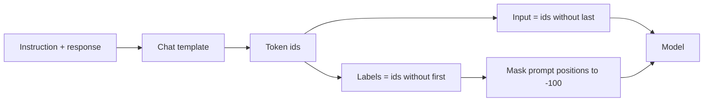

# LF05 - Instruction data and chat templates {#lf05}

**Section path:** [Overview](index.md) · **Module 7** · [Assessment](assessment.md)

| | |
| --- | --- |
| **Study time** | 3 hours |
| **Hardware** | CPU-only |
| **Prerequisites** | [LF04](lf04-tiny-lm-training.md) |
| **You will produce** | A templated instruction dataset and a token-level inspection |


## Learning objectives

By the end of this lesson you can:

* convert examples into instruction, input, and response fields
* apply one chat template consistently at training and inference
* split by template or source so evaluation measures generalisation

## SFT is next-token prediction on a conversation

Supervised fine-tuning (SFT) teaches a base model to answer instructions by
training it on (instruction, response) pairs. The loss is still next-token
prediction; the data changes what the model is rewarded for predicting.

The notebook's FAQ data has 152 pairs split 120/16/16. The splits are disjoint by
**question template**, not by topic: the test score measures paraphrase
robustness, not memorisation of a topic. That is a deliberate, documented choice.

## The chat template is a format contract

A template turns roles and messages into one string:

```text
<|user|>How do I reset my password?<|assistant|>Use the reset link on the sign-in page.<|end|>
```

The model learns this format. At inference, the same template must be used, or the
model sees a distribution it was not trained on. Chat templates are part of the
checkpoint's interface, not cosmetic formatting.

```python
def render(messages):
    parts = []
    for message in messages:
        parts.append(f"<|{message['role']}|>{message['content']}")
    return "".join(parts) + "<|end|>"
```

Expected output for a two-turn example:

```text
<|system|>You answer support questions.<|user|>Where is my order?<|assistant|>
```

## Beginner: what a good SFT example contains

* a clear instruction in the user turn;
* a response that is correct, complete, and in the target style;
* no hidden context the model cannot see at inference;
* a consistent format for special tokens;
* no personal data that should not be memorised.

Quality beats quantity. A few hundred clean examples often beat tens of thousands
of noisy ones, and the notebook's 120 training pairs are enough to move the
measured metrics because the task is narrow.

## Intermediate: masking the prompt

If you compute loss on the user's question as well as the answer, the model learns
to generate questions. Usually you want loss on the assistant tokens only. That
requires labels of `-100` (PyTorch's ignore index) for prompt positions, and the
shift by one must happen **before** masking:

```python
input_ids = tokens[:-1]
labels = tokens[1:].clone()
labels[prompt_length - 1:] = -100   # keep only assistant tokens
```

The exact index depends on whether the template includes the assistant marker. The
notebook's bug fix was precisely this: labels were not shifted, so the model
predicted the token it was given and the loss collapsed. MT06/LF06 covers the
shift in detail.

## Advanced: data mixtures and failure modes

An SFT set defines a behaviour distribution. Common failure modes:

* **Template leakage.** Every answer starts with "Sure!" because every training
  answer does.
* **Refusal imbalance.** The model learns to refuse anything that looks like a
  sensitive topic, including benign requests.
* **Length bias.** Long answers dominate the token-level loss; short correct
  answers are underweighted.
* **Contradictory pairs.** The same question has two different answers; the model
  averages them.

Audit the data for these before training, not after.

## Diagram: from pair to tensors



## Practice

1. Render five examples with the template. Check that decoding the token ids
   reproduces the string exactly.
2. Train once with prompt loss unmasked and once masked. Compare answer accuracy
   and the model's tendency to generate questions.
3. Add ten examples with a different answer style. Does the model adopt it?
4. Find a contradictory pair in the FAQ data. What would you do with it?

## Common mistakes

* **Using a different template at inference.**
* **Masking after the shift.** The assistant's first token is lost or the prompt's
  last token is trained.
* **Training on the test split's templates.**
* **Ignoring answer length distributions.**
* **Assuming more pairs always help.** Contradictions and style artefacts scale.

## Knowledge checks

1. Why is the loss still next-token prediction in SFT?
   *The objective is unchanged; only the data distribution and the label mask
   change.*
2. What does masking the prompt do?
   *It removes the model's incentive to generate user turns and focuses capacity on
   responses.*
3. Why split FAQ by template rather than by row?
   *Row splits share paraphrases and inflate the score; template splits measure
   generalisation to new phrasings.*
4. Why is the chat template part of the interface?
   *The model learned token patterns tied to the template; changing it changes the
   input distribution.*

## Lab connection

[Lab 2](labs/lab-2-sft-and-lora.md) requires a template function, a tokenized
example, and a masked-label check. Include one example where the prompt would be
trained without the mask, and show the difference.

## Further reading

* Wei et al., *Finetuned Language Models Are Zero-Shot Learners* (2021).
* Ouyang et al., *InstructGPT* (2022).
* Hugging Face, *Chat templates* documentation.

---

**Previous:** [LF04 - Training a tiny language model](lf04-tiny-lm-training.md)
**Next:** [LF06 - The SFT loss and label masking](lf06-sft-loss-and-masking.md)
