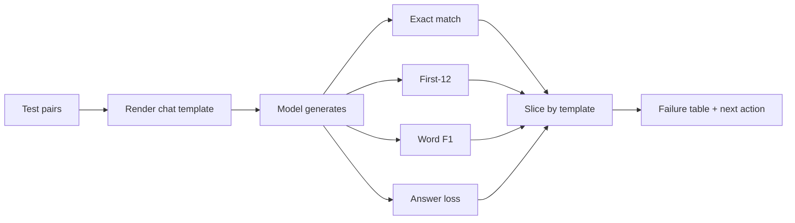

# LF07 - Evaluating a fine-tuned assistant {#lf07}

**Section path:** [Overview](index.md) · **Module 7** · [Assessment](assessment.md)

| | |
| --- | --- |
| **Study time** | 3 hours |
| **Hardware** | CPU-only |
| **Prerequisites** | [LF06](lf06-sft-loss-and-masking.md) |
| **You will produce** | An evaluation table with four metrics and a failure analysis |


## Learning objectives

By the end of this lesson you can:

* choose exact match, token F1, or a task-specific metric for an assistant
* measure held-out quality and forgetting on a retained task
* report a result with n, the split rule, and the failure cases

## Loss is not the product

A fine-tuned assistant is judged on answers, not on average token log-likelihood.
The notebook reports four metrics because each fails in a different way:

| Metric | What it measures | How it fails |
| --- | --- | --- |
| Answer loss | token fit to the reference | rewards fluent wrong answers |
| Exact match | whole answer equals reference | punishes valid paraphrases |
| First-12 accuracy | first 12 tokens match | measures opening style as much as content |
| Word F1 | content-word overlap | rewards verbose answers |

The measured SFT run: answer loss **0.315**, exact match **0.905**, first-12
**0.818**, word F1 **0.258**. The gap between exact match and word F1 is the
story: the model often gets the gist but not the exact wording, and word F1 is
harsh on short answers with one wrong content word.

## Beginner: build a small, fixed test set

Sixteen pairs is enough to see a direction, not enough to rank two close models.
The notebook's test split is disjoint by question template, so a high score means
the model handles new phrasings of the FAQ task, not new topics.

A useful test set has:

* one row per expected behaviour, not per training template;
* at least one unanswerable question (does it abstain?);
* at least one unsafe request (does it refuse?);
* at least one question with a numeric answer (does it copy the number correctly?);
* a stored reference answer and a scoring rule decided **before** the run.

## Intermediate: scoring without an LLM judge

The notebook's `word_f1` is a cheap, deterministic overlap score:

```python
def word_f1(prediction, reference):
    pred = set(re.findall(r"[a-z0-9]+", prediction.lower()))
    ref = set(re.findall(r"[a-z0-9]+", reference.lower()))
    if not pred or not ref:
        return 0.0
    overlap = len(pred & ref)
    precision = overlap / len(pred)
    recall = overlap / len(ref)
    return 0.0 if overlap == 0 else 2 * precision * recall / (precision + recall)
```

It is not semantic. "21 days" vs "three weeks" scores zero on the number, which is
why `gold_numbers` can be checked separately. When you use an LLM judge, pin the
model, the prompt, and the rubric, and report agreement with human labels on a
sample; an unvalidated judge is a random number generator with good manners.

## Advanced: slice and inspect

Aggregate scores hide failure families. Slice by:

* question template (does one phrasing fail?);
* answer type (numeric, yes/no, procedural);
* length (short vs long reference);
* refusal vs answer.

Then read the failures. The notebook's `generate_text` / `answer` helpers make it
easy to print prediction and reference side by side. A failure table with five
examples is worth more than a third decimal place.

## Diagram: evaluation loop



## Practice

1. Add a refusal case and an unanswerable case. Score them with a rule you write
   before running the model.
2. Compute word F1 for a correct paraphrase and for a fluent wrong answer. Which
   scores higher, and is that what you want?
3. Slice the 16 test pairs by template. Report the worst template.
4. Replace word F1 with an LLM judge and measure agreement with your own labels on
   ten examples.

## Common mistakes

* **Reporting loss as answer quality.**
* **Using the training templates in the test set.**
* **Letting the model see the reference during generation.**
* **Changing the scoring rule after seeing predictions.**
* **Using an LLM judge without validating it.**

## Knowledge checks

1. Why does exact match punish a correct paraphrase?
   *It requires the entire string to match, so any wording difference counts as
   wrong.*
2. What does first-12 accuracy capture that exact match does not?
   *Whether the answer starts correctly, which matters for style and for
   constrained decoding.*
3. Why is word F1 alone insufficient for numeric answers?
   *It treats tokens as independent and can miss a wrong number or reward the
   presence of a correct one in a wrong sentence.*
4. What must be fixed before comparing two models?
   *The test set, the prompt template, the decoding settings, and the scoring
   rule.*

## Lab connection

[Lab 2](labs/lab-2-sft-and-lora.md) requires a four-metric table and a failure
analysis. Include the base model's numbers; an improvement without a baseline is
not a result.

## Further reading

* Zheng et al., *Judging LLM-as-a-Judge with MT-Bench and Chatbot Arena* (2023).
* Liang et al., *Holistic Evaluation of Language Models* (2022).
* Google, *Model evaluation* guidance in the Tuning Playbook.

---

**Previous:** [LF06 - The SFT loss and masking](lf06-sft-loss-and-masking.md)
**Next:** [LF08 - LoRA](lf08-lora.md)
