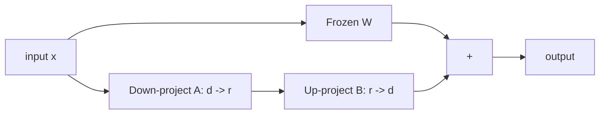

# LF08 - LoRA: fine-tuning a small number of parameters {#lf08}

**Section path:** [Overview](index.md) · **Module 8** · [Assessment](assessment.md)

| | |
| --- | --- |
| **Study time** | 3 hours |
| **Hardware** | CPU-only for the teaching model |
| **Prerequisites** | [LF06](lf06-sft-loss-and-masking.md) |
| **You will produce** | A LoRA adapter, a merge check, and a trainable-parameter table |


## Learning objectives

By the end of this lesson you can:

* explain how a low-rank update reduces trainable parameters
* implement LoRA adapters and merge them into the base weights
* measure the quality and parameter trade-off against full fine-tuning

## The idea

Full fine-tuning updates every weight. LoRA freezes the base model and adds a
low-rank update to selected linear layers:

```text
W' = W + (alpha / r) * B A
```

`A` is `r x d_in`, `B` is `d_out x r`, and `r` is small. Only `A` and `B` receive
gradients. At inference, `B A` can be merged into `W`, so the served model has the
same architecture and no extra latency.

## Measured in the notebook

The teaching model has 239,040 parameters. LoRA with `r=4` on six attention and
MLP projections adds **8,448** trainable parameters, **3.34%** of the model.

| Method | Trainable | Answer loss | Exact match |
| --- | --- | --- | --- |
| full SFT | 244,608 | 0.315 | 0.905 |
| LoRA `r=4` | 8,448 | 0.601 | 0.816 |

LoRA is worse on both metrics at this budget. That is the honest result: fewer
parameters and fewer steps buy less fit. The efficiency argument is about memory
and storage, not free quality.

## Beginner: where to attach adapters

Common choices, in order of parameter efficiency:

* query and value projections only;
* all attention projections (Q, K, V, O);
* attention plus MLP;
* every linear layer.

More adapters means more trainable parameters and more capacity. The notebook
attaches to the attention projections, which is the standard starting point.

## Intermediate: rank, alpha, and learning rate

* **Rank `r`** controls capacity. `r=4` to `r=16` is typical for small tasks.
* **Alpha** scales the update; `alpha/r` is a common convention, but the effective
  learning rate also depends on initialization.
* **Learning rate** for LoRA is usually higher than full fine-tuning (the notebook
  uses a larger rate because only a small subspace moves).
* **Dropout** on the LoRA path can regularise; it is optional.

A LoRA adapter is small enough to version per task. Ten adapters can share one
base model in memory, which is the operational reason LoRA is popular.

## Advanced: merging and its numerical cost

```python
def merge_lora(linear, lora):
    with torch.no_grad():
        linear.weight.add_(lora.B @ lora.A * lora.scale)
```

The notebook checks the merged model against the unmerged model: maximum absolute
difference **6.7e-6**. That is floating-point noise, not a behavioural change.
Always run this check; a merge with the wrong scale or a transposed factor
produces a model that looks fine and answers differently.

Merging is irreversible in the artifact unless you keep the adapter. Keep both:
the merged model for serving, the adapter for provenance and further training.

## Diagram: LoRA in a linear layer



## Practice

1. Attach LoRA to Q and V only, then to all attention projections. Compare
   trainable parameters and exact match.
2. Sweep `r` over 2, 4, 8, 16 at fixed steps. Plot exact match and trainable
   parameters.
3. Merge the adapter and verify the maximum difference is below 1e-4. Then merge
   with the wrong scale and report the difference.
4. Save two adapters and load them sequentially into one base model. Do the answers
   change as expected?

## Common mistakes

* **Training the base model by accident** because parameters were not frozen.
* **Merging twice.** The update is applied twice and the model drifts.
* **Using the wrong scale at merge time.**
* **Comparing LoRA and full fine-tuning at different step counts.**
* **Assuming LoRA cannot overfit.** It can, especially at high rank.

## Knowledge checks

1. What does LoRA freeze, and what does it train?
   *It freezes the base weights and trains the low-rank `A` and `B` matrices.*
2. Why can a merged LoRA model serve with no latency penalty?
   *The low-rank update is added into the existing weight matrix, so the forward
   pass is unchanged.*
3. What does the 6.7e-6 merge difference represent?
   *Floating-point rounding from the matrix addition, not a semantic change.*
4. Why is LoRA's lower exact match not a failure of the method?
   *It trained 3.34% of the parameters; the comparison is at a fixed budget, and
   the efficiency gain is memory and storage.*

## Lab connection

[Lab 2](labs/lab-2-sft-and-lora.md) requires a LoRA run with trainable-parameter
accounting and a merge check. Report both the adapter and the merged artifact.

## Further reading

* Hu et al., *LoRA: Low-Rank Adaptation of Large Language Models* (2021).
* Dettmers et al., *QLoRA* (2023).
* Hugging Face PEFT documentation - adapter configuration in practice.

---

**Previous:** [LF07 - Evaluating assistants](lf07-evaluating-assistants.md)
**Next:** [LF09 - Quantization and QLoRA](lf09-quantization-and-qlora.md)
