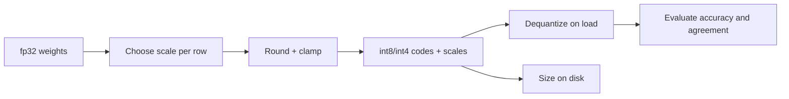

# LF09 - Quantization and QLoRA {#lf09}

**Section path:** [Overview](index.md) · **Module 8** · [Assessment](assessment.md)

| | |
| --- | --- |
| **Study time** | 3 hours |
| **Hardware** | CPU-only; no bitsandbytes or GPU required |
| **Prerequisites** | [LF08](lf08-lora.md) |
| **You will produce** | A size/accuracy table for fp32, int8, and int4 |


## Learning objectives

By the end of this lesson you can:

* quantize weights to int8 and int4 and measure the error introduced
* compare size, accuracy, and per-item agreement
* explain why QLoRA keeps adapters in higher precision

## Quantization in one sentence

Store weights in fewer bits, and optionally compute in a higher precision, to
trade a small accuracy change for a large memory reduction.

The notebook quantizes the fine-tuned teaching model and measures both size and
behaviour:

| Format | Size | Compression | Exact match | Agreement with fp32 |
| --- | --- | --- | --- | --- |
| fp32 | 976 KiB | 1.00x | 0.905 | 1.000 |
| int8 | 259.8 KiB | 3.758x | 0.905 | 0.992 |
| int4 | 139.1 KiB | 7.022x | 0.900 | 0.895 |

The int8 model preserves the answer accuracy and agrees on 99.2% of predictions.
Int4 saves more memory and loses half a point of exact match; agreement falls to
89.5%, which means roughly one in ten predictions changed even when the aggregate
score held.

## Beginner: what the numbers mean

Compression is `fp32_bytes / quantized_bytes`. A 7x reduction is the difference
between a model that fits on a device and one that does not.

Agreement is the fraction of test items where the quantized model's prediction
equals the fp32 model's. It is stricter than accuracy: two models can have the same
accuracy and disagree on many items, which matters if you are comparing behaviour
rather than score.

## Intermediate: symmetric quantization

For a weight tensor, choose a scale so the range maps to integers:

```text
scale = max(abs(W)) / q_max
q = round(W / scale).clamp(-q_max, q_max)
W_hat = q * scale
```

int8 uses `q_max=127`; int4 uses `q_max=7`. Per-tensor scaling is simple;
per-channel scaling reduces error by giving each output row its own scale. The
notebook's quantizer uses per-row scales, which is why its size is slightly above
one byte per weight.

Quantization error is not uniform: weights near zero are represented coarsely
relative to their magnitude, and outlier channels dominate the scale. That is why
outlier-aware methods (LLM.int8, AWQ, GPTQ) exist.

## Advanced: QLoRA

QLoRA keeps the frozen base model in 4-bit NF4 and trains LoRA adapters in bf16.
The base is dequantized on the fly for each matmul, so memory is dominated by the
4-bit weights plus the adapter's optimizer state. Paged optimizers move optimizer
state to CPU memory to survive spikes.

The notebook does **not** implement NF4 or paged optimizers, and it does not run a
GPU. Its QLoRA table is parameter-memory arithmetic under stated assumptions. The
lesson to take is the accounting, not a claimed speedup:

```text
full fine-tune: 16 bytes/parameter (fp32 weights, grads, two Adam moments)
LoRA:           4 bytes/parameter for frozen weights + 16 bytes/adapter value
QLoRA int4:     0.5 bytes/parameter + scale overhead + adapter state
```

Activations and temporary buffers are excluded, and at realistic batch sizes they
dominate. Gradient checkpointing addresses that part of the budget.

## Diagram: quantization pipeline



## Practice

1. Quantize with per-tensor scales instead of per-row. Compare size and agreement.
2. Quantize only the MLP weights, leaving attention in fp32. Measure size and
   exact match.
3. Find a test item where int4 and fp32 disagree. Inspect the weights involved and
   explain a plausible cause.
4. Compute the QLoRA memory table for a 1B-parameter model with `r=16` adapters on
   Q and V of 24 layers. State your assumptions.

## Common mistakes

* **Reporting compression without accuracy or agreement.**
* **Comparing quantized and fp32 models at different temperatures or prompts.**
* **Assuming int4 always preserves accuracy.**
* **Forgetting scale overhead in the size calculation.**
* **Claiming a QLoRA speedup without a GPU measurement.**

## Knowledge checks

1. Why is agreement stricter than accuracy?
   *Two models can have equal accuracy while disagreeing on which items they get
   right; agreement checks per-item behaviour.*
2. What does per-row scaling buy?
   *It prevents one outlier row from forcing a coarse scale on every row, reducing
   quantization error.*
3. Why does QLoRA keep adapters in higher precision?
   *The adapter gradients and optimizer state need range and stability; only the
   frozen base is quantized.*
4. What dominates memory during real training that this table excludes?
   *Activations and temporary buffers, especially at long sequence lengths.*

## Lab connection

[Lab 3](labs/lab-3-efficiency-report.md) requires a size/accuracy/agreement table
and a memory budget with assumptions. A table without the agreement column is
incomplete.

## Further reading

* Dettmers et al., *QLoRA: Efficient Finetuning of Quantized LLMs* (2023).
* Dettmers et al., *LLM.int8()* (2022).
* Frantar et al., *GPTQ* (2022).

---

**Previous:** [LF08 - LoRA](lf08-lora.md)
**Next:** [LF10 - Merging and serving adapters](lf10-merging-and-serving.md)
