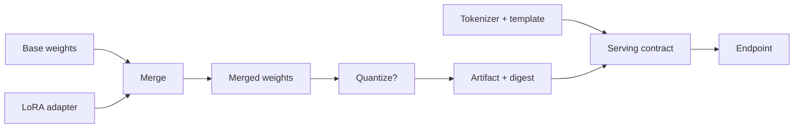

# LF10 - Merging and serving adapters {#lf10}

**Section path:** [Overview](index.md) · **Module 8** · [Assessment](assessment.md)

| | |
| --- | --- |
| **Study time** | 2.5 hours |
| **Hardware** | CPU-only |
| **Prerequisites** | [LF08](lf08-lora.md), [LF09](lf09-quantization-and-qlora.md) |
| **You will produce** | A merged artifact, a verification report, and a serving contract |


## Learning objectives

By the end of this lesson you can:

* merge an adapter and verify the merged model matches the adapter output
* export the artifact with tokenizer and configuration
* state the serving contract: input format, limits, and failure behaviour

## Two artifacts, one model

An adapter is a small delta; a merged model is a full weight file. You need both:

* **Adapter** for provenance, further training, and switching tasks;
* **Merged model** for serving without adapter-loading code.

The merge is a numerical operation with a verification step. The notebook checks
the maximum absolute difference between merged and unmerged predictions: **6.7e-6**.
Anything much larger means the scale, the transpose, or the target layer is wrong.

## Beginner: the serving contract

A served model has an interface beyond the weights:

| Contract item | Why it matters |
| --- | --- |
| Tokenizer + vocab | ids must match training |
| Chat template | the model learned one format |
| Max context | beyond it, predictions degrade or crash |
| Stop tokens | generation must end deterministically |
| Dtype/quantization | changes logits slightly; document it |
| Model version + digest | reproducibility and rollback |

Changing the template or the stop token at serving time is a distribution shift,
not a configuration tweak.

## Intermediate: merging multiple adapters

Two adapters trained on different tasks can be merged if they target disjoint
layers, or combined with a weighted sum if they share layers. Weighted merging is
not guaranteed to preserve either behaviour:

```text
W' = W + a * delta_task_a + b * delta_task_b
```

Test both tasks after merging. If both degrade, serve separate adapters and route
by task. Sharing one base model with several adapters is usually cheaper than
merging them into one compromised model.

## Advanced: batching and KV cache

Serving a decoder involves a KV cache. Each request keeps past keys and values for
its sequence; memory grows with batch size × context × layers × heads. A continuous
batching server packs requests of different lengths and evicts finished sequences.
The notebook does not implement a server; it measures the model's forward pass and
prompts you to state the missing production pieces.

Quantized serving adds a dequantization step per matmul. On CPU it can be slower
than fp32 for small matrices, just as bf16 was in MT05. Measure on the target
hardware.

## Diagram: adapter to service



## Practice

1. Merge an adapter with scale 1.0 and with scale 0.5. Measure the maximum logit
   difference on ten prompts.
2. Serve the merged model with the wrong chat template. Compare exact match with
   the correct template.
3. Merge two adapters with weights 0.5/0.5. Evaluate both tasks before and after.
4. Write a serving contract for your model: template, stop tokens, context limit,
   dtype, digest, and a rollback artifact.

## Common mistakes

* **Merging without a numerical check.**
* **Losing the tokenizer or template when exporting.**
* **Serving a quantized model without re-evaluating.**
* **Assuming merged multi-task adapters preserve both skills.**
* **No rollback artifact.** A digest without a previous version cannot roll back.

## Knowledge checks

1. Why keep the adapter after merging?
   *For provenance, further training, and re-merging with a different base or
   scale.*
2. What does the 6.7e-6 difference tell you?
   *The merge is numerically equivalent to running the adapter, up to floating
   point.*
3. Why is the chat template part of the serving contract?
   *The model's behaviour depends on the token pattern it was trained with.*
4. When should two adapters be served separately rather than merged?
   *When merging degrades either task; routing by task preserves both.*

## Lab connection

[Lab 3](labs/lab-3-efficiency-report.md) requires a merged artifact with a digest
and a verification report. Include the adapter file and the base version.

## Further reading

* Hu et al., *LoRA* (2021), section on merging.
* vLLM, *PagedAttention* (2023) - KV cache and continuous batching.
* Hugging Face, *PEFT* documentation - merge_and_unload and adapter composition.

---

**Previous:** [LF09 - Quantization and QLoRA](lf09-quantization-and-qlora.md)
**Next:** [M15 - AI agents](../ai-agents/index.md)
