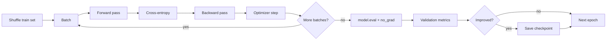

# MT01 - The training loop, end to end {#mt01}

**Section path:** [Overview](index.md) · **Module 4** · [Assessment](assessment.md)

| | |
| --- | --- |
| **Study time** | 3 hours: 1 h reading, 2 h practice |
| **Hardware** | CPU-only for the notebook; GPU optional |
| **Prerequisites** | [F11 - Neural networks](../f11-neural-networks/index.md), [F12 - Backpropagation](../f12-backpropagation/index.md) |
| **You will produce** | A runnable training loop with a measured baseline, a validation curve, and a checkpoint |


## Learning objectives

By the end of this lesson you can:

* write a training loop from forward pass to optimizer step without a framework trainer
* explain why gradients are zeroed, why train/eval mode matters, and why validation uses no_grad
* read a loss and validation curve and name the likely cause when it stalls

## Why this module exists

Frameworks hide the loop, and that is usually good. It becomes a problem the first
time a loss does not move: without knowing which line updates which tensor, you
debug by guessing. This module rebuilds the loop in plain PyTorch so every step is
visible: forward pass, loss, backward pass, optimiser step, zeroing gradients,
validation, scheduling, and stopping.

The notebook (`notebooks/model-training/m04_training_from_scratch.ipynb`) trains a
small CNN on a synthetic three-shape dataset. It is deliberately small: 300
images, 72,499 parameters, seconds per run. Small enough to rerun, large enough
that the curves mean something.

## The five lines that matter

```python
for images, labels in loader:
    logits = model(images)              # forward
    loss = criterion(logits, labels)    # scalar objective
    optimizer.zero_grad(set_to_none=True)
    loss.backward()                     # gradients
    optimizer.step()                    # parameter update
```

Three details are easy to get wrong:

1. **Zero the gradients.** PyTorch accumulates by default. Forget this line and
   the effective learning rate grows with every batch.
2. **Call `model.train()` and `model.eval()`.** Dropout and batch normalisation
   behave differently in each mode. Validation in train mode produces numbers you
   cannot reproduce at inference.
3. **Do not build the graph during validation.** `torch.no_grad()` cuts memory and
   time; without it, a long validation pass can exhaust a GPU for no reason.

## Beginner: what one step computes

For a batch of `B` images with `C` classes, the model produces a `B x C` matrix of
logits. Cross-entropy compares each row with the integer label:

```text
loss = mean over rows of -log( softmax(logits)[correct class] )
```

The gradient of that scalar with respect to every parameter is what `backward()`
computes. The optimiser then applies:

```text
parameter <- parameter - learning_rate * gradient
```

Nothing else is happening. Schedulers change the learning rate; weight decay adds
a term to the gradient; augmentation changes the input. The loop is stable.

## Intermediate: the notebook's measured baseline

The notebook trains the plain CNN for 25 epochs with a one-cycle schedule. The
measured result on its held-out split:

| Quantity | Measured |
| --- | --- |
| Test accuracy | 0.956 |
| Best validation accuracy | 1.000 |
| Train/validation gap at the end | 0.067 |
| Parameters | 72,499 |
| Wall-clock time | about 2.7 s |
| Checkpoint size | 0.29 MB |

A perfect validation score with a 0.956 test score is a warning, not a triumph:
45 validation images are too few to resolve small differences. The section's
split lesson (MT04) shows why the random split itself inflates the test score to
0.867 on a harder, source-grouped split that scores 0.622.

## Advanced: what the loop does not tell you

The loop reports a number. It does not tell you whether that number is stable.
Three habits separate a result from a claim:

* **Seed and record.** The notebook uses a fixed seed and reports every epoch.
  Rerunning must reproduce the curve, not just the final point.
* **Log the learning rate.** A loss plateau at step 200 often means the schedule
  annealed too early; without the rate in the log you cannot see it.
* **Keep the best checkpoint by validation, then evaluate once.** Selecting on
  test is leakage with extra steps.

```python
history = {"train_loss": [], "val_loss": [], "val_acc": [], "lr": []}
best = -1.0
for epoch in range(epochs):
    model.train()
    for images, labels in train_loader:
        ...
    model.eval()
    with torch.no_grad():
        val_loss, val_acc = evaluate(model, val_loader)
    history["val_acc"].append(val_acc)
    if val_acc > best:
        best = val_acc
        torch.save({"model": model.state_dict(), "epoch": epoch}, "best.pt")
```

Expected output shape (values vary by seed and machine):

```text
epoch 05 | train 0.412 | val 0.911 | lr 0.0021
epoch 10 | train 0.188 | val 0.978 | lr 0.0014
epoch 15 | train 0.091 | val 1.000 | lr 0.0006
best validation 1.000 at epoch 15
```

## Diagram: one epoch



## Practice

1. Remove `optimizer.zero_grad()` and run five epochs. Record the loss curve. Explain
   what you see using the accumulation rule.
2. Run validation with `model.train()` still active. Compare the reported accuracy
   with the checkpoint's test accuracy.
3. Replace the one-cycle schedule with a constant learning rate. Measure epochs to
   reach 0.90 validation accuracy. Which is faster, and at what final loss?
4. Save two checkpoints: best validation and last epoch. Evaluate both on test.
   Report the difference. Is the "best" checkpoint actually better?

## Common mistakes

* **Forgetting `zero_grad`.** Gradients accumulate; the run diverges slowly.
* **Evaluating in train mode.** Dropout makes validation noisy and pessimistic.
* **Computing loss on probabilities.** Cross-entropy expects logits; applying
  softmax first double-normalises and flattens gradients.
* **Reporting the last epoch instead of the selected checkpoint.**
* **Using test data to choose the stopping epoch.**

## Knowledge checks

1. Why does `loss.backward()` need a scalar?
   *It seeds the reverse pass with a single derivative; a vector loss would need
   one backward call per element or an explicit gradient.*
2. What does `set_to_none=True` change?
   *It frees gradient buffers instead of zeroing them, saving memory; the next
   backward pass allocates fresh buffers.*
3. Why is a perfect validation score on 45 images not evidence of perfection?
   *The interval is wide: with 45 samples, one error moves accuracy by about 2.2
   points, and selection on that split biases the estimate upward.*
4. What belongs in a checkpoint besides weights?
   *Class names, normalisation statistics, input size, preprocessing version,
   epoch, and the measured validation score.*

## Lab connection

[Lab 1](labs/lab-1-training-ablation.md) asks you to run this loop with three
learning rates and two augmentation settings, then defend one configuration with
a table. Use the notebook's `History` object; do not write a second training
framework.

## Further reading

* PyTorch, *Optimization loop* tutorial.
* Smith, *A disciplined approach to neural network hyper-parameters* (2018) -
  one-cycle schedules.
* Zhang et al., *Understanding deep learning requires rethinking generalization*
  (2017) - why perfect train fit is not the question.

---

**Previous:** [M03 - Deep learning foundations](../f11-neural-networks/index.md)
**Next:** [MT02 - Losses and optimizers](mt02-loss-and-optimizer.md)
