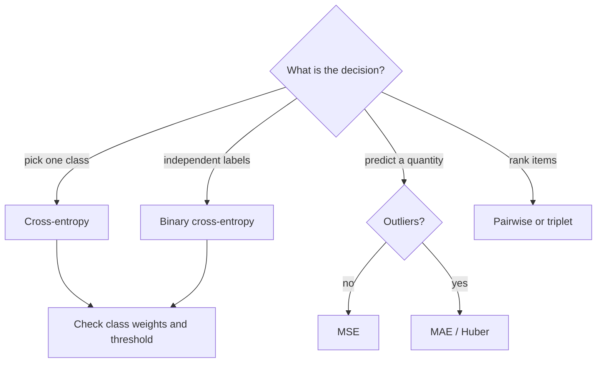

# MT02 - Losses, optimizers, and schedules {#mt02}

**Section path:** [Overview](index.md) · **Module 4** · [Assessment](assessment.md)

| | |
| --- | --- |
| **Study time** | 3 hours |
| **Hardware** | CPU-only |
| **Prerequisites** | [MT01](mt01-training-loop.md) |
| **You will produce** | A learning-rate sweep table and a justified optimizer choice |


## Learning objectives

By the end of this lesson you can:

* choose a loss function that matches the prediction task and label encoding
* compare SGD and Adam on the same run and explain the difference in update behaviour
* read a learning-rate sweep and place a schedule on it

## The loss is the specification

A loss function is the only part of training that states what "good" means. If the
loss does not match the decision the system will make, the model can optimise it
perfectly and still be useless.

| Task | Loss | Output layer | What it punishes |
| --- | --- | --- | --- |
| Multi-class, one label | cross-entropy | logits, `C` units | low probability on the true class |
| Binary or multi-label | binary cross-entropy | one logit per label | each label independently |
| Regression, Gaussian noise | mean squared error | linear | large errors quadratically |
| Regression, outliers | mean absolute error | linear | all errors linearly |
| Ranking | pairwise / triplet | embedding | wrong order, not wrong value |
| Imbalanced detection | focal / weighted CE | logits | easy examples dominate |

A class-balanced dataset with cross-entropy optimises average accuracy. If a false
negative costs ten times a false positive, average accuracy is the wrong
specification: weight the positive class or move the decision threshold after
training, and say which you did.

## Optimizers: what actually differs

Stochastic gradient descent follows the gradient. Momentum accumulates a velocity.
Adam normalises each coordinate by a running estimate of its gradient magnitude.

```text
SGD:     w <- w - lr * g
Momentum: v <- beta*v + g;  w <- w - lr*v
Adam:    m <- b1*m + (1-b1)*g
         v <- b2*v + (1-b2)*g^2
         w <- w - lr * m / (sqrt(v) + eps)
```

Adam is forgiving of unscaled features and a good default for transformers. SGD
with momentum plus a well-tuned schedule often generalises slightly better on
vision models. Neither difference is large enough to justify a claim without a
controlled run on your data.

## Schedules: where most of the gain hides

A constant learning rate is rarely optimal. The notebook uses linear warmup then
cosine decay:

```python
def lr_at(step, total, base_lr, warmup):
    if step < warmup:
        return base_lr * (step + 1) / warmup
    progress = (step - warmup) / max(1, total - warmup)
    return 0.5 * base_lr * (1 + math.cos(math.pi * progress))
```

Warmup prevents early divergence when Adam's second-moment estimate is still
noisy. Cosine decay lets the model settle instead of bouncing around the minimum.

## Worked example: a learning-rate sweep

The notebook trains the same CNN for four epochs at each rate, seed fixed:

```python
for lr in (3e-4, 1e-3, 3e-3, 1e-2):
    model = TinyCNN(num_classes=3, width=16, dropout=0.1)
    history = train_classifier(model, train_x, train_y, val_x, val_y,
                               epochs=4, batch_size=16, lr=lr, seed=0)
    print(f"{lr:<8} {history.best_val_acc:.3f} {history.train_loss[-1]:.3f}")
```

Expected output (CPU, seed 0):

```text
0.0003   0.933    0.842
0.001    0.978    0.511
0.003    1.000    0.276
0.01     0.956    0.193
```

The best validation score is at `3e-3`, but the lowest training loss is at
`1e-2`: the largest rate fits the training set fastest and overfits. Selecting by
training loss would pick the wrong model. With 45 validation images, the top two
rates are within noise of each other; a sweep on this split cannot separate them
reliably. Report the sweep, pick the simpler setting, and validate again on a
larger split.

## Beginner-to-advanced map

* **Beginner:** know which loss matches the output layer; never apply softmax
  before cross-entropy.
* **Intermediate:** read a learning-rate curve; distinguish underfitting (both
  losses high), overfitting (train falls, validation rises), and a broken setup
  (loss constant or NaN).
* **Advanced:** separate parameter groups (lower rate for a pretrained backbone),
  use gradient clipping for recurrent or transformer models, and log gradient
  norms. A gradient norm that grows every step predicts a blow-up before the loss
  shows it.

## Diagram: choosing a loss



## Practice

1. Train with `1e-2` for 25 epochs. Does the final test score beat `3e-3`? Report
   both the best and last epoch.
2. Replace cross-entropy with MSE on logits. Explain why convergence is slower.
3. Add gradient clipping at norm 1.0. Measure the maximum gradient norm with and
   without it.
4. Weight the smallest class by 2x. Report per-class recall before and after.

## Common mistakes

* **Softmax before cross-entropy.** PyTorch's `CrossEntropyLoss` expects logits.
* **Comparing optimizers at different effective learning rates.** Tune each one.
* **Judging a schedule by training loss.** Validation decides.
* **Using accuracy on imbalanced data as the only metric.**
* **Assuming a lower loss means a better decision system.** The threshold and the
  cost matrix are part of the system.

## Knowledge checks

1. Why does Adam need bias correction in its first steps?
   *The moment estimates start at zero, so early values are biased toward zero;
   dividing by `1 - beta^t` corrects them.*
2. What does warmup protect against?
   *Large early updates from an unreliable second-moment estimate, especially in
   transformers.*
3. When is MSE the right loss for a classification score?
   *Rarely; it treats a confident wrong answer as a modest error and has weak
   gradients. Use a proper probabilistic loss and calibrate afterwards.*
4. Why can the best validation epoch differ from the best test epoch?
   *Validation is a noisy estimate; selecting on it overfits the validation split.
   That is why the test split is touched once.*

## Lab connection

[Lab 1](labs/lab-1-training-ablation.md) includes the sweep above. Your report
must state the selection rule (validation accuracy, not training loss) and the
number of runs behind each row.

## Further reading

* Kingma and Ba, *Adam: A Method for Stochastic Optimization* (2014).
* Loshchilov and Hutter, *SGDR: Stochastic Gradient Descent with Warm Restarts*
  (2016).
* Google, *Deep Learning Tuning Playbook* - learning-rate and schedule guidance.

---

**Previous:** [MT01 - The training loop](mt01-training-loop.md)
**Next:** [MT03 - Augmentation and regularization](mt03-augmentation-and-regularization.md)
