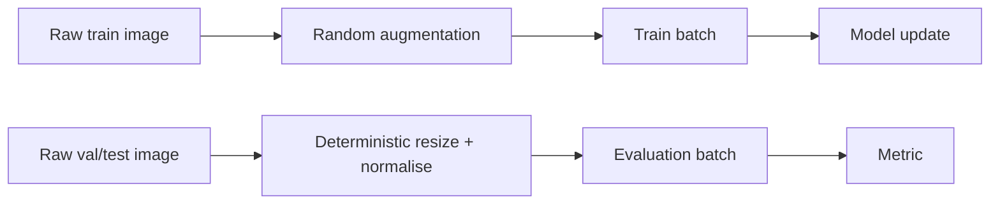

# MT03 - Augmentation and regularization {#mt03}

**Section path:** [Overview](index.md) · **Module 4** · [Assessment](assessment.md)

| | |
| --- | --- |
| **Study time** | 3 hours |
| **Hardware** | CPU-only |
| **Prerequisites** | [MT01](mt01-training-loop.md) |
| **You will produce** | An augmentation ablation with a measured train/validation gap |


## Learning objectives

By the end of this lesson you can:

* distinguish data augmentation from parameter regularization
* apply transforms that preserve the label and reject those that do not
* measure the train-validation gap before and after regularization

## Two ways to fight overfitting

Regularization constrains the model; augmentation constrains the data distribution
the model sees. They are not interchangeable, and on small datasets augmentation
usually wins.

The notebook measures both with the same architecture, seed, and schedule. The
plain model ends with a train/validation gap of **0.067**; the augmented model
ends at **0.017**, and both reach perfect validation accuracy. The test split is
45 images, so treat the difference as an indication, not a law.

## Regularization, from cheap to invasive

| Technique | Mechanism | Cost | Failure mode |
| --- | --- | --- | --- |
| Weight decay | shrinks weights toward zero | none | too high underfits |
| Dropout | randomly zeroes activations | train-time noise | conflicts with batch norm |
| Early stopping | selects the best validation epoch | needs a split | overfits validation |
| Label smoothing | soft targets | small | hides label errors |
| Data augmentation | enlarges the effective sample | CPU/GPU time | changes the task |

Weight decay is L2 in the loss. Dropout prevents co-adaptation: with `p=0.1`, one
in ten activations is zeroed each forward pass, so no unit can rely on a specific
neighbour. At inference, dropout is disabled and the expected activation is
restored by scaling.

## Augmentation is a claim about invariance

A rotation augmentation says: the label does not change when the image rotates.
That is true for shapes and pathology slides, false for digits and traffic signs.
Before adding a transform, write down the invariance it assumes, then test whether
the model still learns the original distribution.

The notebook's transform set is:

```python
train_transform = transforms.Compose([
    transforms.RandomAffine(degrees=12, translate=(0.08, 0.08)),
    transforms.RandomHorizontalFlip(p=0.5),
    transforms.ColorJitter(brightness=0.15, contrast=0.15),
    transforms.ToTensor(),
])
```

Horizontal flip is safe for circles, squares, and triangles. It would be wrong for
a dataset of left-versus-right arrows, and it is wrong for many medical images.
The augmentation pipeline is part of the model specification.

## Beginner: reading the gap

```text
plain:      train loss 0.041 | validation loss 0.108 | gap 0.067
augmented:  train loss 0.052 | validation loss 0.069 | gap 0.017
```

A large gap means the model memorised the training set. A small gap with poor
validation means underfitting or a distribution mismatch. Augmentation raises
training loss (the task is harder) and lowers the gap; that is the expected shape.

## Intermediate: augmentation and the test set

Augmentation is applied to **training** batches only. Validation and test use the
deterministic preprocessing: resize, centre crop, normalise. Applying random
augmentation at evaluation makes the metric depend on the random seed.

```python
train_loader = DataLoader(train_set, batch_size=16, shuffle=True)
val_loader = DataLoader(val_set, batch_size=32, shuffle=False)
```

Also check the normalisation statistics: they must come from the training split.
Computing mean and std over the full dataset leaks test information into
preprocessing.

## Advanced: when augmentation is not enough

If the gap stays large, augmentation is not the bottleneck. Look for:

* **Too many parameters for the data.** Reduce width or add weight decay.
* **Label noise.** The model memorises contradicted labels; see MT09.
* **Duplicate images across splits.** No amount of augmentation fixes leakage;
  see MT08.
* **A test distribution that differs from training.** Augmentation cannot invent
  invariance the data never shows.

The measured leakage in the notebook is a good example: a random split shares 91
source images between train and test, and scores 0.867; a grouped split shares
zero and scores 0.622. Augmentation does not close that gap, because the gap is
not overfitting.

## Diagram: where each transform applies



## Practice

1. Remove horizontal flip and rerun. Report validation accuracy and gap. Is flip
   helping on this dataset, and how would you know?
2. Increase rotation to 45 degrees. Measure the gap and the test score. Explain the
   result in terms of label invariance.
3. Add dropout 0.3 to the plain model. Compare with the augmented model at equal
   training time.
4. Apply augmentation to the validation set by mistake. Report three runs with
   different seeds. How much does the metric move?

## Common mistakes

* **Augmenting validation or test.**
* **Using dataset-wide normalisation statistics.**
* **Adding transforms without checking label invariance.**
* **Assuming a smaller gap always means a better model.** It can mean the model
  stopped learning.
* **Comparing runs with different epochs or schedules.** Change one thing.

## Knowledge checks

1. Why does dropout increase training loss but often improve test accuracy?
   *It prevents co-adaptation and acts like an ensemble of subnetworks; the
   training objective becomes harder, the learned features more robust.*
2. What is the difference between weight decay and L2 regularization in Adam?
   *They coincide for plain SGD; with adaptive optimizers, decoupled weight decay
   (AdamW) behaves differently and is usually preferred.*
3. Why must normalisation statistics come from training data only?
   *Using test statistics leaks information about the evaluation distribution into
   preprocessing, inflating the score.*
4. Give a dataset where horizontal flip is invalid.
   *Left/right arrows, text, laterality in medical imaging, traffic signs with
   directional meaning.*

## Lab connection

[Lab 1](labs/lab-1-training-ablation.md) requires a two-by-two table: augmentation
on/off and learning rate. Report the gap for each cell and state which transform
you would remove first and why.

## Further reading

* Shorten and Khoshgoftaar, *A survey on image data augmentation for deep learning*
  (2019).
* Srivastava et al., *Dropout* (2014).
* Loshchilov and Hutter, *Decoupled Weight Decay Regularization* (2019).

---

**Previous:** [MT02 - Losses and optimizers](mt02-loss-and-optimizer.md)
**Next:** [MT04 - Evaluation and error analysis](mt04-evaluation-and-error-analysis.md)
