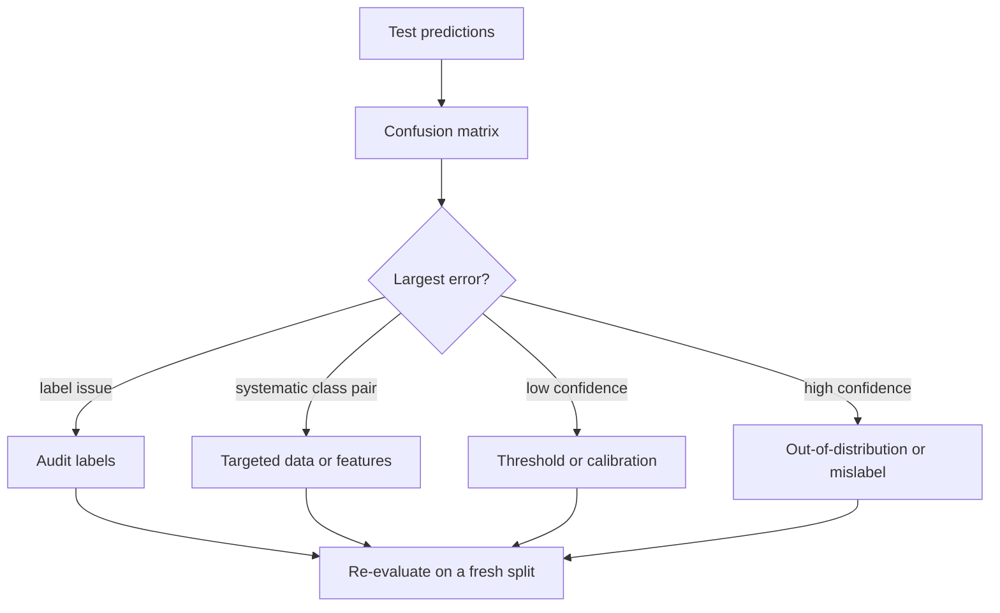

# MT04 - Evaluation and error analysis {#mt04}

**Section path:** [Overview](index.md) · **Module 4** · [Assessment](assessment.md)

| | |
| --- | --- |
| **Study time** | 3 hours |
| **Hardware** | CPU-only |
| **Prerequisites** | [MT01](mt01-training-loop.md), [F10 - Metrics and validation](../f10-metrics-validation/index.md) |
| **You will produce** | A per-class report, a confusion analysis, and three example errors |


## Learning objectives

By the end of this lesson you can:

* compute accuracy, macro F1, and a confusion matrix for a multi-class model
* slice metrics by class and condition instead of reporting one aggregate
* inspect misclassified examples and turn them into a named failure mode

## Accuracy is one number and usually the wrong one

On a balanced three-class problem, accuracy hides the shape of failure. A model
that confuses circles with triangles half the time can still score 0.83. The
per-class report and the confusion matrix show which class pays for that score.

The notebook's plain model reaches 0.956 test accuracy (2 errors in 45). Its
per-class table:

| Class | Precision | Recall | F1 | Support |
| --- | --- | --- | --- | --- |
| circle | 1.000 | 0.867 | 0.929 | 15 |
| square | 1.000 | 1.000 | 1.000 | 12 |
| triangle | 0.900 | 1.000 | 0.947 | 18 |

Both errors are `circle -> triangle`, at confidence 0.563 and 0.488. That is a
specific, actionable finding: the model is not confusing squares, and it is not
confident when it fails. A calibration or an extra circle example is a plausible
next step; retraining everything is not.

## The evaluation checklist

1. **Split by source, not by row.** The notebook's random split shares 91 source
   images and scores 0.867; the grouped split shares none and scores 0.622. The
   leakage premium is 0.244.
2. **Evaluate once.** Choose the checkpoint and threshold on validation, then
   report test. Repeated test peeking turns the test set into a validation set.
3. **Report n.** "0.956" on 45 images has a Wilson 95% interval of roughly
   [0.850, 0.989]. The interval, not the point, is the result.
4. **Inspect errors.** A confusion matrix is a summary; the actual images tell you
   whether the label, the preprocessing, or the model is wrong.
5. **Check the trivial baselines.** Majority class, random, and nearest-neighbour.
   If the model does not beat them clearly, the architecture is not the problem.

## Per-class metrics, defined

For class `c` as the positive class:

```text
precision = TP / (TP + FP)      of the items called c, how many are c
recall    = TP / (TP + FN)      of the items that are c, how many were found
F1        = 2 * precision * recall / (precision + recall)
```

Macro-F1 averages the per-class F1 without weighting by support; weighted-F1
weights by class size. Report which one you used. On imbalanced data, macro-F1
makes a small class matter; weighted-F1 lets the majority hide it.

## Confident errors are different

The notebook reports the most confident errors first. A wrong prediction at 0.99
usually means the label is wrong or the input is out of distribution. A wrong
prediction at 0.36 means the model is uncertain and the decision threshold may be
the problem.

```python
analysis = evaluation.error_analysis(
    model, test_x, test_y, class_names, mean=mean, std=std
)
print(analysis["report"])
print(analysis["confusion_pairs"])
for case in analysis["most_confident_errors"][:5]:
    print(class_names[case["true"]], "->", class_names[case["predicted"]],
          round(case["confidence"], 3))
```

Expected output:

```text
confusion pairs: {'circle -> triangle': 2}
errors: 2 of 45
   circle -> triangle confidence 0.5633
   circle -> triangle confidence 0.4877
```

## Beginner-to-advanced

* **Beginner:** read a confusion matrix; identify the largest off-diagonal cell.
* **Intermediate:** compute per-class precision/recall and explain the trade-off
  in terms of the application (which error is expensive?).
* **Advanced:** slice the evaluation by a variable the model never sees (source,
  lighting, site, device) and report the worst slice. Aggregate accuracy can hide
  a subgroup that fails completely.

## Diagram: from metric to action



## Practice

1. Compute the Wilson interval for 43/45 correct. How much does the interval move
   if the test set had 450 images at the same rate?
2. Re-run the per-class report on the augmented model. It has zero test errors.
   What can you conclude, and what can you not?
3. Slice the test set by shape size (small/large). Report accuracy per slice.
4. Build a majority-class baseline. Compare its accuracy and macro-F1 with the
   model's.

## Common mistakes

* **Reporting accuracy without n or an interval.**
* **Choosing the threshold on test.**
* **Showing a confusion matrix without counts.** Normalised matrices hide small
  classes.
* **Treating a perfect test score on 45 images as saturation.**
* **Ignoring the errors because the aggregate is high.**

## Knowledge checks

1. Why is macro-F1 preferred on imbalanced data?
   *It gives each class equal weight, so a small class cannot be ignored by a
   majority-class predictor.*
2. What does a high-confidence error usually indicate?
   *A label error, an out-of-distribution input, or a systematic shortcut the
   model learned.*
3. Why is the grouped-split score lower than the random-split score?
   *The random split shares source images between train and test, so the model has
   effectively seen near-duplicates; the grouped split measures generalisation to
   new sources.*
4. What is the leakage premium in this notebook?
   *0.867 - 0.622 = 0.244 accuracy points attributable to the split, not the
   model.*

## Lab connection

[Lab 2](labs/lab-2-dataset-audit.md) asks you to produce a per-class report on a
dataset you audit yourself, including the three most confident errors and a
proposed fix for each. Use the notebook's `error_analysis` function.

## Further reading

* Saito and Rehmsmeier, *The Precision-Recall Plot Is More Informative than the
  ROC Plot on Imbalanced Datasets* (2015).
* Oakden-Rayner et al., *Exploring large-scale public medical image datasets*
  (2020) - slice-based evaluation.
* scikit-learn, *Classification report* documentation (concepts apply regardless
  of library).

---

**Previous:** [MT03 - Augmentation and regularization](mt03-augmentation-and-regularization.md)
**Next:** [MT05 - Checkpoints and compute](mt05-checkpoints-and-compute.md)
