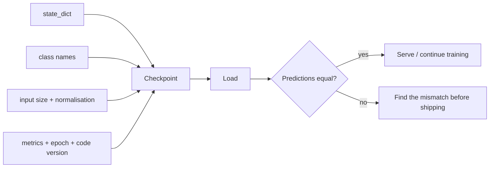

# MT05 - Checkpoints, precision, and the compute budget {#mt05}

**Section path:** [Overview](index.md) · **Module 4** · [Assessment](assessment.md)

| | |
| --- | --- |
| **Study time** | 2.5 hours |
| **Hardware** | CPU-only; bf16 path depends on CPU support |
| **Prerequisites** | [MT01](mt01-training-loop.md) |
| **You will produce** | A portable checkpoint and a measured precision comparison |


## Learning objectives

By the end of this lesson you can:

* save and restore model, optimizer, and epoch state exactly
* compare fp32 and bf16 step time and explain when mixed precision helps
* choose a checkpoint and stopping policy from measured time and quality

## A checkpoint is a contract

Weights alone are not a model. To reproduce a prediction you need:

* the `state_dict` (or a merged artifact),
* class names in the exact output order,
* input size and channel order,
* normalisation mean and standard deviation,
* preprocessing code version,
* the measured validation score and the epoch that produced it.

Omit the normalisation statistics and the same weights produce different
predictions. This is one of the most common deployment bugs, and it is silent:
the service returns a confident answer from the wrong distribution.

```python
meta = {
    "classes": class_names,
    "input_size": 32,
    "mean": mean,
    "std": std,
    "test_accuracy": test_acc,
    "epochs": epochs,
}
models.save_checkpoint(model, "outputs/m04_tinycnn.pt", meta)
```

Expected output:

```text
saved m04_tinycnn.pt 0.29 MB
metadata keys: ['augmented', 'classes', 'epochs', 'input_size', 'mean', 'std', 'test_accuracy']
identical predictions after reload: True
```

The notebook verifies reload equality on the test set, not just that the file
exists. That check catches a mismatch between the saved and loaded architecture.

## Beginner: what "identical" means

Floating-point weights round-trip exactly when saved and loaded on the same
device and dtype. Predictions should match bit for bit. If they do not, the
likely causes are:

* a missing `model.eval()` after loading (dropout still active),
* a different input normalisation,
* a class-order mismatch,
* loading only part of the state dict and leaving random initialisation elsewhere.

## Intermediate: mixed precision

The notebook benchmarks fp32 against bf16 autocast on CPU:

| Precision | Median step time |
| --- | --- |
| fp32 | 1.73 ms |
| bf16 | 3.50 ms |

bf16 is **slower** here. That is not a bug in the benchmark; it is what happens
when the CPU lacks fast bf16 kernels and the tensors are tiny. Mixed precision
pays on hardware with tensor cores and large matrices. Measure before quoting a
speedup; the direction is hardware-dependent.

On a supported GPU the pattern is:

```python
with torch.autocast(device_type="cuda", dtype=torch.bfloat16):
    logits = model(images)
    loss = criterion(logits, labels)
scaler.scale(loss).backward()
scaler.step(optimizer)
scaler.update()
```

bf16 usually needs no gradient scaler because its exponent range matches fp32;
fp16 does. Use the dtype the hardware supports and check for NaNs.

## Advanced: the budget is a design constraint

A training budget has four axes:

| Axis | Lever | What it buys |
| --- | --- | --- |
| Time | epochs, batch size, data size | more updates or more data per update |
| Memory | batch size, checkpointing, precision | larger models or batches |
| Money | GPU hours, spot instances | experiments per dollar |
| Quality | model size, data quality, schedule | the metric you actually report |

Gradient checkpointing trades compute for memory: it recomputes activations
during the backward pass instead of storing them. On a memory-bound job it lets
you double the batch; on a compute-bound job it slows you down.

## Diagram: checkpoint contents



## Practice

1. Load the checkpoint with the wrong normalisation mean. Measure how much test
   accuracy drops. Explain why the model still returns confident probabilities.
2. Save a checkpoint without class names and reconstruct the mapping from the
   training script. What could go wrong in production?
3. Benchmark bf16 with a batch size of 128. Does the direction change? Report the
   median of at least 20 steps after warmup.
4. Estimate GPU hours for 10 hyperparameter runs at 25 epochs each, given the
   measured seconds per epoch. Include evaluation time.

## Common mistakes

* **Saving only `model.state_dict()` with no metadata.**
* **Forgetting `model.eval()` at inference.**
* **Comparing precision modes on one unlucky step.** Warm up and take a median.
* **Assuming mixed precision is faster on every device.**
* **Storing checkpoints in the repository.** Use a release or artifact store with
  a digest.

## Knowledge checks

1. Why must normalisation statistics travel with the weights?
   *They define the input distribution the weights expect; without them the same
   tensor means something different to the model.*
2. Why is bf16 slower than fp32 in this notebook?
   *The CPU has no fast bf16 path for these small tensors, so conversion overhead
   dominates.*
3. What does gradient checkpointing trade?
   *Memory for compute: activations are recomputed in the backward pass.*
4. What should a checkpoint's validation score be used for?
   *Model selection and reproducibility, not as a claim about test performance.*

## Lab connection

[Lab 1](labs/lab-1-training-ablation.md) requires a reload check and a table of
step times. Report the hardware, dtype, batch size, and number of timed steps;
otherwise the number is not comparable.

## Further reading

* PyTorch, *Serialization semantics* and *Automatic mixed precision* docs.
* Micikevicius et al., *Mixed Precision Training* (2017).
* Chen et al., *Training Deep Nets with Sublinear Memory Cost* (2016) - gradient
  checkpointing.

---

**Previous:** [MT04 - Evaluation and error analysis](mt04-evaluation-and-error-analysis.md)
**Next:** [MT06 - Auditing a dataset](mt06-dataset-audit.md)
