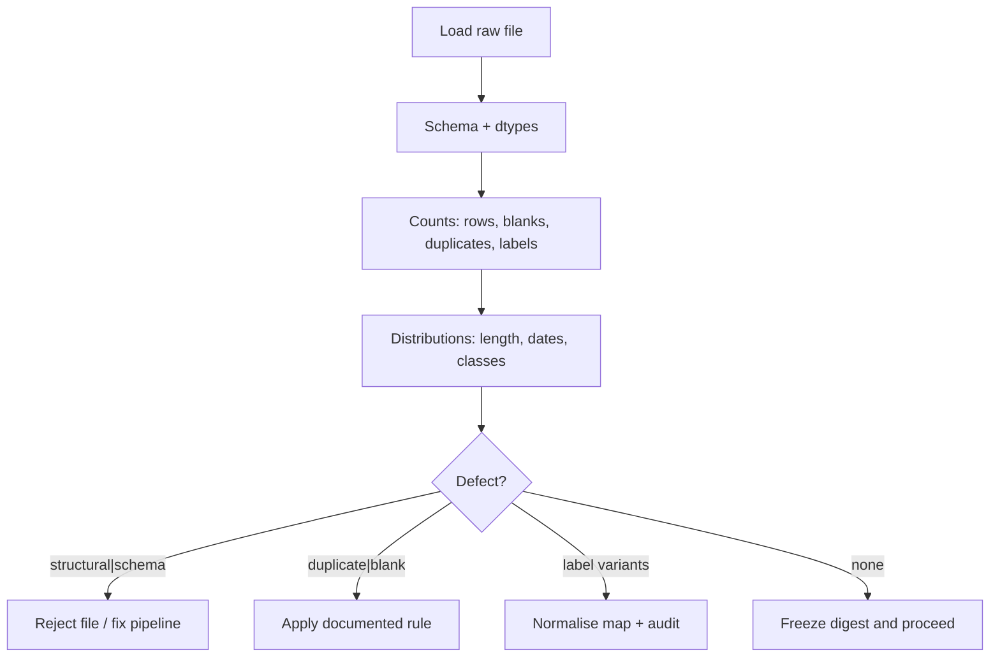

# MT06 - Auditing a dataset before modeling {#mt06}

**Section path:** [Overview](index.md) · **Module 5** · [Assessment](assessment.md)

| | |
| --- | --- |
| **Study time** | 3 hours |
| **Hardware** | CPU-only |
| **Prerequisites** | [F04 - Data cleaning](../f04-data-cleaning/index.md) |
| **You will produce** | An audit table with row counts, defect counts, and a keep/drop decision |


## Learning objectives

By the end of this lesson you can:

* inventory rows, fields, types, missing values, duplicates, and class balance
* distinguish a data defect from a modelling problem
* write an audit another person can reproduce from the digest

## The dataset arrives with defects

The M05 notebook starts from `tickets_messy.csv`, a deliberately damaged support
ticket table: 650 rows, 10 blank texts, 49 duplicate texts, and label spellings
that include `acct`, `Biling`, and `Tech ` alongside the canonical classes. None
of these defects is exotic. All of them are the kind that survive a quick
`read_csv` and quietly damage a model.

An audit is not cleaning. The audit produces evidence; cleaning applies a rule.
Keeping the two steps separate lets a reviewer disagree with the rule without
re-deriving the counts.

## The audit table

| Dataset | Rows | Blank text | Duplicate text | Label values | Top label share |
| --- | --- | --- | --- | --- | --- |
| messy | 650 | 10 | 49 | 6 | 0.329 |
| clean | 600 | 0 | 0 | 3 | 0.333 |

The clean table is the same generator without the planted defects. It is useful as
a control: if your audit reports no defects on the clean file, the audit is
probably working. If it reports the same defects on both, you are measuring the
audit script, not the data.

## Schema checks come first

Before counting labels, verify the contract:

```python
expected = {"ticket_id", "customer_id", "created_at", "text", "label", "resolution_note"}
missing = expected - set(frame.columns)
extra = set(frame.columns) - expected
assert not missing, f"missing columns: {missing}"
assert not extra, f"unexpected columns: {extra}"
```

Then check dtypes and nullability. A `created_at` column read as a string is not
yet a date; a numeric column with `"N/A"` becomes `object` and silently disables
arithmetic. The audit should print `dtypes` and the null count per column, not
assume them.

## Beginner: what to count

* rows, columns, and memory footprint;
* exact duplicate rows and duplicate text;
* blank or whitespace-only text;
* label values and their counts;
* text length distribution (min, median, max);
* missing values per column;
* identifier uniqueness (`ticket_id` should be unique);
* date range and impossible dates.

## Intermediate: what duplicates mean

Duplicate text can be a legitimate resubmission, a copy-paste error, or a
generator artefact. The right action depends on the cause, which is why the audit
reports duplicates instead of deleting them automatically.

The messy file has 40 duplicated text rows on top of 9 exact duplicate rows
created by blank removal? The notebook's audit shows 49 duplicate texts before
cleaning and drops them to reach 600 rows. State the rule: **exact duplicate text
with the same label is dropped; duplicate text with conflicting labels is a label
conflict and must be adjudicated, not averaged.**

## Advanced: near-duplicates and templates

Exact matching misses paraphrases. The notebook computes pairwise Jaccard
similarity on token sets and reports pairs at or above 0.8:

```text
near-duplicate pairs (Jaccard >= 0.8): 24,976
  0.833: 'I cannot reset my password for the account on order 50030.'
       <> 'I cannot reset my password for the account on order 94268.'
```

Nearly 25,000 pairs is not a data-cleaning emergency; it is a **template
measurement**. The corpus contains a small number of sentence templates with
different order numbers, so bag-of-words similarity calls them near-duplicates.
That is exactly why a random split leaks: the model can memorise the template and
the order number is irrelevant. MT08 uses this to motivate grouping.

## Diagram: audit to decision



## Practice

1. Add a check for tickets whose `created_at` is in the future. How many are there
   in the messy file?
2. Compute duplicate text with conflicting labels. What would you do with them?
3. Lower the Jaccard threshold to 0.6. How many pairs appear, and does the count
   still tell you something useful?
4. Write an audit function that returns a dictionary and a one-page Markdown
   report. Run it on both files and diff the reports.

## Common mistakes

* **Cleaning before counting.** You lose the evidence.
* **Dropping duplicates without checking labels.**
* **Treating near-duplicates as exact duplicates.**
* **Assuming a column's dtype from its name.**
* **Auditing only the training file.** Audit every split and the live sample.

## Knowledge checks

1. Why keep the clean control file?
   *It verifies the audit detects the defects it claims to detect and gives a
   baseline for counts and class balance.*
2. What does 24,976 near-duplicate pairs tell you?
   *The corpus is templated; exact/near-duplicate counts reflect template reuse,
   which has consequences for splitting and leakage.*
3. Why is duplicate text with conflicting labels worse than a duplicate with the
   same label?
   *The model receives contradictory supervision for identical input; no
   architecture can resolve it without a label decision.*
4. What should an audit report include besides counts?
   *The rule applied, the rows affected, the digest of the input, and the decision
   (keep, drop, escalate).*

## Lab connection

[Lab 2](labs/lab-2-dataset-audit.md) requires an audit of a dataset you choose,
including a defect table, a cleaning rule, and a before/after card. Use the
notebook's audit function and keep the raw file untouched.

## Further reading

* Gebru et al., *Datasheets for Datasets* (2018).
* Sambasivan et al., *Everyone wants to do the model work, not the data work*
  (2021).
* Google, *Data Cascades in High-Stakes AI* (2021).

---

**Previous:** [MT05 - Checkpoints and compute](mt05-checkpoints-and-compute.md)
**Next:** [MT07 - Cleaning and label normalization](mt07-cleaning-and-labels.md)
