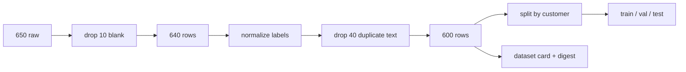

# MT07 - Cleaning and label normalization {#mt07}

**Section path:** [Overview](index.md) · **Module 5** · [Assessment](assessment.md)

| | |
| --- | --- |
| **Study time** | 3 hours |
| **Hardware** | CPU-only |
| **Prerequisites** | [MT06](mt06-dataset-audit.md) |
| **You will produce** | A cleaning function, a label map, and a row-level reason log |


## Learning objectives

By the end of this lesson you can:

* define a label taxonomy with explicit inclusion and exclusion rules
* normalize values without destroying meaning or creating unseen categories
* adjudicate ambiguous labels and record the decision

## Cleaning is a sequence of decisions, not a pipeline

Every cleaning step removes information. The professional habit is to make each
step explicit, reversible where possible, and recorded in a log: which rows were
dropped and why. The notebook's messy ticket file goes from 650 to 600 rows with:

```text
rows dropped for unknown label: 0
audited rows (duplicates kept): 640
after cleaning: 600 rows
class balance: {'account': 200, 'billing': 200, 'technical': 200}
remaining duplicates: 0
```

The counts reconcile: 650 raw, 10 blank rows removed, 40 duplicate rows removed,
600 remain. The audit reports 49 duplicate texts because it counts duplicate
occurrences including the blank duplicates; the cleaning log is the authoritative
account of what happened.

## Label normalization is a mapping, not a guess

The raw labels include four typos each for `acct`, `Biling`, and `Tech `, plus
canonical spellings. Normalise case and whitespace, then apply an explicit map:

```python
LABEL_MAP = {
    "account": "account", "acct": "account",
    "billing": "billing", "biling": "billing",
    "technical": "technical", "tech": "technical",
}

def normalize_label(raw: str) -> str:
    key = " ".join(str(raw).strip().lower().split())
    if key not in LABEL_MAP:
        raise ValueError(f"unmapped label: {raw!r}")
    return LABEL_MAP[key]
```

Raising on an unmapped label is deliberate. A silent fallback to `"other"` creates
a class nobody planned for and hides a pipeline change. The notebook reports
`rows dropped for unknown label: 0`; if that number were nonzero, the run should
stop and a human should inspect the new label.

## Beginner: the cleaning order

1. Normalise column names.
2. Strip whitespace from text and labels.
3. Drop rows with blank text.
4. Normalise labels; reject unmapped values.
5. Drop exact duplicate text with the same label.
6. Report near-duplicates; do not delete them automatically.
7. Verify class balance and row counts.
8. Write a dataset card and digest.

Order matters. Normalising labels after deduplication can merge rows that looked
distinct; dropping blanks before counting duplicates changes the duplicate count.
Document the order and keep it stable across reruns.

## Intermediate: what not to clean

* **Punctuation and case in text** may carry signal (`"not good"` vs `"good"`).
  Lowercasing is usually safe for bag-of-words models but not for code or IDs.
* **Rare but valid labels** are not noise. A class with three examples is a data
  collection problem, not a typo.
* **Outliers** may be the most valuable examples. Inspect before removing.
* **Duplicate rows with different labels** must be adjudicated, not averaged.

## Advanced: cleaning changes the evaluation

If you clean the full dataset and then split, near-duplicates can still cross the
split. If you split first and clean each side, you may apply different rules to
train and test. The defensible order is:

1. audit the raw data;
2. define the cleaning rule on training data;
3. apply the **same** deterministic rule to validation and test;
4. report how many rows each split lost.

The notebook's cleaned set is balanced at 200 per class. That is a property of the
generator, not a general guarantee; real ticket data is rarely balanced, and
resampling is a modeling decision that belongs after the split.

## Diagram: row lifecycle



## Practice

1. Add a `reason` column to the cleaning log with one value per dropped row. Report
   the counts by reason.
2. Change the unmapped-label policy to keep the row with label `"unknown"`. What
   happens to class balance and to the model's confusion matrix?
3. Write a unit test that fails if the cleaning function returns a different row
   count for the same input.
4. Clean the data before splitting and then split; compare the duplicate overlap
   with the notebook's split-first result.

## Common mistakes

* **Silent label coercion.** Typos become a new class or a wrong class.
* **Cleaning test data with statistics from test.** Use training-derived rules.
* **Dropping rows without logging.**
* **Removing near-duplicates with a similarity threshold you did not validate.**
* **Assuming balanced classes after cleaning.**

## Knowledge checks

1. Why raise on an unmapped label instead of mapping it to `"other"`?
   *A new label is a pipeline change; failing loudly forces a human decision
   instead of silently creating an unplanned class.*
2. Why is the cleaning order part of the result?
   *Different orders change which rows are considered duplicates and which labels
   merge, so the same input can produce different outputs.*
3. What is the risk of cleaning before splitting?
   *Information from the test set can influence the cleaning rule, and duplicates
   can still cross the split; cleaning rules should be learned on train and applied
   unchanged.*
4. What must accompany a cleaning function?
   *A log of dropped rows and reasons, a digest of input and output, and tests for
   the row counts and label map.*

## Lab connection

[Lab 2](labs/lab-2-dataset-audit.md) requires a cleaning function with a reason
log and a before/after class-balance table. The marker will rerun it on a held-out
messy file; do not hard-code row counts.

## Further reading

* Rahm and Do, *Data Cleaning: Problems and Current Approaches* (2000).
* Chu et al., *Data Cleaning: Overview and Emerging Challenges* (2016).
* Northcutt et al., *Pervasive Label Errors in Test Sets* (2021).

---

**Previous:** [MT06 - Auditing a dataset](mt06-dataset-audit.md)
**Next:** [MT08 - Leakage and splitting](mt08-leakage-and-splits.md)
