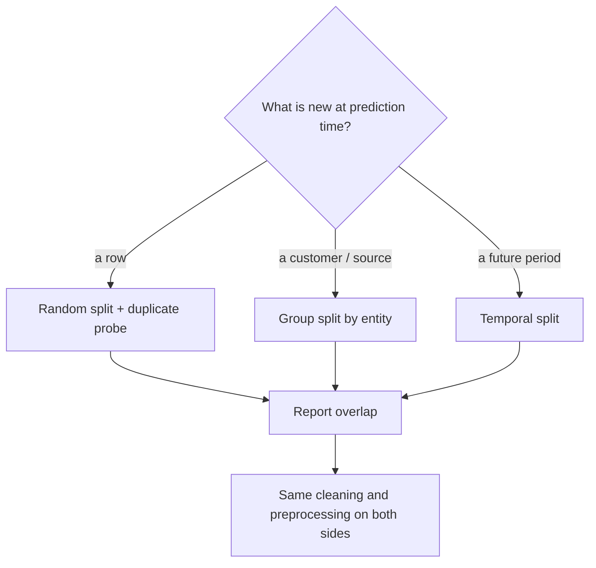

# MT08 - Leakage and splitting {#mt08}

**Section path:** [Overview](index.md) · **Module 5** · [Assessment](assessment.md)

| | |
| --- | --- |
| **Study time** | 3 hours |
| **Hardware** | CPU-only |
| **Prerequisites** | [MT06](mt06-dataset-audit.md), [F05 - Splits](../f05-splits/index.md) |
| **You will produce** | Two split strategies, a leakage probe, and an honest accuracy estimate |


## Learning objectives

By the end of this lesson you can:

* identify target, temporal, group, and near-duplicate leakage
* choose a split that matches the deployment unit
* measure overlap between splits and report it

## The split is part of the model

A random row split answers: can the model predict a held-out row from the same
sources? That is rarely the deployment question. Deployment asks: can it predict a
**new customer, new camera, new hospital, or new week?**

In the ticket data, each customer writes several tickets from the same templates.
The notebook compares:

| Split | Test rows also in train | Accuracy |
| --- | --- | --- |
| random rows | 16 | 0.983 |
| grouped by customer | 0 | 0.984 |

Accuracy barely moves here, but the leakage probe does: 16 test rows appear
verbatim in training under the random split. The classifier can score them by
memorisation. The grouped split guarantees no customer crosses the boundary.

The same pattern is much larger in the image notebook: a random split shares 91
source images between train and test and scores 0.867; a source-grouped split
shares none and scores 0.622. The leakage premium is 0.244. Same model, same data
pool, different question.

## Three kinds of leakage

1. **Row leakage.** The same row appears in train and test (duplicates, resubmitted
   tickets, re-uploaded images).
2. **Group leakage.** Different rows from the same entity (customer, patient,
   video, source image) cross the split. The model learns entity-specific cues.
3. **Temporal leakage.** The test set is from the past relative to training, or
   features are computed using future information (a churn label that includes
   post-cancellation activity, a target encoded from the full dataset).

The first is easy to detect with an exact join. The second needs a group key. The
third needs a timestamp and a story about what was known at prediction time.

## Beginner: build the probe

```python
train_texts = set(train["text"])
overlap = test["text"].isin(train_texts).sum()
print("test rows also in train:", int(overlap))
```

If that number is greater than zero, the random-split score is optimistic. Report
the overlap next to the metric. A score without the overlap is not interpretable.

## Intermediate: group splitting

```python
from sklearn.model_selection import GroupShuffleSplit

splitter = GroupShuffleSplit(n_splits=1, test_size=0.3, random_state=0)
train_idx, test_idx = next(splitter.split(frame, groups=frame["customer_id"]))
```

If scikit-learn is unavailable, group by key and assign whole groups:

```python
customers = sorted(frame["customer_id"].unique())
rng = np.random.default_rng(0)
rng.shuffle(customers)
cut = int(0.7 * len(customers))
train = frame[frame["customer_id"].isin(customers[:cut])]
test = frame[frame["customer_id"].isin(customers[cut:])]
```

Then assert the intersection is empty. The assertion is the deliverable, not the
code.

## Advanced: temporal splits and target leakage

For time-dependent data, sort by timestamp and train on the past, test on the
future. A random split lets the model see the future, which is not available at
deployment.

Target leakage is subtler. Suppose `resolution_note` contains "refund approved"
for billing tickets. If you include that column as a feature, the model reads the
answer. The notebook uses only `text`; the audit should flag columns that are
populated after the label is known.

## Diagram: choose the split by the deployment question



## Practice

1. Compute the exact overlap for the image dataset's random split. Confirm 91.
2. Build a group split by `customer_id`, train the notebook's classifier, and
   report accuracy and overlap. Compare with the published 0.984.
3. Create a temporal split using `created_at`. Does accuracy change? What does that
   tell you about the generator?
4. Add `resolution_note` as a feature and measure the accuracy jump. Explain why
   this is leakage, not signal.

## Common mistakes

* **Splitting after augmentation.** Augmented copies of the same image land on both
  sides.
* **Grouping by a column that is not the entity.** `ticket_id` is unique per row and
  groups nothing.
* **Stratifying by label but not by group.** Stratification does not prevent group
  leakage.
* **Reporting only the random-split score because it is higher.**
* **Assuming zero overlap means no leakage.** Near-duplicates and shared templates
  still leak.

## Knowledge checks

1. Why does the random split score higher on images?
   *It shares source images, so the model has seen transformed versions of the
   test images during training; the score measures memorisation.*
2. What is the leakage premium in the image notebook?
   *0.867 - 0.622 = 0.244 accuracy.*
3. Why can grouped accuracy be lower and still be the better estimate?
   *It answers the deployment question: performance on unseen entities. The lower
   number is an honest estimate, not a worse model.*
4. What probe would catch template leakage in tickets?
   *Near-duplicate similarity plus a group split by customer; exact text overlap
   catches only verbatim copies.*

## Lab connection

[Lab 2](labs/lab-2-dataset-audit.md) requires both a random and a grouped split,
with the overlap printed for each. A submission that reports only one split loses
the leakage marks.

## Further reading

* Kaufman et al., *Leakage in data mining: Formulation, detection, and avoidance*
  (2012).
* Kapoor and Narayanan, *Leakage and the reproducibility crisis in ML-based
  science* (2022).
* Roberts et al., *Common pitfalls and recommendations for using machine learning
  to detect and prognosticate for COVID-19* (2021).

---

**Previous:** [MT07 - Cleaning and labels](mt07-cleaning-and-labels.md)
**Next:** [MT09 - Label noise](mt09-label-noise.md)
