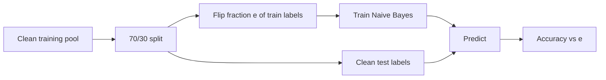

# MT09 - Label noise: measuring the cost of bad labels {#mt09}

**Section path:** [Overview](index.md) · **Module 5** · [Assessment](assessment.md)

| | |
| --- | --- |
| **Study time** | 2.5 hours |
| **Hardware** | CPU-only |
| **Prerequisites** | [MT07](mt07-cleaning-and-labels.md) |
| **You will produce** | A noise curve and an agreement audit |

## Learning objectives

By the end of this lesson you can:

* model symmetric and asymmetric label noise and predict its effect
* compute Cohen's kappa and interpret agreement beyond chance
* decide when cleaning stops helping and when it removes signal

## "Just label more data" is not a strategy

If a fraction of labels is wrong, more labels add more errors at the same rate.
The useful question is quantitative: how much accuracy does a given noise rate
cost, and how would you detect it?

The notebook flips training labels at random and evaluates on clean held-out
labels. The classifier is multinomial Naive Bayes, deliberately simple so that the
only changing variable is the data.

| Training label noise | Test accuracy |
| --- | --- |
| 0.00 | 1.000 |
| 0.20 | 0.868 |
| 0.40 | 0.794 |
| 0.60 | 0.382 |

The curve is not linear. Small noise is absorbed; at 0.6 the classifier is close
to guessing. The exact numbers depend on the seed and the template pool, but the
shape is the lesson.

## Why the split stays inside one template pool

The sentiment file has disjoint question templates across its shipped test split.
Evaluating there measures **paraphrase generalisation**, a much harder question
than label noise. The notebook therefore splits the training pool 70/30, so train
and test share templates and the only manipulated variable is the label.

Mixing the two questions produces a confusing result: a model can look terrible
on unseen templates and still be a perfectly good measurement instrument for
noise. Separate the experiments.

## Beginner: what random flipping does

For binary labels, flipping a fraction `e` of training labels means the model sees
the wrong answer on `e` of examples. A model with enough capacity can memorise the
noise, which is why training accuracy stays high while test accuracy falls. The
gap between train and test is not overfitting in the usual sense; it is fitting
the wrong target.

## Intermediate: detecting noise without clean labels

Three practical signals:

1. **Agreement between annotators.** The notebook simulates two labelers and
   reports Cohen's kappa:

   | Flip rate | Raw agreement | Kappa |
   | --- | --- | --- |
   | 0.05 | 0.933 | 0.866 |
   | 0.12 | 0.862 | 0.723 |
   | 0.25 | 0.754 | 0.509 |

   Raw agreement is misleading when classes are imbalanced; kappa corrects for
   chance. A kappa below roughly 0.6 means the label definition needs work before
   modeling.

2. **Confident disagreement.** Train a model, find examples where it is very
   confident and wrong. Those are label candidates, not model failures.
3. **Loss on a held-out set.** A subset with unusually high loss often contains
   mislabeled or out-of-distribution examples.

## Advanced: noise-robust training

Options, in increasing order of effort:

* **Clean the labels.** Usually the highest return.
* **Use a noise-robust loss** (symmetric cross-entropy, generalized cross-entropy).
* **Sample selection** (co-teaching, small-loss selection) - train on the examples
  the model currently finds easy.
* **Model the noise** with a transition matrix, which needs an estimate of the
  noise process.

None of these replaces an audit. A noise-robust loss trained on systematically
biased labels learns the bias more efficiently.

## Diagram: noise curve experiment

## Practice

1. Extend the curve to 0.8 and 1.0. What accuracy do you expect at 1.0, and why?
2. Flip labels only within one class. Compare the damage with uniform flipping.
3. Compute kappa for the 0.4 flip rate. Is raw agreement still misleading?
4. Train on the noisy data and report **training** accuracy as well. Explain the
   train/test gap.

## Common mistakes

* **Evaluating noise robustness on the noisy test set.**
   You then measure agreement with noise, not truth.
* **Reporting raw agreement without kappa.**
* **Assuming a high training accuracy means the labels are fine.**
* **Using a complex model to "power through" noise.** It memorises it.
* **Flipping labels after splitting.** The test labels must stay clean.

## Knowledge checks

1. Why does the curve flatten near 0.6 rather than falling linearly?
   *The classifier's decision boundary breaks down; with most labels flipped, it
   approaches the inverse of the true rule and then chance.*
2. What does Cohen's kappa correct for?
   *Chance agreement given the class marginals.*
3. Why keep the noise experiment inside one template pool?
   *To isolate label quality from paraphrase generalisation; otherwise a drop in
   accuracy has two causes.*
4. What is the first response to a low kappa?
   *Fix the label definition and annotator instructions, not the model.*

## Lab connection

[Lab 2](labs/lab-2-dataset-audit.md) asks for an agreement table on a small
double-labeled sample. Report kappa and the disagreements you would adjudicate
first.

## Further reading

* Frénay and Verleysen, *Classification in the Presence of Label Noise: A Survey*
  (2014).
* Northcutt et al., *Confident Learning* (2021).
* Cohen, *A coefficient of agreement for nominal scales* (1960).

---

**Previous:** [MT08 - Leakage and splits](mt08-leakage-and-splits.md)
**Next:** [MT10 - Dataset cards](mt10-dataset-cards.md)
