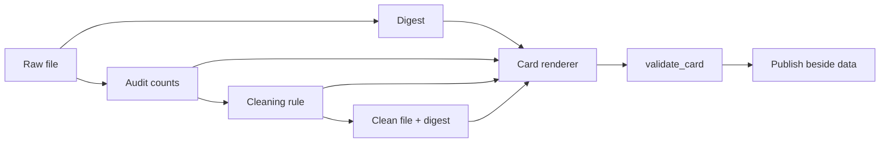

# MT10 - Dataset cards and provenance {#mt10}

**Section path:** [Overview](index.md) · **Module 5** · [Assessment](assessment.md)

| | |
| --- | --- |
| **Study time** | 2 hours |
| **Hardware** | CPU-only |
| **Prerequisites** | [MT06](mt06-dataset-audit.md), [MT07](mt07-cleaning-and-labels.md) |
| **You will produce** | A dataset card generated from measured statistics |


## Learning objectives

By the end of this lesson you can:

* write a dataset card with provenance, composition, preprocessing, and licence
* state intended use, out-of-scope use, and known bias
* tie the card to a data digest so it describes the bytes actually used

## A card is a contract with the next person

A dataset card answers questions that a CSV cannot: where the data came from,
what was removed, what the labels mean, who is represented, and what the data must
not be used for. It is not marketing prose. The notebook generates one from
measured values and writes it next to the data.

```text
missing sections: []
# Dataset card: Northwind support tickets

## Dataset details
- Version: 1.0
- Format: CSV, 6 columns, 650 raw rows
- Digest: `24b6521b...f90b69`

## Composition
650 raw rows; 600 rows after removing blanks, duplicates, and label typos.
Classes: account (200), billing (200), technical (200).
```

The digest is the SHA-256 of the raw file. Without it, "the dataset" is a name, not
an artifact.

## The sections that matter

| Section | Must answer | Common failure |
| --- | --- | --- |
| Details | version, format, size, digest | no digest |
| Provenance | who created it, how, when | "scraped from the web" |
| Composition | rows, classes, splits | counts that do not reconcile |
| Collection | consent, compensation, selection | unknown |
| Preprocessing | cleaning rules, order | "cleaned" |
| Uses | intended and out-of-scope | only intended |
| Limitations | missing groups, label ambiguity | none listed |
| Licence | permitted use | absent |

## Beginner: counts must reconcile

If the raw file has 650 rows and the cleaned file has 600, the card must explain
the 50 removed rows. In the notebook: 10 blank, 40 duplicate text. A reader should
be able to reproduce the arithmetic. A card that says "cleaned" without counts is
a claim without evidence.

## Intermediate: document the label definition

For support tickets, "billing" means the customer's issue is about an invoice,
payment, or refund. A ticket that mentions a refund but is really about a login
failure belongs to `account`. Write the decision rule and two boundary examples.
Label ambiguity is a data defect even when every row has a label.

## Advanced: representation and harm

A card should state who is **not** in the data. The synthetic ticket set has no
real customers and no demographics, which is a limitation for claims about
fairness: you cannot measure disparate performance on groups that were never
recorded. Absence of demographic columns is not evidence of fairness.

For real data, include:

* collection period and geographic scope;
* inclusion/exclusion criteria;
* known missing populations;
* consent and retention terms;
* any transformation that could remove signal (translation, anonymisation).

## Diagram: card generation pipeline



## Practice

1. Add a `split` section to the card with row counts per split and the group key
   used. Re-run validation.
2. Write a boundary example for `account` vs `technical`. Add it to the card.
3. Remove the digest line and confirm `validate_card` still passes. Why is section
   validation not enough?
4. Compare this card with the model card in M16. Which claims belong on which?

## Common mistakes

* **Writing the card by hand after the model is done.**
* **Omitting the digest.**
* **Listing limitations as "data may be noisy".** Name the specific risk.
* **Claiming fairness because protected attributes were removed.**
* **Letting the card drift from the cleaning script.** Generate it.

## Knowledge checks

1. Why does the card need a digest?
   *It ties the description to exact bytes; without it, a changed file silently
   invalidates every claim.*
2. What is a boundary example for?
   *It makes an ambiguous label rule concrete and testable by annotators.*
3. Why is "no demographic columns" not a fairness guarantee?
   *Unmeasured groups can still be harmed, and proxy features can encode group
   membership.*
4. Which card section covers out-of-scope use?
   *Uses (dataset card) / Out-of-scope use (model card).*

## Lab connection

[Lab 2](labs/lab-2-dataset-audit.md) requires a dataset card with every section,
a digest, and counts that reconcile with the audit. The validation function in
`eval_core.cards` can check the sections; the arithmetic is your job.

## Further reading

* Gebru et al., *Datasheets for Datasets* (2018).
* Pushkarna et al., *Data Cards: Purposeful and Transparent Dataset Documentation*
  (2022).
* Bender and Friedman, *Data Statements for NLP* (2018).

---

**Previous:** [MT09 - Label noise](mt09-label-noise.md)
**Next:** [M06 - Transformers and language models](../llm-fine-tuning/index.md)
