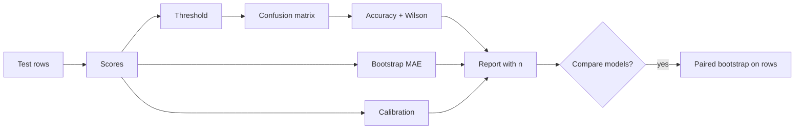

# PR01 - Metrics, intervals, and paired comparisons {#pr01}

**Section path:** [Overview](index.md) · **Module 16** · [Assessment](assessment.md)

| | |
| --- | --- |
| **Study time** | 3 hours |
| **Hardware** | CPU-only |
| **Prerequisites** | [MT04](../model-training/mt04-evaluation-and-error-analysis.md) |
| **You will produce** | A metric table with intervals and one paired comparison |


## Learning objectives

By the end of this lesson you can:

* compute a Wilson interval and explain why it is preferred at small n
* bootstrap a metric and a paired difference on the same rows
* choose the resampling unit for grouped or temporal data

## A point estimate hides its uncertainty

The M16 churn classifier scores **0.790** accuracy on 371 test rows (293 correct).
The Wilson 95% interval is **[0.745, 0.828]**. Two models whose intervals overlap
heavily are not separated by a single decimal.

```python
low, high = metrics.wilson_interval(293, 371)
print(round(accuracy, 3), round(low, 3), round(high, 3))
```

Expected: `0.79 0.745 0.828`. The interval is asymmetric, which is correct near the
boundaries and at small n; a normal approximation would be wrong.

## Beginner: pick the metric from the decision

| Decision | Primary metric | Must report with it |
| --- | --- | --- |
| Rank customers for review | ROC AUC / PR AUC | base rate, precision@k |
| Flag suspicious transactions | recall at a fixed FPR | FPR, threshold, alert volume |
| Predict a probability | Brier / log loss | calibration curve |
| Choose between two models on the same rows | paired difference | interval on the difference |

Accuracy alone is rarely the decision. The threshold converts a score into an
action, and the threshold belongs in the report.

## Intermediate: bootstrap and pairing

The notebook computes the mean absolute probability error and its bootstrap
interval: **0.329 [0.308, 0.350]**. The bootstrap resamples rows with replacement
and recomputes the statistic; it makes no normal-theory assumption.

For two models on the same test rows, resample **rows**, not each model's scores
independently:

```python
diff = metrics.paired_bootstrap_diff(mae_raw, mae_calibrated, n_boot=1000, seed=0)
print(diff)
```

Expected:

```text
{'difference': -0.0097, 'low': -0.0110, 'high': -0.0084, 'includes_zero': False}
```

The negative difference means the calibrated model has **higher** error on this
split. The interval excludes zero, so the difference is real for this sample. A
result that contradicts "calibration is always better" is exactly why the
comparison is run.

## Advanced: what the interval does not cover

The interval covers sampling error under the assumption that the test rows are
exchangeable draws from the deployment distribution. It does **not** cover:

* distribution shift (M16's week-2 drift is a separate measurement);
* label errors in the test set;
* selection effects from tuning on the same split;
* dependence between rows (grouped or temporal data needs a cluster bootstrap).

For grouped data, resample **groups**, not rows. For temporal data, use a blocked
bootstrap. The naive interval will be too narrow and too confident.

## Diagram: from predictions to a decision



## Practice

1. Compute the Wilson interval for 293/371 and for 2930/3710. How does the width
   change?
2. Bootstrap accuracy instead of MAE. Does the interval agree with Wilson?
3. Compare the raw and calibrated models with an unpaired bootstrap. How does the
   interval differ from the paired one?
4. Compute precision@50 for the churn model. Report the base rate next to it.

## Common mistakes

* **Reporting a metric without n.**
* **Comparing overlapping intervals instead of a paired difference.**
* **Bootstrapping rows when the unit is a customer or a day.**
* **Tuning the threshold on test.**
* **Treating the interval as a guarantee under distribution shift.**

## Knowledge checks

1. Why is Wilson preferred to a normal approximation for accuracy?
   *It behaves correctly at small n and near 0 or 1, where the normal interval can
   exceed [0, 1].*
2. What does pairing exploit?
   *Both models saw the same rows, so their errors are correlated; resampling rows
   preserves that correlation.*
3. What does an interval excluding zero mean in a paired comparison?
   *The observed mean difference is unlikely under the null of no difference, for
   this sample and sampling model.*
4. What is the unit of resampling for customer data?
   *The customer (cluster), not the row.*

## Lab connection

[Lab 1](labs/lab-1-evaluation-and-serving.md) requires an interval for every
headline metric and one paired comparison. A table of point estimates is
incomplete.

## Further reading

* Efron and Tibshirani, *An Introduction to the Bootstrap* (1993).
* Brown et al., *Interval estimation for a binomial proportion* (2001).
* Sculley et al., *Hidden Technical Debt in ML Systems* (2015).

---

**Previous:** [AG05 - Injection and evaluation](../ai-agents/ag05-injection-and-evaluation.md)
**Next:** [PR02 - Calibration](pr02-calibration.md)
