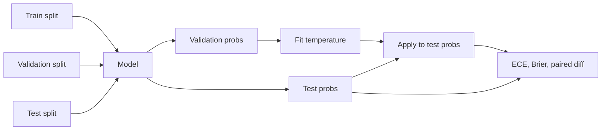

# PR02 - Calibration: does the probability mean anything? {#pr02}

**Section path:** [Overview](index.md) · **Module 16** · [Assessment](assessment.md)

| | |
| --- | --- |
| **Study time** | 2.5 hours |
| **Hardware** | CPU-only |
| **Prerequisites** | [PR01](pr01-metrics-and-intervals.md) |
| **You will produce** | A reliability table and a temperature-scaling result you can defend |


## Learning objectives

By the end of this lesson you can:

* build a reliability table with bin counts and compute ECE and Brier
* fit temperature scaling on validation and evaluate once on test
* decide whether to keep a calibrator from a paired comparison

## Discrimination and calibration are different

AUC asks: can the model rank a positive above a negative? Calibration asks: when
the model says 0.8, is the observed frequency about 80%? A model can rank well and
be badly calibrated, which breaks any decision rule that uses the probability
directly.

The churn model's measured reliability (5 bins):

| Bin | n | Mean confidence | Observed churn | Gap |
| --- | --- | --- | --- | --- |
| 0.0-0.2 | 143 | 0.117 | 0.098 | 0.020 |
| 0.2-0.4 | 109 | 0.299 | 0.229 | 0.069 |
| 0.4-0.6 | 75 | 0.487 | 0.360 | 0.127 |
| 0.6-0.8 | 37 | 0.697 | 0.811 | 0.113 |
| 0.8-1.0 | 7 | 0.837 | 0.714 | 0.123 |

ECE is the weighted average gap: **0.067**. The model is roughly calibrated in the
low bins and overconfident in the middle; the top bin has only 7 rows, so its gap
is noisy.

## Beginner: ECE and Brier

```text
ECE = sum over bins of (n_bin / n) * |mean_confidence - observed_frequency|
Brier = mean((p - y)^2)
```

ECE is interpretable but depends on binning. Brier is a proper scoring rule and
does not. Report both, and report the bin counts; a reliability curve with 3 rows
in a bin is not evidence.

## Intermediate: temperature scaling

Temperature scaling fits one parameter `T` on validation data and applies it to
test probabilities through the odds:

```text
p' = sigmoid(logit(p) / T)
```

The notebook fits `T = 1.10` on validation and evaluates on test:

| Stage | ECE | Brier |
| --- | --- | --- |
| raw | 0.067 | 0.157 |
| temperature 1.10 | 0.075 | 0.158 |

It gets **worse**. The paired difference in MAE is -0.0097 with a 95% interval
[-0.0110, -0.0084], excluding zero. On this split, temperature scaling is a
measured regression.

That is not an argument against calibration; it is an argument against applying a
one-parameter fix without checking. A linear model's probabilities may already be
close to calibrated, and the validation split is small.

## Advanced: when calibration helps, and how to validate it

Calibration helps when the model is systematically overconfident: deep networks
trained with cross-entropy, models evaluated out of distribution, and ensembles
with correlated members. It helps less when the model is simple and the split is
small.

The validation protocol:

1. fit the calibrator on a split not used for training or test;
2. evaluate on test once;
3. report ECE, Brier, and a paired interval against the raw model;
4. keep the raw model if the calibrated one is not better.

Never fit the calibrator on test. The notebook's result would look better and mean
nothing.

## Diagram: calibration pipeline



## Practice

1. Fit temperature on test instead of validation. Report ECE. Explain why the
   improvement is leakage.
2. Bin the test probabilities into 10 bins. Which bins have fewer than 20 rows?
3. Apply temperature 0.8 and 1.5. Report ECE and Brier for both.
4. Compute the Brier decomposition (reliability, resolution, uncertainty) if your
   library supports it.

## Common mistakes

* **Reporting accuracy as calibration.**
* **Fitting the calibrator on test.**
* **Using 10 bins on 371 rows.** Several bins will be empty or tiny.
* **Assuming calibration fixes discrimination.** It cannot reorder predictions.
* **Hiding a negative result.** The regression is the finding.

## Knowledge checks

1. What does ECE measure?
   *The weighted average absolute gap between predicted confidence and observed
   frequency across bins.*
2. Why is Brier a proper scoring rule?
   *It is minimised by the true probability; it rewards honest uncertainty.*
3. What did temperature scaling do in this run?
   *It increased ECE from 0.067 to 0.075 and Brier from 0.157 to 0.158; the paired
   MAE difference was negative and excluded zero.*
4. Why can calibration not improve AUC?
   *Temperature scaling is monotonic, so it preserves the ranking of scores.*

## Lab connection

[Lab 1](labs/lab-1-evaluation-and-serving.md) requires a reliability table with bin
counts and a calibration decision. A negative result is acceptable if measured and
explained.

## Further reading

* Guo et al., *On Calibration of Modern Neural Networks* (2017).
* Murphy, *Probabilistic Machine Learning*, calibration chapter.
* Kull et al., *Beyond temperature scaling* (2019).

---

**Previous:** [PR01 - Metrics and intervals](pr01-metrics-and-intervals.md)
**Next:** [PR03 - Drift](pr03-drift.md)
