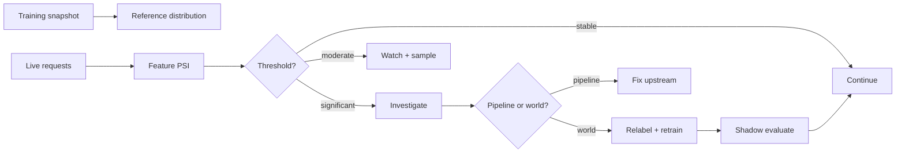

# PR03 - Drift: detecting a changing world {#pr03}

**Section path:** [Overview](index.md) · **Module 16** · [Assessment](assessment.md)

| | |
| --- | --- |
| **Study time** | 3 hours |
| **Hardware** | CPU-only |
| **Prerequisites** | [PR01](pr01-metrics-and-intervals.md) |
| **You will produce** | A drift report for two live windows and a decision |


## Learning objectives

By the end of this lesson you can:

* compute PSI against a training reference distribution
* distinguish feature, concept, and prior drift
* turn a drift report into a hold, watch, or investigate decision

## The model is a snapshot; the world is not

Drift is any change between the data a model was trained on and the data it sees
now. It can be in the inputs (feature drift), in the relationship between inputs
and target (concept drift), or in the labels themselves (prior drift).

The M16 notebook compares the training customer table with two live weeks. The
population stability index (PSI) is computed per feature:

| Feature | Week 1 PSI | Status | Week 2 PSI | Status |
| --- | --- | --- | --- | --- |
| monthly_charges | 0.065 | stable | 0.223 | moderate |
| usage_gb | 0.168 | moderate | **1.171** | significant |
| support_tickets | 0.097 | stable | **1.212** | significant |
| region | 0.094 | stable | **0.492** | significant |

Week 1 decision: **hold**. Week 2 decision: **investigate**. The report names the
worst feature and the significant set; it does not silently retrain.

## Beginner: what PSI computes

PSI bins a numeric feature using the training distribution and compares the
proportion of live values in each bin:

```text
PSI = sum over bins of (live_share - train_share) * ln(live_share / train_share)
```

The conventional reading: `< 0.1` stable, `0.1-0.25` moderate, `> 0.25`
significant. These are conventions, not statistical tests; they do not come with a
p-value.

For categorical features, use the category shares. Unseen categories get a small
epsilon so the log is finite; a new category is itself a signal.

## Intermediate: a drift decision is a workflow

| Signal | First check | Action |
| --- | --- | --- |
| one feature moderate | schema and units | watch, no retrain |
| several features significant | upstream pipeline, new segment | investigate before retraining |
| prediction distribution shift | input drift or model bug | inspect a sample |
| performance drop with stable inputs | concept drift or label delay | relabel and re-evaluate |

Retraining on drifted data without understanding the cause can bake in a pipeline
bug. The notebook's week 2 moves `usage_gb`, `support_tickets`, and `region`
together, which points to an upstream change rather than random noise.

## Advanced: labels arrive late

Input drift is observable immediately. Performance drift needs labels, which may
arrive days or weeks later. Until then, monitor proxies: prediction distribution,
confidence, guard blocks, and a small human-labeled sample.

Concept drift is the hardest: inputs look the same but the relationship changed. A
churn model trained before a pricing change may rank customers backwards. Only
fresh labels reveal it.

## Diagram: monitoring loop



## Practice

1. Compute PSI for `tenure_months` after simulating a 20% drop. Is it significant?
2. Add a new region value to week 2. What does the categorical report show?
3. Compare week 1 and week 2 feature by feature. Which single feature would you
   investigate first, and why?
4. Build a prediction-distribution monitor. How would it catch a model that is
   stable on inputs but broken?

## Common mistakes

* **Retraining on every moderate PSI.**
* **Ignoring several moderate features moving together.**
* **Treating PSI thresholds as universal.**
* **Monitoring only inputs, never predictions or outcomes.**
* **Using the live window to recompute training statistics.**

## Knowledge checks

1. What is the difference between feature drift and concept drift?
   *Feature drift changes the input distribution; concept drift changes the
   input-target relationship.*
2. Why is PSI not a hypothesis test?
   *It is a binned divergence with conventional thresholds, not a statistic with a
   null distribution and p-value.*
3. What does the week-2 pattern suggest?
   *Several features moved together, which usually indicates an upstream change or
   a new segment rather than independent noise.*
4. Why can retraining immediately be harmful?
   *It may learn a pipeline bug or a transient segment; investigate first.*

## Lab connection

[Lab 1](labs/lab-1-evaluation-and-serving.md) requires a drift report with a
decision and a proposed next action. A table without a decision is incomplete.

## Further reading

* Gama et al., *A survey on concept drift adaptation* (2014).
* Sculley et al., *Machine Learning: The High-Interest Credit Card of Technical
  Debt* (2014).
* NannyML, *Drift detection* documentation - practical methods.

---

**Previous:** [PR02 - Calibration](pr02-calibration.md)
**Next:** [PR04 - Guardrails and model cards](pr04-guardrails-and-cards.md)
