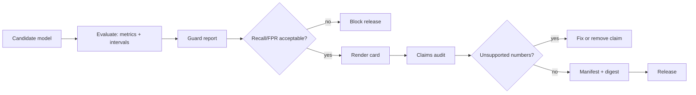

# PR04 - Guardrails and model cards {#pr04}

**Section path:** [Overview](index.md) · **Module 16** · [Assessment](assessment.md)

| | |
| --- | --- |
| **Study time** | 3 hours |
| **Hardware** | CPU-only |
| **Prerequisites** | [PR02](pr02-calibration.md), [AG05](../ai-agents/ag05-injection-and-evaluation.md) |
| **You will produce** | An adversarial report and an audited model card |


## Learning objectives

By the end of this lesson you can:

* measure guard recall and false-positive rate on the same set
* analyze missed attacks instead of reporting recall alone
* render a model card and audit its numbers against measured metrics

## Measure both sides of a guard

The M16 adversarial set has 16 attacks and 12 benign requests. The regex guard
blocks **12/16** attacks (recall **0.75**) and allows **12/12** benign requests
(false-positive rate **0.0**).

Recall alone is not a result; a guard that blocks everything scores 1.0 and breaks
the product. The missed attacks are the useful part:

| ID | Kind | Why it passed |
| --- | --- | --- |
| a13 | encoded injection | base64 is not decoded |
| a14 | paraphrase injection | "disregard your earlier guidance" is not a known pattern |
| a15 | prompt extraction | asking for prior instructions is not matched |
| a16 | zero-width | a zero-width character splits the keyword |

This is honest reporting. The guard raises the cost of known attacks; it is not a
security boundary. Capability limits are the boundary.

## Beginner: what a guard can and cannot do

A guard can:

* reject malformed JSON, over-limit payloads, control characters, and path
  traversal;
* flag known instruction patterns for review;
* normalise Unicode so lookalike characters do not bypass keywords.

A guard cannot:

* decide intent reliably;
* block every paraphrase or encoding;
* replace authorisation or sandboxing.

## Intermediate: the model card as an audited artifact

The notebook renders a card from metadata and measured metrics, then validates its
sections and audits every number against the metrics dictionary:

```text
card sections valid: True | missing: []
unsupported numbers: []
```

The card includes intended use, out-of-scope use, limitations, ethical
considerations, and a licence. The digest ties it to the exact model bytes.

The audit is not proof of truth. It catches an invented number, which is the most
common failure of hand-written cards.

## Advanced: claims that need evidence

| Claim | Evidence required |
| --- | --- |
| "90% accurate" | test n, split, interval |
| "works across regions" | per-region table |
| "fair" | group metrics and a defined fairness criterion |
| "calibrated" | reliability table and ECE |
| "robust" | adversarial results with both recall and FPR |

A card without these is a brochure. The template can enforce sections; it cannot
enforce honesty.

## Diagram: guard and card in the release path



## Practice

1. Add a base64 decoder to the guard. Re-run the cases and report the new recall
   and false-positive rate.
2. Write a card claim "the model is fair" and run the audit. What happens, and why
   is that not enough?
3. Remove the out-of-scope section and confirm validation fails.
4. Compare the model card with the dataset card from MT10. Which claims belong on
   which, and where do they overlap?

## Common mistakes

* **Reporting guard recall without false positives.**
* **Treating a regex guard as a security boundary.**
* **Hand-writing a card after the fact.**
* **Listing no limitations.**
* **Claiming fairness without group metrics.**

## Knowledge checks

1. Why is 0.75 recall not a failure of the whole system?
   *The guard is one layer; capability limits and approvals bound the damage. The
   miss rate must be documented and improved.*
2. What does the claims audit check?
   *That numbers in the card can be traced to the metrics dictionary or declared
   counts, not that the claims are true.*
3. Why does the card need a digest?
   *To tie the description to the exact artifact being served.*
4. What is the difference between a model card and a dataset card?
   *The model card documents intended use, evaluation, and limitations of a model;
   the dataset card documents provenance, composition, and preprocessing of data.*

## Lab connection

[Lab 1](labs/lab-1-evaluation-and-serving.md) requires a guard report with both
rates and a card that passes the claims audit. Include the missed attacks.

## Further reading

* Mitchell et al., *Model Cards for Model Reporting* (2019).
* Gebru et al., *Datasheets for Datasets* (2018).
* OWASP, *LLM Top 10* - prompt injection and insecure output handling.

---

**Previous:** [PR03 - Drift](pr03-drift.md)
**Next:** [PR05 - Artifacts and serving](pr05-artifacts-and-serving.md)
