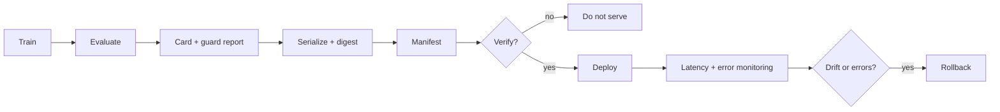

# PR05 - Artifacts, manifests, and serving latency {#pr05}

**Section path:** [Overview](index.md) · **Module 16** · [Assessment](assessment.md)

| | |
| --- | --- |
| **Study time** | 3 hours |
| **Hardware** | CPU-only; loopback HTTP server |
| **Prerequisites** | [PR04](pr04-guardrails-and-cards.md) |
| **You will produce** | A verified manifest and a p50/p95 latency table |


## Learning objectives

By the end of this lesson you can:

* write and verify a manifest with digests for every artifact
* demonstrate that tampering is detected and state what a digest cannot prove
* measure p50 and p95 latency and list the controls a teaching server lacks

## Hash it or it did not happen

A manifest lists each artifact, its SHA-256 digest, and its size. Verification
answers: are the bytes I am about to serve the bytes I evaluated?

```python
manifest = artifacts.write_manifest(
    out_dir / "manifest.json",
    {"churn_model.json": model_path, "model_card.md": card_path},
    metadata={"created": "2026-11-05", "test_accuracy": 0.790},
)
print(artifacts.verify_manifest(manifest))
```

Expected: `[]`. The notebook then appends one byte to a copy and verifies again:

```text
after tampering: ['digest mismatch: churn_model.json']
```

A manifest is not a signature. If an attacker can rewrite both the artifact and
the manifest, the check passes. Sign the manifest or store it in a trusted system
when the threat model includes that attacker.

## Beginner: what to include

* model weights or serialized model;
* tokenizer/vocabulary and chat template;
* preprocessing statistics (mean, std, feature order);
* model card and evaluation report;
* the manifest itself, versioned outside the artifact directory.

If the tokenizer is missing, the weights are not a model. If the feature order is
missing, the model receives the right numbers in the wrong columns.

## Intermediate: serving is more than `predict`

The notebook's loopback server handles 40 requests and reports:

```text
statuses: [200] | responses: 40
latency ms: p50=15.53 p95=16.72 max=29.60
sample response: {'churn_probability': 0.5152}
```

p50 and p95 are reported separately; the mean hides the tail. The server is
deliberately minimal and is missing authentication, rate limits, request ids,
model version in the response, and monitoring. Those are the next lesson, not
optional polish.

## Advanced: the latency budget

| Component | Typical contribution | Lever |
| --- | --- | --- |
| network | variable | region, connection reuse |
| queue | grows under load | concurrency, admission control |
| preprocessing | small but serial | vectorise, cache |
| model forward | dominant for large models | batch, quantize, distill |
| postprocessing | small | avoid copies |

Measure at the percentile that matches the product's promise. A p95 of 16 ms on
loopback says nothing about a mobile network; it is a lower bound.

## Diagram: release and serve



## Practice

1. Add the tokenizer and feature order to the manifest. Verify a fresh load.
2. Sign the manifest with a local key and verify the signature. What threat does
   this address that the digest does not?
3. Run the server with 4 concurrent clients. Report p50/p95 and the error rate.
4. Add a `model_version` field to the response. Why does a caller need it?

## Common mistakes

* **Serving an artifact without a digest.**
* **Storing the manifest next to an untrusted artifact without signing it.**
* **Reporting mean latency only.**
* **Forgetting the tokenizer and preprocessing metadata.**
* **No rollback artifact.**

## Knowledge checks

1. What does `verify_manifest` detect?
   *A missing file or a digest mismatch between the manifest and the artifact.*
2. What does it not detect?
   *A coordinated rewrite of artifact and manifest; that needs a signature or
   trusted storage.*
3. Why report p95?
   *It bounds the experience of most callers; the mean hides a slow tail.*
4. Why is loopback latency a lower bound?
   *It excludes network, TLS, queueing, and real client devices.*

## Lab connection

[Lab 1](labs/lab-1-evaluation-and-serving.md) requires a manifest, a verification
report, and a latency table with p50 and p95. Include the server's missing
production controls in the limitations.

## Further reading

* Sculley et al., *Hidden Technical Debt in Machine Learning Systems* (2015).
* NIST, *Secure Software Development Framework* - artifact integrity.
* Google SRE Book, *Monitoring distributed systems* - percentiles.

---

**Previous:** [PR04 - Guardrails and model cards](pr04-guardrails-and-cards.md)
**Next:** [M17 - Capstone](../capstone/index.md)
