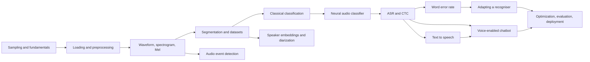

# Speech and audio: from a waveform to a documented voice interface



This section teaches audio the way a voice product is actually built: understand what a
sample is, turn it into something a model can use, measure the result on audio you did
not train on, and write down what the system cannot do. You start with sampling rate and
finish with a model card for a voice interface.

Fourteen modules, eight labs, a consent and rights page, and a documented capstone.
Everything runs on a laptop CPU with no account, no download, and no dataset licence to
negotiate.

| | |
| --- | --- |
| **Level** | 3 - Speech and audio (after F03-F13) |
| **Study time** | 58 hours: 24 h reading, 30 h labs, 4 h write-up |
| **Hardware** | CPU-only. Every exercise in this section runs without a GPU |
| **Prerequisites** | [F03-F10](../index.md#foundation-sequence), [F11-F13](../index.md#foundation-sequence) |
| **You will produce** | Eight working programs with measured results, a robustness table, a WER report, and a model card |

!!! note "What this section does not cover"
    Music information retrieval, speech enhancement as a product, streaming ASR at
    scale, and transformer speech models trained from scratch. What it does cover is
    the layer that decides whether a speech system is useful: correct features, correct
    splits, the right metric, and evidence that it works on more than one clean clip.

## Why this section exists

Audio demos are unusually easy to fake. A recogniser that transcribes one clean
sentence looks identical to a recogniser that transcribes nothing else. An accuracy
number computed on clips whose speakers were also in training looks like a working
system. A confidence of 0.98, printed without calibration, looks like certainty.

Two failure modes are specific to audio and worth naming before you write any code:

1. **Splitting by clip instead of by speaker.** Two recordings of the same person are
   near-duplicates acoustically. If one is in training and one in test, the test score
   measures voice memorisation, not recognition. This section splits by speaker and
   audits the split.
2. **Forgetting the training-time normalisation at inference.** Log-Mel values sit
   around -31 dB. A model trained on `(x - mean) / std` and fed raw values produces
   confident nonsense, with no error and no warning. This section keeps the weights,
   vocabulary, and statistics in one object so the mismatch cannot happen silently.

By Module 14 you will have measured both failure modes yourself.

## The modules

| Code | Module | Hours | Lab |
| --- | --- | --- | --- |
| SA01 | [Audio fundamentals: sampling, amplitude, frequency, channels](sa01-audio-fundamentals.md) | 3 | - |
| SA02 | [Loading, playing, visualising, and preprocessing audio](sa02-loading-and-preprocessing.md) | 4 | - |
| SA03 | [Waveforms, spectrograms, and Mel spectrograms](sa03-waveform-spectrogram-mel.md) | 4 | [B](labs/lab-b-waveform-vs-spectrogram.md) |
| SA04 | [Segmentation, labelling, and dataset preparation](sa04-segmentation-and-datasets.md) | 4 | [A](labs/lab-a-environmental-sound-classifier.md) |
| SA05 | [Audio classification with traditional machine learning](sa05-classical-classification.md) | 4 | [A](labs/lab-a-environmental-sound-classifier.md) |
| SA06 | [A basic neural audio classifier](sa06-neural-audio-classifier.md) | 4 | [A](labs/lab-a-environmental-sound-classifier.md) |
| SA07 | [Speech to text and automatic speech recognition](sa07-asr-and-stt.md) | 5 | [C](labs/lab-c-transcribe-clip.md) |
| SA08 | [Word error rate and transcription evaluation](sa08-wer-and-transcription-evaluation.md) | 4 | [D](labs/lab-d-wer-evaluation.md) |
| SA09 | [Fine-tuning or adapting a compatible pretrained model](sa09-adapting-pretrained-asr.md) | 5 | [E](labs/lab-e-adaptation.md) |
| SA10 | [Text to speech and pretrained speech generation](sa10-tts-and-speech-generation.md) | 4 | [G](labs/lab-g-voice-chatbot.md) |
| SA11 | [Speaker embeddings and diarization, conceptually](sa11-speaker-embeddings-and-diarization.md) | 4 | - |
| SA12 | [Audio event detection and environmental sound](sa12-audio-event-detection.md) | 4 | [A](labs/lab-a-environmental-sound-classifier.md) |
| SA13 | [Building a voice-enabled chatbot](sa13-voice-chatbot.md) | 4 | [G](labs/lab-g-voice-chatbot.md) |
| SA14 | [Inference optimization, evaluation, responsible deployment](sa14-optimization-and-deployment.md) | 5 | [F](labs/lab-f-stt-interface.md), [H](labs/lab-h-model-comparison.md) |

Supporting pages: [Ethics, consent, and rights](ethics-and-consent.md),
[Model card](model-card.md), [Assessment](assessment.md).

## The labs

| Lab | Title | Produces |
| --- | --- | --- |
| [A](labs/lab-a-environmental-sound-classifier.md) | Classify a small environmental-sound dataset | Accuracy, per-class recall, robustness table |
| [B](labs/lab-b-waveform-vs-spectrogram.md) | Compare waveforms and spectrograms for different classes | Representation comparison with a weak classifier |
| [C](labs/lab-c-transcribe-clip.md) | Transcribe a short audio clip | Frame-level view of CTC decoding |
| [D](labs/lab-d-wer-evaluation.md) | Evaluate recognition with word error rate | WER, CER, per-word accuracy, condition table |
| [E](labs/lab-e-adaptation.md) | Adapt a pretrained model to a small permitted dataset | Before/after WER, forgetting check |
| [F](labs/lab-f-stt-interface.md) | Build a simple speech-to-text interface | A CLI that handles silence and low confidence |
| [G](labs/lab-g-voice-chatbot.md) | Connect speech input and responses to a chatbot | An offline voice assistant |
| [H](labs/lab-h-model-comparison.md) | Compare inference speed and recognition quality | RTF and WER across three model sizes |

## Setup

```bash
python -m pip install -r requirements/audio.txt
python scripts/make_audio_data.py      # ~2 s, deterministic, ~20 MB
```

The generator writes `data/audio/` (git-ignored). Every lab also works without it by
synthesising the same corpus in memory with the same seeds, so a failed download cannot
block the exercises.

```text
data/audio/
  env/        240 clips, 4 classes, 80 sources, 16 kHz mono WAV
  speech/     288 clips, 24 synthetic voices, 6 words, 2 utterances each
  diarization/two_speakers.wav + truth.json
  dataset_card.json   licence, provenance, sizes, known issues
```

## What is synthetic here, and why that matters

Every clip is generated from code: formant speech (a glottal pulse through three
resonators) and procedural environmental sounds. The corpus is **CC0-1.0**, contains no
recordings of people, and needs no consent paperwork. That is deliberate: a course
cannot ask students to collect voice recordings.

The cost is real, and every module states it: synthetic voices are more regular than
human voices, the vocabulary is six words, and there are no accents, children, or
disordered speech. When a module reports a number, the number belongs to this corpus.
It is evidence that the pipeline is correct, not evidence that a system works on people.

For work that must generalise, Module SA09 describes adapting a real pretrained model
and [Lab E](labs/lab-e-adaptation.md) implements the mechanics on this corpus so the
protocol - frozen front end, untouched evaluation set, before/after numbers - is
practised before you point it at real speech.

## How to read a number in this section

Each lab prints its configuration alongside its results, and writes JSON to
`projects/speech-audio/outputs/`. CPU training is not bit-reproducible, so re-runs move
in the third decimal and sometimes more; the ordering of conditions is stable, single
digits in the last place are not. If you report a number, report the seed, the epochs,
and the split it came from.

## Start here

Read [SA01](sa01-audio-fundamentals.md), then run
[Lab B](labs/lab-b-waveform-vs-spectrogram.md) before touching a model. Seeing a
waveform and its spectrogram side by side prevents most of the confusion that follows.
