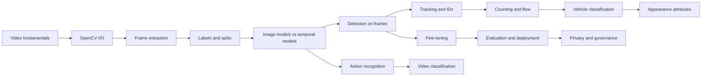

# Video AI: frames, motion, and counting what moves

Video is not "images with an extra dimension" in the way that is usually taught. A video is a
sequence of samples from a moving scene, and the useful information is frequently in the
*differences* between samples - a direction, a rate, an arrival. That is why a model with a
98% image-classification score can be useless on video: it never sees a difference.

This section teaches the pipeline you actually build, in the order you build it: decode,
extract, label, split by video, detect, associate, count, and measure. Every number quoted in
these modules was produced by the code in `projects/video-ai` and is reproducible with one
command.

| | |
| --- | --- |
| **Level** | 3 - Vision and video (after CV01-CV09 and F03-F13) |
| **Study time** | 64 hours: 28 h reading, 30 h labs, 6 h write-up |
| **Hardware** | CPU-only. One optional lab downloads a 13 MB pretrained checkpoint |
| **Prerequisites** | [F03-F10](../index.md#foundation-sequence), [F11-F13](../index.md#foundation-sequence), [CV01-CV09](../computer-vision/index.md) |
| **You will produce** | Eight working programs, a measured tracking and counting table, a fine-tuning comparison, and a model card that says what the system cannot do |

!!! note "What this section does not cover"
    Distributed streaming infrastructure, GPU optimisation, multi-camera re-identification,
    and training large video transformers from scratch. It covers the layer that decides
    whether a video system is useful: honest sampling, a split that is by video, a tracker
    whose failures you have measured, and a count you can defend.

## Why this section exists

The failure this section is designed to prevent is specific and common. A student takes a
pretrained detector, runs it on a few frames, sees a green box around a car, and writes "the
model works on video". The system then:

- misses a third of the vehicles, because the detector has never seen this camera's night
  footage - Lab 2 measures 0.048 mAP on the day clip and 0.000 at night;
- hands the same car three different IDs, because the tracker was never tuned for the
  occlusion in this scene - Lab 3 measures 14 tracks for 6 vehicles and 5 ID switches;
- reports a total that is right and a breakdown that is not, because a car was counted as a
  truck - Lab 3 shows exactly that;
- or claims to be a video model when it is a still-image model applied 30 times a second -
  Module 5 and Lab 6 make that distinction measurable.

By the end you will have all of those numbers for your own pipeline, and you will know which
of them matters for the decision the system is meant to support.

## The modules

| Code | Module | Hours | Lab |
| --- | --- | --- | --- |
| VD01 | [Digital video: frames, rate, resolution, codecs, timestamps](vd01-digital-video.md) | 3 | - |
| VD02 | [Reading and writing video with OpenCV](vd02-reading-and-writing.md) | 3 | [1](labs/lab-1-preprocessing.md) |
| VD03 | [Frame extraction and frame datasets](vd03-frame-extraction-and-datasets.md) | 3 | [1](labs/lab-1-preprocessing.md) |
| VD04 | [Labelling video and annotation formats](vd04-labelling-and-annotation-formats.md) | 4 | [4](labs/lab-4-domain-adaptation.md) |
| VD05 | [Image models versus temporal video models](vd05-image-vs-temporal-models.md) | 4 | [6](labs/lab-6-action-recognition.md) |
| VD06 | [Object detection on video frames](vd06-detection-on-frames.md) | 4 | [2](labs/lab-2-object-detection.md) |
| VD07 | [Object tracking and track IDs](vd07-tracking-and-track-ids.md) | 5 | [3](labs/lab-3-tracking-and-counting.md) |
| VD08 | [Counting vehicles and analysing traffic flow](vd08-counting-and-traffic-flow.md) | 4 | [3](labs/lab-3-tracking-and-counting.md) |
| VD09 | [Vehicle classification and domain adaptation](vd09-vehicle-classification-and-adaptation.md) | 5 | [4](labs/lab-4-domain-adaptation.md) |
| VD10 | [Clothing and appearance attributes](vd10-clothing-and-appearance.md) | 4 | [5](labs/lab-5-garment-attributes.md) |
| VD11 | [Action recognition and temporal information](vd11-action-recognition.md) | 5 | [6](labs/lab-6-action-recognition.md) |
| VD12 | [Video classification and event detection](vd12-video-classification-and-events.md) | 4 | [6](labs/lab-6-action-recognition.md) |
| VD13 | [Fine-tuning compatible models for video tasks](vd13-fine-tuning.md) | 5 | [4](labs/lab-4-domain-adaptation.md) |
| VD14 | [Evaluation, performance profiling, and deployment](vd14-evaluation-and-deployment.md) | 5 | [7](labs/lab-7-integrated-analytics.md), [8](labs/lab-8-performance.md) |
| VD15 | [Privacy, fairness, governance, and responsible analytics](vd15-responsible-video-analytics.md) | 4 | All |

## The labs

| Lab | Title | Time | What it measures |
| --- | --- | --- | --- |
| [1](labs/lab-1-preprocessing.md) | Video preprocessing | 2 h | Frame count, rate, interval quantisation, contact sheet |
| [2](labs/lab-2-object-detection.md) | Object detection on frames | 2 h | Pretrained detector speed and accuracy on unfamiliar footage |
| [3](labs/lab-3-tracking-and-counting.md) | Detection, tracking, and line counting | 4 h | MOTA, ID switches, fragmentation, count error |
| [4](labs/lab-4-domain-adaptation.md) | Vehicle-domain adaptation | 4 h | Fine-tuned vs zero-shot vs from-scratch, held-out videos |
| [5](labs/lab-5-garment-attributes.md) | Clothing attribute recognition | 3 h | Per-class metrics and a lighting/occlusion sweep |
| [6](labs/lab-6-action-recognition.md) | Action recognition | 4 h | Frame baseline vs a temporal model on the same clips |
| [7](labs/lab-7-integrated-analytics.md) | Integrated analytics application | 5 h | End-to-end pipeline plus error handling for bad input |
| [8](labs/lab-8-performance.md) | Performance optimisation | 4 h | Sampling, model size, resolution, memory, accuracy trade-offs |

## The data

Everything core runs on seven six-second synthetic traffic clips (4.2 MB total) generated by
`scripts/make_video_data.py`: four vehicle classes, day/dusk/night/rain/occlusion/shake
conditions, and frame-exact ground truth for boxes, track IDs, and line crossings. The data
is CC0-1.0, deterministic, and ignored by Git; the script regenerates it in about two
seconds. Module 2 and each lab manual explain how to substitute real footage, and what you
must record if you do.

## How to work through it

1. Read VD01-VD04 with the code open. The modules quote functions you can call.
2. Run Labs 1-3 in order. Do not skip Lab 1: the interval arithmetic it teaches is what makes
   your later sampling decisions defensible.
3. Read VD05 before Lab 6. The frame-versus-temporal distinction is the intellectual core of
   the section.
4. Keep every report the labs write. The assessment asks you to compare two of them.

## Conventions used throughout

- **Timestamps** are seconds from the start of the clip, computed as `frame / fps`.
- **Boxes** are `[x1, y1, x2, y2]` in pixels, with `x2`/`y2` exclusive of the far edge, in the
  source frame's coordinate space.
- **Labels** are vehicle classes only: `car`, `motorcycle`, `bus`, `truck`.
- **Metrics** come from `video_core.metrics` and are defined where they are first used.
- **Determinism**: every script takes a seed, and the labs are reproducible run to run.
