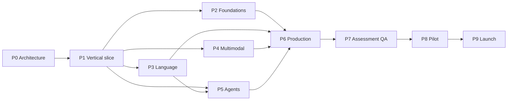

# Implementation phases

This plan sequences the work from architecture to a public, reviewed course. It
is deliberately conservative: one vertical slice must work end to end before
content is produced at scale.

## Phase gates

Every phase has an exit gate. A phase is not complete because files exist; it is
complete when the gate passes.

| Gate | Requirement |
| --- | --- |
| G1 Architecture | Site builds with `mkdocs build --strict`; no placeholder chapters; navigation complete |
| G2 Vertical slice | M01 lesson, notebook, lab, and assessment run on Windows 11 and Colab |
| G3 Foundation content | M00-M05 complete, reviewed, and reproducible |
| G4 Language content | M06-M10 complete, with GPU and CPU variants documented |
| G5 Multimodal content | M11-M14 complete, with license and privacy reviews |
| G6 Agents and production | M15-M17 complete, with security review |
| G7 Assessment QA | Quizzes, rubrics, answer keys, and accessibility checks complete |
| G8 Pilot | A cohort completes the path with documented issues resolved |
| G9 Launch | License approved, Pages enabled, links checked, release tagged |

## Phase 0 - Audit and architecture

**Status:** complete except the final build verification recorded below.

**Goal:** establish the course structure, module plans, standards, and technical
decisions without generating lesson content.

**Artifacts:**

- Student README and course entry pages.
- Roadmap, learning paths, study guide, assessment guide, capstone guide, FAQ.
- Six syllabus pages covering M00-M17.
- Repository architecture, this phase plan, content inventory, quality standards.
- Build, maintainer, contribution, and troubleshooting documentation.
- MkDocs configuration, `.gitignore`, docs requirements, directory skeleton.

**Exit criteria:**

- [x] Audit recorded; no existing files overwritten.
- [x] All 18 modules have objectives, prerequisites, time, theory, notebook, lab,
      assessment, deliverables, and next step.
- [x] Repository architecture and data policy documented.
- [x] Deployment and CI documented separately from student content.
- [x] No fake notebooks, no empty lesson chapters, no fabricated test results.
- [x] `mkdocs build --strict` passes. See the verification log below.

**Completed on 2026-11-06:** M04-M05 lessons, notebooks, labs, and assessment;
M06-M08, M15-M17 sections; seven additional executed notebooks. See the
[curriculum coverage](curriculum-coverage.md) and
[final audit](../technical/final-audit.md).

**Verification log:**

| Date | Check | Result |
| --- | --- | --- |
| 2026-10-30 | Repository audit | Local workspace empty; remote returned 404; no Pages or framework found |
| 2026-10-30 | `mkdocs build --strict` | Passed: 23 pages, 0.67 s, Windows 11, Python 3.12.10 |
| 2026-10-30 | Relative links and anchors | Passed: 101 links, 0 missing files, 0 missing anchors |
| 2026-10-30 | Browser render | Home, roadmap Mermaid diagram, and module plan rendered correctly |

The full command and environment are recorded in
[Build and deploy](../technical/build-and-deploy.md#verification-log).

**Estimated effort:** 1-2 person-weeks including review.

## Phase 1 - Vertical slice and conventions

**Status:** in progress. M01 content and Windows execution are complete; Colab
verification, second-person lab review, and the repository infrastructure gates
remain.

**Goal:** prove the entire content pipeline with one module before scaling.

**Scope:**

- Complete M01: lesson page, environment-check notebook, lab brief, assessment,
  and reflection template.
- Add `pyproject.toml`, `src/aitopics_course/` (seeding, paths, version), and
  unit tests.
- Add `requirements/base.txt`, `cpu.txt`, `gpu.txt`, `dev.txt`.
- Add pre-commit, ruff, and a minimal pytest suite.
- Add GitHub Actions for docs build, lint, and unit tests. No GPU jobs.
- Add issue and pull-request templates.
- Add `CONTRIBUTING.md`, `CODE_OF_CONDUCT.md`, and `SECURITY.md` as short
  GitHub-facing entry points.
- Draft the license decision (MIT + CC BY 4.0 recommended) for instructor
  approval; do not assume approval.
- Dry-run Pages build locally; do not publish.

**Exit criteria:**

- [x] M01 notebook executes top-to-bottom on Windows 11 CPU.
- [ ] M01 notebook executes top-to-bottom on free Colab CPU/GPU.
- [ ] Environment report and lock file reproduce on a second machine.
- [ ] Lab brief and rubric are reviewed by a second person.
- [x] Docs build passes with strict mode and no broken internal links.
- [ ] CI passes on a pull request.
- [x] No datasets, weights, secrets, or large binaries are added to versioned
      paths.
- [x] Lesson follows the module template and the notebook standards.
- [ ] A student not involved in authoring can complete the lab.

**Completed on 2026-10-30:**

- M01 lesson, guided-notebook page, lab brief, assessment, and submission
  template.
- `notebooks/foundations/m01_environment_check.ipynb` executed top-to-bottom on
  Windows 11 with Python 3.12.10.
- `requirements/base.txt` and `requirements/notebooks.txt`.
- Course conventions, lesson index, and chapter/notebook/lab/assessment/project
  templates.
- README and site landing page rebuilt around the published M01 path.
- Breadcrumb navigation enabled; module anchors added to all syllabus plans.
- `mkdocs build --strict` and the internal link/anchor check pass.

**Verification log:**

| Date | Check | Result |
| --- | --- | --- |
| 2026-10-30 | M01 notebook, Windows 11 CPU | Passed: 22 cells; accuracy 0.9778; checksum verified; GPU branch skipped because PyTorch was absent |
| 2026-10-30 | M01 notebook, Google Colab | Not run |
| 2026-10-30 | `mkdocs build --strict` after M01 | Passed, 0.83 s |
| 2026-10-30 | Internal links and anchors | Passed: 321 links across 36 Markdown files |
| 2026-10-30 | Browser render of the new landing page | Pending final check |

**Dependencies:** Colab access for the second environment; reviewer availability;
repository access for CI.

**Risks:** environment drift between Windows and Colab; package installation
failures; over-engineering the shared package.

**Estimated effort:** 2-3 person-weeks.

**Phase 1 is complete.** Phases 2-6 are authored; Phases 7-9 (assessment QA,
pilot, and launch) remain.

## Phase 2 - Level 0 and Level 1 content (M00-M05)

**Status:** complete for content. The foundation sequence F01-F13 delivers M01-M03,
and M04-M05 are published as the ten-lesson
[Model Training](../lessons/model-training/index.md) section with two executed
notebooks, two lab briefs, and an assessment. Colab, GPU, and a second-person
review remain outstanding.

**Goal:** deliver the foundation path as a complete, reviewed learning sequence.

**Scope:**

- Lessons, notebooks, labs, dataset cards, and assessment materials for M00-M05.
- Tabular and image datasets with verified licenses and download scripts.
- Experiment-tracking guidance and templates.
- Reference solutions kept outside the public repository.
- CPU and GPU budget notes for every lab.

**Exit criteria:**

- [x] Six modules published with lesson, notebook, lab, and rubric.
- [ ] Each notebook runs on the stated hardware or documents a tested fallback.
- [ ] Dataset cards include license, checksum, and known bias.
- [ ] At least one external reviewer checks technical correctness.
- [ ] Learner pilot completes M02-M04 without author intervention.

**Completed on 2026-10-30:**

- F01-F13 lesson, notebook guide, lab brief, and assessment pages (52 pages).
- Thirteen executable notebooks under `notebooks/foundations/`, including the
  existing M01 notebook. The twelve new notebooks were executed top-to-bottom on
  Windows 11 with Python 3.12.10 on CPU.
- Twelve independent lab starters under `labs/foundations/`.
- Four synthetic CC0 tables with a generator, SHA-256 manifest, and dataset card.
- `requirements/cpu.txt` and `requirements/gpu.txt`, plus the student-facing
  [foundation data and dependencies](../technical/foundation-assets.md) page.
- F01-F13 navigation, lessons index, README, landing page, and syllabus mapping.
- Notebooks use scikit-learn and PyTorch; every core path runs on CPU. GPU and
  Colab branches were not executed.

**Verification log:**

| Date | Check | Result |
| --- | --- | --- |
| 2026-10-30 | Twelve new foundation notebooks, Windows 11 CPU | Passed: all cells executed, 0 error outputs; F11-F13 used PyTorch 2.4.1+cpu |
| 2026-10-30 | Foundation notebooks, Google Colab | Not run |
| 2026-10-30 | Foundation notebooks, GPU | Not run; optional paths documented |
| 2026-10-30 | `nbformat.validate` on 13 foundation notebooks | Passed |
| 2026-10-30 | `py_compile` on `scripts/make_foundation_data.py` | Passed |
| 2026-10-30 | `mkdocs build --strict` after F01-F13 | Passed; 85 pages, 0 warnings, 2.09 s |
| 2026-10-30 | Relative links and anchors | Passed; 903 links in `docs/` and `README.md`, 0 missing files or anchors |

**Dependencies:** Phase 1 conventions; dataset licenses.

**Risks:** dataset link rot; CUDA issues on student machines; labs too long.

**Estimated effort:** 6-8 person-weeks.

## Phase 3 - Language AI content (M06-M10)

**Goal:** deliver the language path from tiny transformers to RAG.

**Scope:**

- M06 tiny transformer lesson and notebook.
- M07 SFT pipeline, dataset, and evaluation harness.
- M08 LoRA/QLoRA trade-off lab and export instructions.
- M09 chatbot UI and guardrail tests.
- M10 RAG corpus, benchmark, and injection tests.
- GPU fallbacks and free-tier session guidance.

**Exit criteria:**

- [ ] All notebooks execute on a free T4 or documented CPU fallback.
- [ ] Evaluation sets are created before training and stored with the lab.
- [ ] Model licenses and acceptable-use policies are documented.
- [ ] At least one fine-tuning run is reproduced by a second person.
- [ ] No evaluation contamination in SFT datasets.

**Dependencies:** GPU quota; Hugging Face model availability; Phase 1 shared
helpers.

**Risks:** model/API drift; gated model access; free-tier session limits;
non-commercial model licenses.

**Estimated effort:** 8-10 person-weeks.

## Phase 4 - Vision, speech, and video content (M11-M14)

**Goal:** deliver the applied multimodal path with strong privacy and license
controls.

**Scope:**

- M11 classifier and calibration lab.
- M12 detector and tracker lab, with a license decision on detector frameworks.
- M13 ASR/audio/TTS lab with consent rules.
- M14 video analytics prototype with blurring and a privacy impact assessment.
- Dataset cards and short demo clips that are legal to redistribute; otherwise
  download scripts.

**Exit criteria:**

- [ ] Detector framework license is documented and compatible with course use.
- [ ] No face recognition, identity inference, or covert surveillance content.
- [ ] Audio consent and non-commercial dataset restrictions are explicit.
- [ ] At least one video lab runs end to end on a free GPU.
- [ ] Privacy review is completed for M14.

**Dependencies:** GPU access; dataset licenses; legal/ethics review.

**Risks:** video dataset licensing; AGPL detector use; privacy harm from examples;
large downloads.

**Estimated effort:** 8-10 person-weeks.

## Phase 5 - Agent content (M15)

**Goal:** deliver a rigorous, bounded agent module.

**Scope:**

- Tool schemas, minimal agent loop, memory, tracing, and evaluation.
- Sandboxed tools with no real credentials.
- Failure-injection and prompt-injection test suites.
- Optional framework comparison, without making a framework mandatory.

**Exit criteria:**

- [ ] Agent lab runs with a small local model and with an optional hosted model.
- [ ] No tool can spend money, delete data, or access credentials.
- [ ] Evaluation includes 30+ held-out tasks and safety cases.
- [ ] Traces are sufficient to diagnose a failed run.
- [ ] Security review is completed.

**Dependencies:** model access; Phase 3 RAG content.

**Risks:** API drift; model behavior variance; framework churn; prompt-injection
false confidence.

**Estimated effort:** 3-4 person-weeks.

## Phase 6 - Production and capstone (M16-M17)

**Goal:** deliver deployment, security, and capstone scaffolding.

**Scope:**

- M16 evaluation plan, API, container, tests, red-team checklist, monitoring, and
  rollback.
- Capstone template, proposal form, milestone reviews, report template, model and
  dataset card templates.
- Example sanitized capstone or a detailed case study.

**Exit criteria:**

- [ ] A prior student artifact can be deployed following the guide.
- [ ] Tests include adversarial inputs.
- [ ] Monitoring and rollback are documented with concrete thresholds.
- [ ] Capstone rubric and templates are reviewed.
- [ ] No public endpoint with write access is shipped as an example.

**Dependencies:** at least one applied module; Phase 5 security patterns.

**Risks:** deployment platform drift; Docker on Windows; scope creep in examples.

**Estimated effort:** 3-4 person-weeks.

## Phase 7 - Assessment and quality assurance

**Goal:** make the course assessable, accessible, and link-safe.

**Scope:**

- Knowledge checks and answer keys for all modules.
- Rubric calibration with sample submissions.
- Accessibility review: headings, alt text, contrast, transcripts.
- Internal and external link checks.
- Dependency and notebook execution audit.
- Student-facing errata process.

**Exit criteria:**

- [ ] Every module has a knowledge check and answer key.
- [ ] Rubrics are applied consistently to at least two sample submissions.
- [ ] Accessibility checklist passes.
- [ ] Link checker passes or has documented exceptions.
- [ ] Notebook execution report covers all published notebooks.

**Estimated effort:** 3-4 person-weeks.

## Phase 8 - Pilot cohort

**Goal:** validate the course with real learners before public launch.

**Scope:**

- 10-30 students across at least two paths.
- Pre/post self-assessment and lab review.
- Weekly issue triage.
- Measure time estimates, failure points, and hardware blockers.
- Revise the weakest labs and instructions.

**Exit criteria:**

- [ ] At least 70% of pilot learners complete their first path module sequence.
- [ ] No unresolved blocker-level issues.
- [ ] Time estimates are revised from observed data.
- [ ] At least three labs are improved based on evidence.
- [ ] Student feedback is summarized without collecting unnecessary personal data.

**Estimated effort:** 6-8 weeks elapsed, part-time.

## Phase 9 - Public launch

**Goal:** publish a licensed, reviewed, reproducible course.

**Scope:**

- Final license approval and files.
- Enable GitHub Pages and set `site_url`.
- Tag the release (`v2026.1`).
- Publish a changelog and known-limitations page.
- Announce through appropriate academic and open-source channels.
- Set a maintenance cadence.

**Exit criteria:**

- [ ] License files committed and referenced from the README.
- [ ] Pages deployment succeeds from the default branch.
- [ ] All G1-G8 gates pass.
- [ ] Release notes list published modules and known gaps.
- [ ] Maintenance owner and review cadence are documented.
- [ ] No secrets, personal data, or unlicensed assets in the repository.

**Estimated effort:** 1-2 person-weeks.

## Critical path

P2, P3, P4, and P5 can overlap if reviewers and GPU access allow. P6 depends on
at least one applied path. P7-P9 are sequential.

## Program-level risks

| Risk | Impact | Mitigation |
| --- | --- | --- |
| Remote repository is private or misnamed | Work diverges from existing content | Reconcile before Phase 1; use the inventory procedure |
| Licence implementation review | Publication terms may be inconsistent | The approved MIT, CC BY 4.0, and CC0 1.0 architecture is implemented; review and commit it before publication |
| Limited GPU access | Training labs stall | Free-tier plans, smaller models, CPU fallbacks, partner labs |
| Dataset link rot or license change | Labs break or become illegal | Checksums, mirrors, dataset cards, quarterly review |
| Library/API drift | Notebooks stop running | Pinned requirements, smoke tests, quarterly execution audit |
| MkDocs Material end of life (2027-05-05) | Documentation stack becomes unsupported | Evaluate Zensical before 2027; keep the build simple and portable |
| Reviewer bandwidth | Quality drops | Module definition of done; one external reviewer per level |
| Scope creep | Course never finishes | One module at a time; no new modules before a level is complete |
| Unsafe use of vision/audio | Harm and reputational risk | Explicit exclusions, privacy review, instructor approval |
| Free-tier limits | Students cannot finish | Document fallbacks and estimated runtimes; avoid giant models |

## Definition of done

A module is done only when it satisfies the
[quality standards](quality-standards.md), including:

- Lesson, notebook, lab, rubric, and dataset card.
- Executed on supported environments.
- Technical and pedagogical review.
- License and ethics review.
- Navigation, inventory, and tests updated.

## Recommended next phase

**Phase 1 - Vertical slice and conventions**, finishing the remaining gates.

Exact next actions:

1. Execute M01 on Google Colab (CPU and, if available, GPU) and record the
   versions, artifacts, and any differences.
2. Ask a second person to complete the lab from the published brief and record
   where they get stuck.
3. Reconcile the remote repository if it is private or renamed; do not overwrite
   existing work.
4. Obtain a license decision from the instructor.
5. Add `pyproject.toml`, `src/aitopics_course/`, unit tests, and the remaining
   split requirements.
6. Add CI for docs build, lint, and unit tests. Do not add GPU jobs.
7. Add contribution, conduct, and security entry points.
8. Re-run `mkdocs build --strict`, the notebook smoke check, and the link checker
   after every content change.
9. Do **not** enable Pages or announce the course until the license is approved
   and the pilot gate passes.
