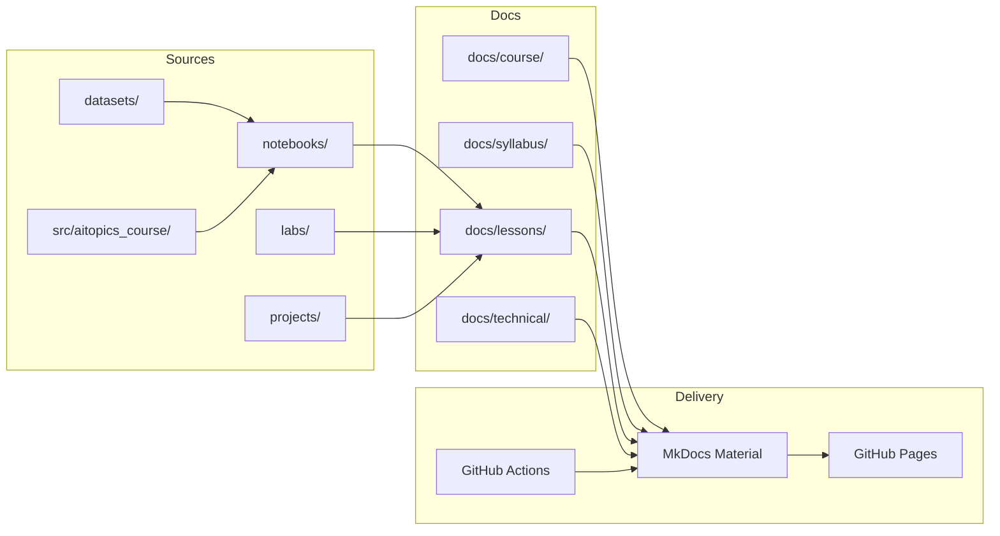
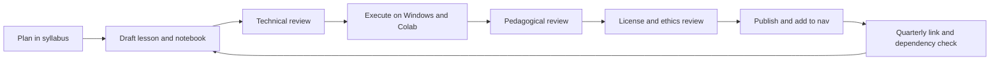

# Repository architecture

This document defines how the course repository is organized, how content moves
from draft to publication, and which technical decisions are intentional. It is
the reference for maintainers and contributors.

## Audit findings (October 2026)

The architecture was designed after reviewing the local workspace and the
remote repository referenced in the task.

| Check | Finding |
| --- | --- |
| Local working directory `E:\AITopics` | Empty at audit time; no files to preserve |
| Git repository | Not initialized locally |
| Remote `github.com/nadeem-majeedch/AITopics` | Returned HTTP 404; the account exists but the repository is not publicly visible |
| GitHub Pages | Not configured; no deployment files found |
| Documentation framework | None found |
| Notebooks, tests, workflows | None found |
| License files | None found at the initial audit; implemented and verified 2026-11-07 |
| Existing completed work | None accessible |

**Implication:** this phase created the architecture from scratch. If a private
or renamed repository exists, reconcile it before Phase 1 using the procedure in
[Content inventory](content-inventory.md#reconciliation-if-a-remote-repository-exists).
Do not overwrite existing work.

## Design goals

1. **Student clarity.** A learner can find the roadmap, the current module, its
   lab, and the assessment rubric without reading maintainer documentation.
2. **Separation of concerns.** Conceptual lessons, executable notebooks, lab
   briefs, datasets, and capstone templates have distinct homes.
3. **Reproducibility.** Every notebook records its environment, seeds, data
   source, and hardware.
4. **Legal safety.** No unlicensed data, personal data, model weights, or secrets
   in Git.
5. **Low-cost operation.** Free and open tools; static hosting; CPU-feasible
   defaults; free GPU tiers for heavy labs.
6. **Maintainability.** One module at a time, with a definition of done, tests,
   and review gates.
7. **Extensibility.** New modules, languages, or modalities can be added without
   restructuring the site.

## Architecture at a glance



## Target tree

Status labels: **available** (exists now), **planned** (created in Phase 1 or
later), **blocked** (requires a decision).

```text
AITopics/
├── README.md                         available   Student entry point
├── mkdocs.yml                        available   Site configuration and navigation
├── .gitignore                        available   Ignores data, weights, secrets, build output
├── .editorconfig                     planned     Editor consistency
├── .pre-commit-config.yaml           planned     Formatting and lint hooks
├── pyproject.toml                    planned     Package, tooling, and test configuration
├── CONTRIBUTING.md                   planned     Short GitHub-facing pointer
├── CODE_OF_CONDUCT.md                planned     Community expectations
├── SECURITY.md                       planned     Vulnerability reporting
├── LICENSE                           available   MIT text for original source code
├── LICENSES/                         available   CC BY 4.0 and CC0 1.0 texts, scope map, synthetic-data record
├── licensing-scope.json              available   Machine-readable scope and exceptions
├── docs/
│   ├── index.md                      available   Course home
│   ├── course/                       available   Roadmap, paths, study guide, conventions, assessment, projects, FAQ
│   ├── syllabus/                     available   Module plans by level
│   ├── lessons/                      partial     Student lessons; F01-F13 available
│   │   └── foundation units/         available   Four pages per unit (F01-F13)
│   ├── planning/                     available   Architecture, phases, inventory, standards
│   ├── technical/                    available   Build, maintenance, contribution, troubleshooting
│   │   └── templates/                available   Chapter, notebook, lab, assessment, project templates
│   ├── about/                        available   Instructor
│   ├── resources/                    planned     Curated free datasets, models, tools, papers
│   └── assets/                       planned     Images, diagrams, downloadable templates
├── notebooks/                        available   Guided notebooks; F01-F13 available
│   ├── foundations/                  available   Thirteen executed notebooks
│   ├── model-training/               available dir
│   ├── llm-fine-tuning/              available dir
│   ├── chatbots-rag/                 available dir
│   ├── computer-vision/              available dir
│   ├── speech-audio/                 available dir
│   ├── video-ai/                     available dir
│   ├── ai-agents/                    available dir
│   └── production/                   available dir
├── labs/                             partial     Lab starters and submission templates
│   ├── foundations/                  available   M01 template plus 12 F-unit starters
│   ├── model-training/               available dir
│   ├── llm-fine-tuning/              available dir
│   ├── chatbots-rag/                 available dir
│   ├── computer-vision/              available dir
│   ├── speech-audio/                 available dir
│   ├── video-ai/                     available dir
│   ├── ai-agents/                    available dir
│   └── production/                   available dir
├── projects/                         planned     Capstone templates and submission structure
├── datasets/                         partial     Foundation card and CC0 synthetic tables; raw data excluded
├── src/
│   └── aitopics_course/              planned     Shared, tested helper package
├── scripts/                          partial     Foundation data generator
├── tests/                            planned     Unit tests and notebook smoke tests
├── requirements/                     partial     docs, base, notebooks, cpu, gpu available; llm, agents, dev planned
└── .github/
    ├── workflows/                    planned     Docs, lint, tests, notebook smoke, Pages
    ├── ISSUE_TEMPLATE/               planned     Bug, content correction, dataset proposal
    └── pull_request_template.md      planned     Review checklist
```

Empty directories currently contain `.gitkeep` files so that the intended layout
is visible. They are not evidence of finished content.

## Directory responsibilities

### `docs/`

The published site. Every Markdown page must be reachable from `mkdocs.yml` and
must build under `mkdocs build --strict`.

- `docs/course/` answers student questions: where to start, what to study, how
  assessment works, what the capstone requires.
- `docs/syllabus/` is the authoritative module plan: objectives, prerequisites,
  time, theory, notebook, lab, rubric, deliverables, next step.
- `docs/lessons/` holds the student lesson pages, one folder per unit. F01-F13 are
  available; later modules are added only when complete. Published lab briefs and
  assessment pages live beside the lesson; executable notebooks stay in
  `notebooks/` so they can be run and versioned independently.
- `docs/planning/` is for maintainers and contributors, published for
  transparency.
- `docs/technical/` holds build, deployment, contribution, and troubleshooting
  details. It is deliberately separate from the student README. `templates/`
  contains the reusable page structures described in
  [Course conventions](../course/course-conventions.md).
- `docs/resources/` will hold curated, license-checked external resources.
- `docs/assets/` will hold diagrams and downloadable templates. Prefer Mermaid
  for diagrams that can be text-versioned.

### `notebooks/`

Guided, executable notebooks. They are the demonstration layer, not the
assessment layer.

- One notebook per module, named `mXX_slug.ipynb`.
- Organized by learning area, matching `labs/`.
- Must run top-to-bottom from a clean kernel.
- Must record environment, hardware, seeds, data source, and runtime.
- Must use small, legal datasets with a download script or a bundled sample.
- Outputs must be small; no giant logs, videos, or model weights.

### `labs/`

Independent lab briefs and starter assets.

- Brief: `labs/<area>/mXX_slug.md`.
- Starter files, if any: `labs/<area>/starters/mXX_slug/`.
- Briefs define the task, constraints, deliverables, rubric, and resource budget.
- Reference solutions are **not** published in the public repository by default.
  See [Solutions policy](#solutions-policy).

### `projects/`

Capstone templates and student submission scaffolding.

- `projects/_template/` will provide the required folder structure.
- `projects/README.md` will explain submission and sanitization.
- Student work is not merged into the course repository unless it is contributed
  as an approved example with a license.

### `datasets/`

Dataset cards, not data.

- `datasets/<dataset-name>/README.md`: card with source, license, size, fields,
  splits, known bias, and checksum.
- `datasets/<dataset-name>/download.py`: idempotent downloader with checksum
  verification.
- `datasets/<dataset-name>/checksums.sha256`: integrity hashes.
- Raw data goes to `data/`, which is gitignored, or to the user's own storage.

### `src/aitopics_course/`

Planned shared Python package for code reused across notebooks and labs:

- `seeding.py`: deterministic seed helpers.
- `metrics.py`: task-specific metric wrappers with documented conventions.
- `plotting.py`: consistent confusion matrices, curves, and galleries.
- `paths.py`: cross-platform data/model paths.
- `hub.py`: guarded Hugging Face download helpers with license prompts.

Rationale: copy-pasted helper code across 18 notebooks becomes inconsistent and
untestable. A small tested package keeps notebooks focused on the lesson.

### `scripts/`

Cross-platform Python automation, preferred over Makefiles because the course
targets Windows 11:

- `check_links.py` (planned): internal and external link checks.
- `run_notebook.py` (planned): execute one notebook with timeout and hardware
  guard.
- `smoke_notebooks.py` (planned): run a fast subset in CI.
- `new_module.py` (planned): scaffold a lesson, notebook, and lab from templates.
- `download_data.py` (planned): dataset download entry points.
- `build_docs.py` (planned, optional): wrapper around `mkdocs build --strict`.

### `tests/`

- Unit tests for `src/aitopics_course/`.
- Schema tests for dataset cards and module metadata.
- Notebook smoke tests on tiny data.
- No GPU dependency in the default test suite.

### `requirements/`

Split dependency sets so that students and maintainers install only what they
need. See `requirements/README.md` for the matrix and status.

### `.github/`

- Workflows for docs build, lint, unit tests, notebook smoke tests, and Pages
  deployment.
- Issue templates for content corrections, lab problems, and dataset proposals.
- A pull request template aligned with the review checklist.

None of these are created in the architecture phase. Deployment and CI are
documented in [Build and deploy](../technical/build-and-deploy.md).

## Content lifecycle



| Status | Meaning | Visible to students? |
| --- | --- | --- |
| Planned | Defined in the syllabus only | Yes, as a plan |
| Draft | Lesson or notebook exists but is incomplete | No |
| Technical review | Code and claims are being checked | No |
| Executed | Notebook runs on the primary supported environment | No |
| Pedagogical review | Objectives, exercises, and rubric align | No |
| Published | Approved, linked in navigation, and executed on at least one supported environment | Yes |
| Verified | Executed on every supported environment and link-checked | Yes |

A module is not published until the lesson, notebook, lab brief, and assessment
materials are complete and the notebook has been executed on at least one
supported environment. It is not **verified** until the notebook has run on every
supported environment and the links have been checked. F01-F13 are published and
executed on Windows 11 CPU, but they are not yet fully verified: Google Colab
verification and optional GPU runs are tracked in the
[content inventory](content-inventory.md).

## Solutions policy

Independent labs are the assessment. If full solutions are public, many learners
will read them before attempting the work.

- Guided notebooks are public and complete.
- Lab briefs, starter assets, and rubrics are public.
- Full reference solutions are kept out of the public repository until a
  deliberate release decision.
- Instructors may maintain a private solutions repository.
- After a review period, selected solution notes may be published with the
  instructor's approval.

This policy is a pedagogical decision, not a security mechanism.

## Data and model policy

| Item | Rule |
| --- | --- |
| Raw datasets | Never committed; use download scripts and `data/` |
| Personal data | Prohibited unless explicit consent and ethics review |
| Sensitive attributes | Avoid; if required for a fairness audit, minimize and document |
| Model weights | Never committed; link to official sources or provide export scripts |
| Adapters | Not committed by default; use the Hugging Face Hub or a release asset |
| Generated media | Not committed; store samples under a size limit in `docs/assets/` |
| Secrets | Environment variables or platform secrets only |
| Dataset license | Required in the dataset card; research-only must be labeled |
| Model license | Required in the model card and the lesson |
| Checksums | Required for downloaded data used in evaluated results |
| Redistribution | Only when the license permits it |

Target datasets are small, public, and legal to use for education. Where a
dataset is non-commercial or research-only, the lesson states the restriction and
the capstone guidance forbids deployment use.

## Naming conventions

| Artifact | Pattern | Example |
| --- | --- | --- |
| Module ID | `M` plus two digits | `M07` |
| Lesson folder | `mXX-slug` | `m07-fine-tuning` |
| Notebook | `mXX_snake_case.ipynb` | `m07_sft_small_lm.ipynb` |
| Lab brief | `docs/lessons/mXX-slug/lab.md` | `docs/lessons/m07-fine-tuning/lab.md` |
| Lab starter | `labs/<area>/mXX_snake_case.md` | `labs/llm-fine-tuning/m07_domain_sft.md` |
| Dataset folder | kebab-case | `speech-commands` |
| Python module | snake_case | `seeding.py` |
| Branch | `type/short-description` | `content/m07-sft` |
| Release tag | `vYYYY.N` | `v2026.1` |

Use US English spelling consistently in course text (`license`, `labeled`,
`modeling`).

## Navigation

`mkdocs.yml` uses explicit `nav` entries. This is intentional:

- Order is pedagogical, not alphabetical.
- Planned pages cannot leak into the site accidentally.
- New lessons require a conscious navigation update and review.

When a lesson is published, add it under a future `Lessons` section grouped by
level. Do not add empty pages to navigation to "reserve" space.

## Build and hosting decisions

| Decision | Choice | Rationale |
| --- | --- | --- |
| Documentation framework | MkDocs Material | Fast static build, built-in search, Mermaid, tabs, good Windows support, simple GitHub Pages deployment. Material 9.8.0 reports end of life on 2027-05-05; Zensical is its successor and must be evaluated before then. |
| Alternative rejected | Jupyter Book | Strong notebook integration but heavier; notebooks are already separate and not all lessons need execution |
| Alternative rejected | Sphinx | Better for API reference than a linear course; steeper contribution curve |
| Hosting | GitHub Pages via Actions | Free, static, versioned with the repository |
| Notebook execution | Separate from docs build | Avoids long, GPU-dependent site builds; execution is a content QA step |
| Versioning | Git tags and course editions | Simple; versioned docs can be added later if needed |
| Search | MkDocs built-in | No external service or tracking |
| Analytics | None by default | Student privacy; add only with consent and documentation |
| Comments | GitHub Issues | Avoids third-party tracking and moderation overhead |

`site_url` is set to the project-site URL
(`https://nadeem-majeedch.github.io/AITopics/`) and the deployment workflow is in
`.github/workflows/deploy-pages.yml`. No deployment has been run, so no live URL
is claimed. See [GitHub Pages publication](../technical/GITHUB-PAGES.md).

## Security and privacy

- No secrets in Git; `.gitignore` covers common files, but review before every
  commit.
- No public write-access demo endpoints.
- Agent labs use sandboxed tools and no real credentials.
- Video labs prohibit face recognition and covert surveillance.
- Speech labs require consent for voice data and prohibit non-consensual voice
  cloning.
- Dependencies are pinned and reviewed; supply-chain risk is part of M16.
- Download scripts verify checksums where possible.
- Student data is not collected by the site. No analytics by default.

## Licensing

The instructor approved the licensing architecture on 2026-11-07. It is
implemented and validated locally; instructor review of the final report is
pending.

- MIT for original source code, tests, and build configuration.
- CC BY 4.0 for original educational content, including lessons, documentation,
  labs, notebooks, templates, and diagrams.
- CC0 1.0 for original synthetic datasets after provenance verification.
- Third-party datasets, images, models, dependencies, and quotations keep their
  own licences and must be attributed. Pretrained weights are not MIT.
- `LICENSE`, `LICENSES/`, `licensing-scope.json`, and
  `scripts/check_licensing.py` define and enforce the scope. CI runs the
  validator; see the [licensing register](../technical/licensing-and-attribution.md).

## Extensibility

- **New module:** add a syllabus entry, lesson folder, notebook, lab brief,
  dataset card, nav entry, and inventory row.
- **New modality:** reuse the area-based notebook/lab structure; no site
  restructuring required.
- **Translations:** future work can add `docs/<lang>/` with a language selector.
  Not in scope for v2026.1.
- **Versioned editions:** tag releases; add `mike` only if multiple live versions
  are needed.

## Related documents

- [Implementation phases](implementation-phases.md)
- [Content inventory](content-inventory.md)
- [Quality standards](quality-standards.md)
- [Build and deploy](../technical/build-and-deploy.md)
- [Maintainer guide](../technical/maintainer-guide.md)
